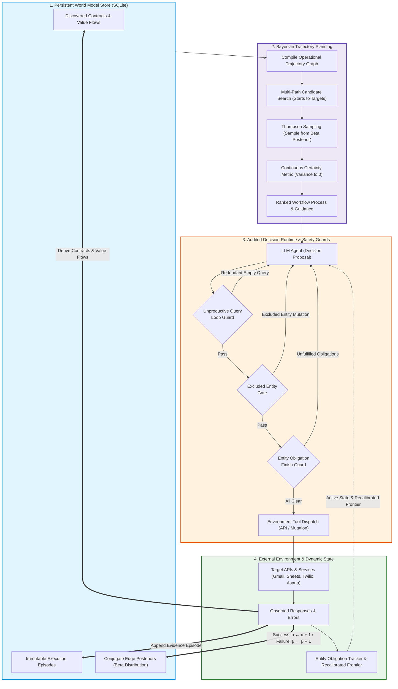

# Operational World Model Harness

An adaptive agent execution harness that learns and accumulates operational environment knowledge—such as API endpoint contracts, observed value flows, prerequisite conditions, failure modes, and recovery paths—without contaminating tasks with unverified assumptions.

The system compiles empirical interaction traces into a persistent operational trajectory graph, models transition reliability using Bayesian posterior distributions, and gates agent decisions to prevent unproductive loops, duplicate actions, and premature finishes.



---

## Architecture & Implementation

### 1. Persistent Knowledge Graph (`store.py`, `knowledge.py`)
- **Claims & Episodes**: Structured operational knowledge is stored in an append-only SQLite database. Each `Claim` records an environment regularity (endpoint contract, value flow, contrastive precondition, error cause) with strict tenant/task scoping (`Scope`).
- **Lossless Evidence**: Historical executions are logged as immutable `Episode` records linking actions, parameters, responses, outcomes, and citations.

### 2. Trajectory Graph & Bayesian Path Planning (`trajectory_graph.py`, `process_planner.py`)
- **Operational Trajectory Graph**: Connects canonical API endpoints and tools via empirical transitions and observed value flows.
- **Beta-Binomial Conjugate Posteriors**: Each transition edge $e = (u \to v)$ models reliability via a conjugate posterior $\theta_e \sim \text{Beta}(\alpha_e, \beta_e)$ where $\alpha_e = 1 + \text{successes}$ and $\beta_e = 1 + \text{failures}$.
- **Continuous Empirical Certainty**: Replaces arbitrary confidence thresholds with posterior concentration:
  $$\text{certainty}(e) = \mathbb{E}[\theta_e] \times \left(1.0 - \min\left(1.0, \frac{\text{Var}(\theta_e)}{\text{Var}_{\text{uninformed}}}\right)\right)$$
  Certainty starts at $0.0$ and increases monotonically toward $1.0$ as successful uses accumulate ($\text{Var}(\theta_e) \to 0$).
- **Thompson Sampling**: When multiple candidate paths exist, paths are ranked by posterior draws $\tilde{\Theta}(\tau) = \prod_{e \in \tau} \tilde{\theta}_e$. High-certainty paths are sampled with probability proportional to optimality while preserving continuous exploration of alternative routes.

### 3. Execution Runtime & State Guards (`decision_runtime.py`, `goal_checks.py`, `execution_state.py`)
- **Structured Decision Dispatch**: The agent proposes next actions through an audited decision gate before environment dispatch.
- **Unproductive Query Loop Guard**: Detects and intercepts consecutive identical queries returning empty results, returning diagnostic repair guidance.
- **Excluded Entity Gate**: Blocks mutations targeting known duplicate or excluded entities (e.g., negative prompt constraints or already resolved records) and directs attention to pending eligible entities.
- **Entity Obligation Finish Guard**: Prevents the agent from calling `finish()` prematurely while pending unfulfilled obligations remain.
- **Predicate Filter Grounding**: Automatically filters out records matching task negative constraints or already resolved statuses.

### 4. Direct Verification & Goal Auditing (`operational_requirements.py`, `goal_checks.py`)
- **Lossless Requirement Tracking**: Maintains an exact ledger of required outcomes and observations without lossy context compression.
- **State-Grounded Verification**: Verifies task outcomes using typed evidence comparisons against public task requirements rather than model self-assertions.

### 5. Procedure Adaptation & Independent Validation (`procedures.py`, `adaptation.py`)
- **Trace-Grounded Synthesis**: Candidate procedures are extracted from repeated successful execution slices.
- **Independent Validation Gate (`adopt`)**: Before an artifact can be activated or "frozen", it must pass isolated execution on at least two independent development tasks with verified completion checks. Unverified candidates remain experimental or suspended.

---

## Repository Structure

```
├── configs/                  # Model routing and profile configs (Gemma, Qwen, Nemotron)
├── docs/                     # Design specifications, formalisms, and benchmark docs
├── scripts/                  # Evaluation and analysis CLI scripts
│   ├── run_iterative_worldmodel_eval.py  # Multi-task iterative evaluation runner
│   ├── run_small_injection_test.py      # Targeted single-task diagnostic runner
│   ├── compare_execution_frontier.py    # Baseline vs. World Model comparison
│   └── audit_worldmodel_accuracy.py     # Claim and graph validation auditor
├── src/worldmodel_harness/   # Core harness package
│   ├── context.py            # Bounded context assembly and prompt rendering
│   ├── decision_runtime.py   # Decision proposal, schema validation, and runtime guards
│   ├── execution_state.py    # Entity tracking and predicate filter grounding
│   ├── goal_checks.py        # Goal verification and finish obligation guards
│   ├── knowledge.py          # Scoped claims, episodes, and working graph schemas
│   ├── operational_tools.py  # Environment interaction tools and action dispatch
│   ├── process_planner.py    # Multi-path workflow extraction and guidance
│   ├── procedures.py         # Procedure representation and independent adoption
│   ├── store.py              # SQLite persistent knowledge store
│   └── trajectory_graph.py   # Operational graph compilation, Beta posteriors, Thompson sampling
└── tests/                    # Comprehensive unit and integration test suite (540 tests)
```

---

## Installation & Setup

### Prerequisites
- Python 3.13+
- [`uv`](https://github.com/astral-sh/uv) package manager

```bash
# Clone the repository
git clone git@github.com:masoudhashemi/worldmodel-harness.git
cd worldmodel-generation-harness

# Install dependencies
uv sync --locked --extra automationbench

# Verify installation and configuration
uv run worldmodel check-config
```

### Environment Configuration
Configure model access in `.env` (or pass via environment variables):
```env
OPENROUTER_API_KEY=your_key_here
```

---

## Running Tests & Evaluations

### 1. Run Unit Tests
```bash
uv run pytest
```

### 2. Single Task Run
Run a single task using the operational world model:
```bash
WORLDMODEL_MODEL_CONFIG=configs/model-gemma.toml uv run python scripts/run_small_injection_test.py operations.contractor_badge_expiration
```

### 3. Iterative Multi-Task Evaluation
Evaluate continual learning across iterations, carrying and updating the persistent world model store:
```bash
WORLDMODEL_MODEL_CONFIG=configs/model-gemma.toml uv run python scripts/run_iterative_worldmodel_eval.py \
  --domains operations \
  --iterations 3 \
  --seed-store runs/focused-env-audit/store.sqlite \
  --output-dir runs/iterative-eval-bayesian
```

### 4. Official AutomationBench Baseline Benchmark
Run the full 604-task AutomationBench evaluation in official API mode across all 6 enterprise domains (`operations`, `sales`, `marketing`, `support`, `finance`, `hr`):
```bash
uv run python scripts/run_iterative_worldmodel_eval.py \
  --domains public \
  --only-baseline \
  --output-dir runs/official-automationbench-baseline \
  --resume
```

---

## Documentation & Research Reports

- [Background & Related Work Formulation](docs/background_and_related_work_formulation.md): Literature taxonomy, standardized POMDP comparison framework, and formal motivation for the operational world model.
- [Systematic Research Report](docs/paper_systematic_research_report.md): Formal research report covering problem framing, core claims, empirical verification, and baseline comparisons.
- [Experiment Journal](docs/experiment-journal.md): Complete chronological log of empirical milestones (E001–E012) including the 604-task official benchmark scorecard.
