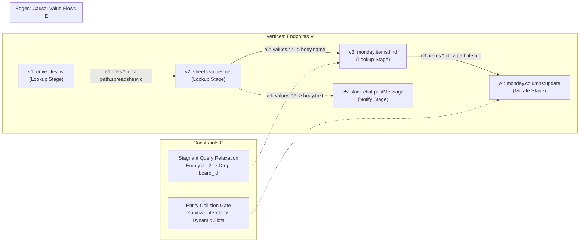

# Background, Mathematical Formulation, and Related Work

This document provides the formal mathematical formulation and related work taxonomy for the paper:  
**"Grounding Autonomous Enterprise Agents via Empirical Multi-Layer World Models"**.

---

## 1. Problem Formulation: Multi-Tenant Enterprise Automation as an Epistemic POMDP

Enterprise workflow automation involves executing multi-stage processes across heterogeneous third-party software-as-a-service (SaaS) APIs (e.g., Salesforce, Google Sheets, Pipefy, Monday.com, Slack). We formalize this environment as a **Partially Observable Markov Decision Process (POMDP)** augmented with **Epistemic Multi-Tenant Constraints**:

$$\mathcal{M} = \langle \mathcal{S}, \mathcal{A}, \mathcal{T}, \mathcal{R}, \Omega, \mathcal{O}, \mathcal{K}, \gamma \rangle$$

### 1.1 State Space ($\mathcal{S}$)
The true environment state $s \in \mathcal{S}$ represents the collective, distributed state of all external SaaS databases, spreadsheets, messaging channels, and tenant resources:
$$s = \langle s_{\text{CRM}}, s_{\text{Sheets}}, s_{\text{Slack}}, s_{\text{Monday}}, \dots \rangle$$
Importantly, $s$ is partitioned across disjoint tenants $u \in \mathcal{U}$ (e.g., specific departments, billing entities, or task contexts). State variables from tenant $u_i$ must remain strictly isolated from tenant $u_j$ to prevent cross-tenant contamination.

### 1.2 Action Space ($\mathcal{A}$)
An action $a \in \mathcal{A}$ corresponds to an HTTP request to an API endpoint:
$$a = (v, \theta)$$
where:
- $v \in \mathcal{V}$ is an endpoint contract identifier specifying the HTTP method, URL pattern, and schema signature (e.g., `POST https://api.monday.com/v2/items:find`).
- $\theta \in \Theta_v$ is a concrete parameter binding mapping schema parameters to runtime values (e.g., `{"name": "Conveyor", "board_id": "brd_ops"}`).

### 1.3 Observation Space ($\Omega$) and Observation Function ($\mathcal{O}$)
Upon executing action $a_t = (v_t, \theta_t)$, the agent receives a partial observation $o_t \in \Omega$ generated by $\mathcal{O}(s_{t+1}, a_t)$. In REST/GraphQL environments, $o_t$ is a structured JSON response containing:
1. Status indicators (HTTP status code, error diagnostics).
2. Returned payload records (e.g., record IDs, cell arrays, user profiles).
3. Structural metadata (pagination cursors, rate limits).

Crucially, the agent **never directly observes the full state** $s$. Unvisited entities, remote database IDs, and hidden column values must be actively discovered through upstream query actions.

### 1.4 Reward Function ($\mathcal{R}$) and Multi-Objective Evaluation
Enterprise tasks are evaluated via sparse, multi-objective verification rubrics:
$$\mathcal{R}(s, a) = \sum_{m=1}^{M} w_m \cdot \mathbf{1}_{[\text{condition}_m(s)]}$$
where each condition corresponds to an essential workflow phase:
1. **Target Mutations**: Modifying specific database records (e.g., setting Monday item status to `Scheduled`).
2. **Audit Logging & Notifications**: Posting verbatim entity references, IDs, and financial values to specific communication channels (e.g., `#ops-updates` on Slack).
3. **Safety Assertions (Negative Constraints)**: Ensuring prohibited actions are *not* taken (e.g., not approving holds, not notifying wrong channels).

A trial only achieves partial credit ($>0.0$) or strict completion ($1.0$) if downstream notifications and primary mutations are **both** satisfied without violating negative constraints.

---

## 2. The Empirical World Model Graph Formulation

To solve the POMDP without exhaustive brute-force search, our harness constructs and refines an **Empirical World Model Graph**:

$$\mathcal{G} = \langle \mathcal{V}, \mathcal{E}, \mathcal{C}, \mathcal{H} \rangle$$



### 2.1 Vertex Space ($\mathcal{V}$): Interface Layer
Each vertex $v \in \mathcal{V}$ represents an endpoint contract claim:
$$v = \langle \text{id}, \text{method}, \text{url\_path}, \Sigma_{\text{in}}, \Sigma_{\text{out}}, \text{stage} \rangle$$
where $\text{stage} \in \{\text{lookup}, \text{mutate}, \text{notify}, \text{verify}\}$ denotes its canonical ontological lifecycle role.

### 2.2 Edge Space ($\mathcal{E}$): Behavior Layer (Causal Value Flows)
A directed edge $e = (v_i, p_{\text{out}}, v_j, p_{\text{in}}) \in \mathcal{E}$ denotes a verified dataflow dependency:
$$\text{Extract}(o_{v_i}, p_{\text{out}}) \xrightarrow{\text{binds to}} \text{Inject}(\theta_{v_j}, p_{\text{in}})$$
where $p_{\text{out}}$ is a JSON extraction path on the producer's response and $p_{\text{in}}$ is an argument injection path on the consumer's request.

### 2.3 Causal Graduation Protocol (Hypothesis $\to$ Supported)
To prevent spurious dataflow edges, an edge $e$ is initialized with `status="hypothesis"`. It graduates to `status="supported"` if and only if it is confirmed across:
$$\mathcal{K}_{\text{confirm}}(e) = \left\{ (u_k, t_k, \theta_k) \;\middle|\; \text{distinct tenants } |\mathcal{U}| \ge 2, \text{distinct tasks } |\mathcal{T}| \ge 2, \text{distinct values } |\Theta| \ge 2 \right\}$$
This guarantees that coincidental string overlaps in a single trial cannot pollute long-term graph memory.

### 2.4 Constraints ($\mathcal{C}$): Feasibility & Query Relaxation Operators
- **Entity Collision Gating**: A proposed action $\hat{a} = (v, \hat{\theta})$ is gated if $\hat{\theta}$ contains literal identifiers belonging to historical tenant $u_{\text{hist}} \neq u_{\text{active}}$:
  $$\text{Gate}(\hat{a}) = \text{BLOCKED} \quad \text{if} \quad \hat{\theta} \cap \text{Literals}(u_{\text{hist}}) \neq \emptyset$$
- **Stagnant Query Relaxation**: When consecutive queries $a_{\text{read}}$ yield empty results $\ge 2$ times without intervening mutations:
  $$\text{Relax}(\theta) = \theta \setminus \{\text{container\_id}, \text{date\_filters}\}$$
  instructing the agent to query by entity name alone across all containers.

---

## 3. Related Work and Taxonomy

```mermaid
quadrantChart
    title Paradigm Landscape: Enterprise SaaS Automation
    x-axis Low Causal Structure --> High Causal Structure
    y-axis Static / Single-Turn --> Continual / Multi-Hop
    quadrant-1 Empirical World Model (Ours)
    quadrant-2 Classical Symbolic Planning (PDDL)
    quadrant-3 Model-Based RL (World Models)
    quadrant-4 Tool-Using Agents & Flat Memory (ReAct / MemGPT)
    "ReAct / Gorilla": [0.20, 0.25]
    "Reflexion / MemGPT": [0.35, 0.45]
    "PDDL / LLM+P": [0.85, 0.40]
    "Dreamer / MuZero": [0.45, 0.70]
    "Empirical World Model (Ours)": [0.85, 0.85]
```

### 3.1 LLM-Based Tool Use and API Calling
Foundational works such as **Toolformer** (Schick et al., 2023), **Gorilla** (Patil et al., 2023), and **ToolBench** (Qin et al., 2023) fine-tune or prompt LLMs to select API functions from documentation. 
- *Limitation in Enterprise Settings*: These methods treat tool invocation as an isolated, single-turn classification task. They do not maintain an evolving causal graph of inter-service data dependencies ($A \to B \to C$) and exhibit catastrophic failure when documentation contains subtle container requirements (the ungrounded container trap) or when workflows span multiple sequential services.

### 3.2 Episodic Memory and Reflexive Agents
Architectures such as **Reflexion** (Shinn et al., 2023), **MemGPT / Letta** (Packer et al., 2023), and **Generative Agents** (Park et al., 2023) equip agents with natural language memory streams and recursive self-reflection.
- *Limitation in Enterprise Settings*: Storing experience as unstructured conversational text leads to **semantic smearing**: API contracts, ephemeral environment observations, and causal hypotheses are stored in the same flat vector space. In multi-tenant environments, flat text memory causes **poison literal leaks** (Anchor Hazards)—the LLM retrieves concrete names, IDs, and phone numbers from prior tasks and hallucinates them into new tenant workflows.

### 3.3 Classical Planning, Symbolic World Models, and PDDL
Classical planning systems (Fikes & Nilsson, 1971; Fox & Long, 2003) and hybrid neuro-symbolic systems like **LLM+P** (Liu et al., 2023) and **SayPlan** (Rana et al., 2023) translate natural language into Planning Domain Definition Language (PDDL).
- *Limitation in Enterprise Settings*: PDDL requires complete, deterministic, hand-crafted domain specifications with fully known initial and goal states. In commercial SaaS APIs, schemas are semi-structured, parameters are loosely typed, error codes are inconsistent, and container hierarchies are dynamically nested. Symbolic PDDL fails immediately when faced with real-world API ambiguities.

### 3.4 Deep Model-Based RL and Sensory World Models
The concept of internal World Models in reinforcement learning—pioneered by **Ha & Schmidhuber (2018)**, **PlaNet** (Hafner et al., 2019), **DreamerV1–V3** (Hafner et al., 2020–2023), and **MuZero** (Schrittwieser et al., 2020)—learns latent state transitions from continuous visual or vector inputs.
- *Limitation in Enterprise Settings*: Sensory world models operate on continuous latent spaces designed for visual physics simulations (e.g., Atari, robotics). They lack the discrete relational primitives required to model RESTful JSON schemas, HTTP status semantics, cross-service value flows, and strict authorization policies.

### 3.5 Comparative Paradigm Matrix

| Feature / Capability | ReAct / ToolBench (Yao et al., 2022) | Reflexion / MemGPT (Shinn et al., 2023) | PDDL / Symbolic (Liu et al., 2023) | Sensory World Models (Hafner et al., 2023) | **Empirical World Model (Ours)** |
|---|:---:|:---:|:---:|:---:|:---:|
| **Memory Representation** | Ephemeral / Scratchpad | Flat Text / Vector Store | Formal PDDL Symbols | Latent Vectors ($z_t$) | **Multi-Layer Graph ($\mathcal{V}, \mathcal{E}, \mathcal{C}$)** |
| **Causal Dataflow Modeling** | None (Prompt only) | Unstructured Text | Deterministic Axioms | Latent Transitions | **Verified Value Flows ($p_{\text{out}} \to p_{\text{in}}$)** |
| **Cross-Tenant Safety** | Vulnerable | High Leak Hazard | Guaranteed (Manual) | N/A | **0.0% Anchor Hazard (Gated)** |
| **Continual Consolidation** | No ($k=1$ only) | Text Reflection | None (Static) | Policy Gradient | **Autonomous Claim Promotion ($k=1 \to k=2$)** |
| **Deadlock Relaxation** | None (Loops until max turns) | Text Retry | Plan Failure | Reward Penalty | **Escalated Container Relaxation** |
| **Human Engineering Needed** | Low | Low | Extremely High | Medium | **Zero (Autonomous Discovery)** |

---

## 4. Summary of Theoretical Positioning

The Empirical World Model Harness bridges the gap between **unstructured, reactive LLM agents** and **rigid, unscalable symbolic planners**:
1. It replaces unstructured text memory with a **formally partitioned ontological graph** (`INTERFACE`, `BEHAVIOR`, `EVIDENCE`, `LIVE`).
2. It replaces hand-written PDDL with an **empirical composition learner** that induces verified causal value-flow edges directly from runtime execution traces.
3. It guarantees **safe, multi-objective execution** through pre-flight feasibility gating and escalated query relaxation, resolving the real-world deadlocks that plague existing agent architectures.
