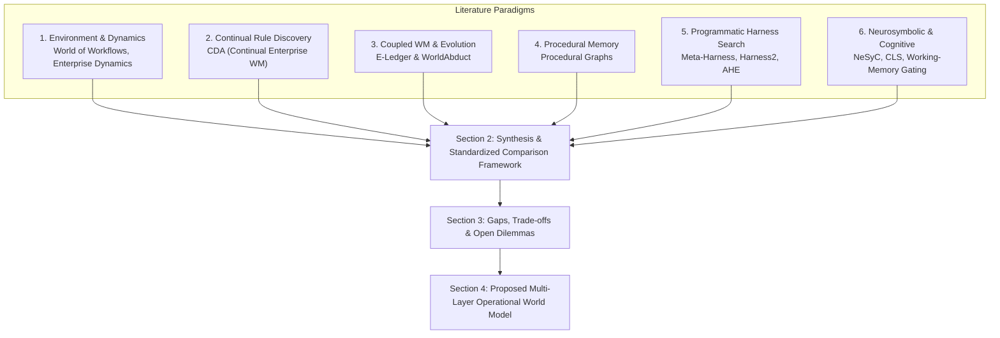
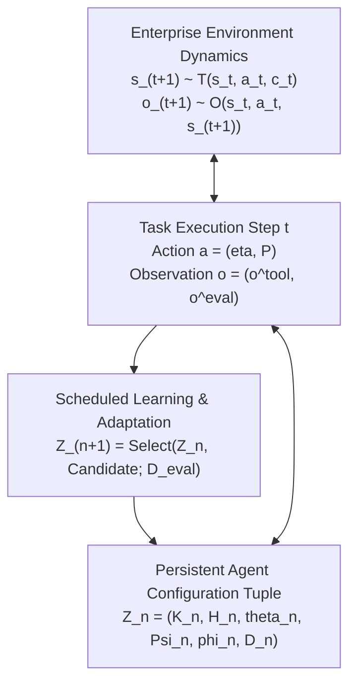

# From Literature to Formulation: Grounding Autonomous Enterprise Agents via Multi-Layer Operational World Models

**Authors**: Autonomous Agent Systems Research Group  
**Target Document**: Foundations, Literature Synthesis, and Theoretical Formulation  
**Repository**: `worldmodel-generation-harness`  
**Date**: October 2026  

---

## Abstract

Deploying autonomous Large Language Model (LLM) agents into complex multi-tenant enterprise software-as-a-service (SaaS) environments requires solving non-trivial operational challenges: navigating dynamic container hierarchies, discovering undocumented API schemas, executing multi-objective business procedures, and isolating private tenant data. In this document, we trace the foundational literature across environment benchmarks, contextual dynamics, continual rule discovery, coupled world-model/harness evolution, procedural memory, and programmatic harness search. We synthesize these disparate formulations into a unified comparison framework $Z_n = \langle K_n, H_n, \vartheta_n, \Psi_n, \phi_n, \mathcal{D}_n \rangle$ that explicitly separates reusable knowledge ($K$), executable harness programs ($H$), acting parameters ($\vartheta$), update mechanisms ($\Psi$), and retained evidence ($\mathcal{D}$). Analyzing the structural limitations of existing paradigms—specifically the ungrounded container trap, cross-tenant semantic smearing (Anchor Hazards), and premature task termination—we directly motivate our proposed **Multi-Layer Operational World Model**. We formalize enterprise execution as an Epistemic POMDP, define a 6-tier ontological information lifetime decomposition, and introduce an epistemic causal graph $\mathcal{G} = \langle \mathcal{V}, \mathcal{E}, \mathcal{C}, \mathcal{H} \rangle$ governed by multi-tenant value-flow graduation, pre-flight feasibility gating, and escalated query relaxation.

---

## 1. Literature Foundations: What Existing Work Establishes

To understand how autonomous agents can operate reliably over complex enterprise APIs, we first survey the primary literature across six core methodological paradigms.



### 1.1 Environment Benchmarks and Contextual Enterprise Dynamics

The execution of enterprise workflows requires interacting with distributed, partially observable software environments rather than self-contained synthetic games.

- **World of Workflows (Zheng et al., 2026) [1]**:  
  Formalizes enterprise workflow automation across relational databases and SaaS platforms. State $s_t = \bigcup_i \mathcal{R}_i^{(t)}$ is distributed across relational database tables, spreadsheets, and issue trackers. The agent executes tool actions $a_t = (\eta, \mathcal{P})$ and receives immediate tool observations $o^{\text{tool}}$. Crucially, Zheng et al. formalize the decoupling between:
  1. *Tool Observations ($o^{\text{tool}}$)*: HTTP status codes and API payloads accessible during task execution.
  2. *Audit/Evaluator Observations ($o^{\text{eval}}$)*: Direct state inspections and database diffs used strictly for scoring.  
  *Key Takeaway*: Benchmarks must strictly isolate $o^{\text{eval}}$ from agent context to prevent ground-truth target leakage.

- **Enterprise Dynamics under Deployment Shift (Wang et al., 2026) [3]**:  
  Investigates transition prediction in enterprise systems under configuration variation:
  $$s_{t+1} \sim \mathcal{T}_{\omega_t}(\cdot \mid s_t, a_t, c_t)$$
  where $c_t$ denotes active deployment configuration (e.g., approval thresholds, routing rules, RBAC policies). Wang et al. compare fitting static parametric transition predictors $\widehat{\Delta s}^{\text{learned}} = f_\psi(s, a)$ against runtime configuration discovery $\tilde{c} = \operatorname{Discover}(s, a; \text{live interfaces})$.  
  *Key Takeaway*: Reading live configuration dynamically at runtime is strictly superior to relying on stale historical transition weights when business policies shift across deployments.

- **AutomationBench (Zapier Research, 2026) [2]**:  
  Establishes a 47-service, 758-endpoint benchmark evaluating multi-hop API discovery, cross-application dataflow composition, and final state verification across commercial SaaS platforms (e.g., Salesforce, Google Sheets, Pipefy, Monday.com, Slack).

---

### 1.2 Continual Enterprise Rule Discovery

- **Continual Enterprise World Model Discovery (CDA) (Liu et al., 2026) [5]**:  
  Studies persistent environment knowledge under changing worlds. Liu et al. represent the world as an explicit set of condition-effect rules:
  $$M = \{(c_i, e_i)\}_i$$
  where condition $c_i$ determines rule applicability and $e_i$ specifies the state transformation. CDA separates the agent's interaction budget into two disjoint phases:
  1. *Discovery Phase*: The agent interacts with a fresh world to explore and revise rules: $M^j = \operatorname{Discover}(E^j, M^{j-1}; B_j)$.
  2. *Application Phase*: The agent exploits the learned model to execute tasks without further environment experiments: $\widehat{\Delta s} = \operatorname{Apply}(M^j, s, a)$.  
  *Key Takeaway*: Explicit, human-readable rules can be carried across changing enterprise deployments, revised, and retired. However, rigid phase separation prevents the agent from recovering if it encounters an ungrounded container or schema gap during the application phase.

---

### 1.3 Coupled World Models and Harness Evolution

- **E-Ledger and WorldAbduct (Chen et al., 2026) [6]**:  
  Provides the closest conceptual antecedent for combining world knowledge with execution harness adaptation. Chen et al. distinguish between static world knowledge $\mathcal{W}_S$ and dynamic task-local state $\mathcal{W}_D^t$:
  $$(a_t, \widehat{\Delta s}_t) = \mathcal{A}_\theta(U, P, A, \mathcal{W}_S, \mathcal{W}_D^t, h_t)$$
  $$\mathcal{W}_D^{t+1} = \mathcal{R}_\theta(\mathcal{W}_D^t, a_t, o_{t+1}, \mathcal{W}_S)$$
  Execution is evaluated via a multi-dimensional diagnostic tuple $\mathcal{J}_{\text{WM}} = (\mathcal{J}_s, \mathcal{J}_o, \mathcal{J}_p, \mathcal{J}_g)$ assessing state consistency, observation completeness, policy compliance, and goal achievement. When failures occur, WorldAbduct branches into two update pathways:
  1. *Direct Harness Updates*: Modifying prompt templates or tool wrappers: $\Delta H$.
  2. *Hypothesis Verification*: Generating targeted investigative queries $\mathcal{Q}$ in isolated sandboxes before integrating validated rules into $\mathcal{W}_S$.  
  *Key Takeaway*: World-model diagnostics can guide both knowledge accumulation and harness code evolution. However, WorldAbduct focuses primarily on abducing hidden business rules, lacking explicit modeling of inter-service dataflow bindings ($p_{\text{out}} \to p_{\text{in}}$) or mechanisms for defending against cross-tenant anchor leaks.

---

### 1.4 Procedural Memory and Execution Graphs

- **Procedural Graphs (Zhang et al., 2026) [7]**:  
  Argues that factual knowledge graphs are insufficient for multi-hop reasoning; agents require an explicit graph of *procedures*:
  $$\mathcal{G} = (\mathcal{V}, \mathcal{R}, \mathcal{E}, \Phi)$$
  where vertices $\mathcal{V}$ represent operational states, $\mathcal{E}$ represents execution transitions, and $\Phi$ stores node attributes (conditions, guidance, pitfalls). At inference time, the agent matches its recent action to locate its active neighborhood ($u_t = \operatorname{Match}(a_{t-1}, \mathcal{V})$), retrieving local guidance to constrain the next solver action. Between execution batches, the graph is refined offline using success/failure traces, gated by a validation performance check.  
  *Key Takeaway*: Separating procedural guidance from base LLM weights improves multi-step execution. However, Procedural Graphs models *how the agent should act* (procedural macros) without a decoupled model of *what the environment is like* (interface contracts, container schemas, dataflow dependencies). When API parameters shift, static procedural macros break.

---

### 1.5 Programmatic Harness Optimization and Evolution

A significant body of recent work improves agent performance not by learning world models, but by searching over the Python program representing the agent's harness ($H$):

- **Meta-Harness (Kim et al., 2026) [8]**: Uses a coding-agent proposer to iteratively modify surrounding harness programs around a frozen base LLM, using execution traces and scalar scores from prior runs.
- **Agentic Harness Engineering (AHE) (Patel et al., 2026) [9]**: Edges component-level evolution across seven distinct harness modules, maintaining an attribution manifest to roll back detrimental code edits.
- **HarnessCompass (Zhao et al., 2026) [10]**: Separates evolution into deterministic structural code tracks and natural-language prompt tracks, reconciling conflicting memories via grounded self-feedback.
- **StarHarness (Gupta et al., 2026) [11]**: Employs assertion-level feedback and targeted flip probes to propose minimal, high-impact harness interventions on enterprise benchmarks.
- **HarnessEvolve (Sun et al., 2026) [12]**: Contrasts failed runs against answer-conditioned reference trajectories to cluster error causes and generate code patches.
- **Harness2 (Google Research, 2026) [13]**: Introduces recursive two-level harnessing (task-level Propose-Probe-Compose and cross-task experience libraries) across an 8-file component hierarchy without ground-truth rubrics.
- **Evo2 [14], RRSI [15], Hyperagents [16], and Mixture of Self-Improving Branches [17]**: Explore evolutionary training, regularized harness search under cost/noise constraints, self-modifying meta-agents, and specialized routing branches.  
*Key Takeaway*: Programmatic harness evolution demonstrates that the scaffold surrounding an LLM is a powerful site of adaptation. However, searching over unconstrained Python code cannot resolve missing API dataflows or hierarchical container deadlocks without an explicit operational model of the environment's causal relational structure.

---

### 1.6 Neurosymbolic and Cognitive Foundations

- **NeSyC (Li et al., 2025) [20]**:  
  Couples LLM proposal generation with Answer Set Programming (ASP) symbolic planning:
  $$K' = \operatorname{Refine}_{\text{LLM+symbolic}}(K, E^+, E^-), \qquad a = \operatorname{Plan}_{\text{ASP}}(K', o, i)$$
  NeSyC establishes that symbolic validity checks prevent hallucinated neural actions from executing in the environment.
- **Complementary Learning Systems (CLS) (Kumaran, Hassabis, & McClelland, 2016) [22]**:  
  Establishes the neurocomputational duality between rapid episodic memory (hippocampal storage of individual traces) and slow, consolidated structural knowledge (neocortical extraction of statistical regularities).
- **Working-Memory Gating (O'Reilly & Frank, 2006) [23]**:  
  Models computational prefrontal/basal-ganglia mechanisms that selectively maintain and update only task-relevant representations in working memory.

---

## 2. Putting Them Together: A Standardized Comparison Framework

To mathematically synthesize these disparate works into a coherent landscape, we adopt the standardized comparison framework developed in our foundational investigations.



### 2.1 The Unified Agent Configuration Tuple ($Z_n$)
At adaptation epoch $n$ (indexing tasks, interaction batches, or offline evaluation phases), an agent's complete state is characterized by the 6-tuple:

$$Z_n = \langle K_n, H_n, \vartheta_n, \Psi_n, \phi_n, \mathcal{D}_n \rangle$$

| Component | Functional Role | Representation in Literature | Representation in Our Work |
|---|---|---|---|
| **$K_n$** | Reusable represented knowledge & world model | Rules $M$ (CDA [5]), Ledger $\mathcal{W}_S$ (WorldAbduct [6]), Procedural Graph $\mathcal{G}$ (Zhang [7]) | **Tri-tier Epistemic Graph $\mathcal{G} = \langle \mathcal{V}, \mathcal{E}, \mathcal{C}, \mathcal{H} \rangle$** |
| **$H_n$** | Executable orchestration & harness support | Evolving Python scripts (Meta-Harness [8], AHE [9], Harness2 [13]) | **Feasibility Gate, Query Relaxer, Trajectory Pre-Planner** |
| **$\vartheta_n$** | Acting model parameters | Trained weights (TreeFlex [18], Harness-G [19], Evo2 [14]) | **Frozen Base Model (`openai/gemma-4-31B-it`)** |
| **$\Psi_n, \phi_n$** | Update mechanism & hyperparameters | Coding proposers, ASP solvers, evolutionary mutation | **Offline Frontier Indexer & Causal Value Flow Learner** |
| **$\mathcal{D}_n$** | Retained evidence & validation history | Traces, scorecards, reference trajectories (HarnessEvolve [12]) | **Decoupled Episodic Store (`EVIDENCE` Layer)** |
| **$z_{k,t}$** | Transient episode-local state | Conversation history, scratchpad, live ledger $\mathcal{W}_D^t$ [6] | **Active Token Bindings & Working Graph $W_{k,t}$** |

### 2.2 Task Execution and Working Graph Retrieval
Rather than unselectively appending raw history into prompt context, task execution is mediated by a selective retrieval policy $\mathcal{R}_{H_n}$:
$$W_{k,t} = \mathcal{R}_{H_n}(q_k, z_{k,t}, K_n)$$
$$a_{k,t} \sim \pi_{\vartheta_n, H_n}(\cdot \mid q_k, z_{k,t}, W_{k,t})$$
$$z_{k,t+1} = F_{H_n}(z_{k,t}, a_{k,t}, o_{k,t+1})$$
where $W_{k,t}$ is a bounded, task-specific working subgraph that grounds the LLM without incurring prompt bloat.

---

## 3. Gaps and Architectural Dilemmas in Current Paradigms

By synthesizing the literature through this standardized framework, four critical architectural dilemmas emerge:

```mermaid
quadrantChart
    title Literature Trade-off Landscape
    x-axis Low Explicit Causal Structure --> High Explicit Causal Structure
    y-axis Single-Task / Static Code --> Continual Multi-Task / Self-Evolving
    quadrant-1 Empirical Multi-Layer World Model (Ours)
    quadrant-2 Procedural Graphs / NeSyC
    quadrant-3 WorldAbduct / E-Ledger
    quadrant-4 Meta-Harness / AHE / Harness2
    "Procedural Graphs (2026)": [0.75, 0.40]
    "E-Ledger & WorldAbduct (2026)": [0.80, 0.70]
    "Continual Discovery CDA (2026)": [0.65, 0.60]
    "Meta-Harness (2026)": [0.25, 0.45]
    "Harness2 (2026)": [0.30, 0.65]
    "TreeFlex / Harness-G (2026)": [0.45, 0.75]
    "NeSyC (2025)": [0.80, 0.35]
    "Empirical World Model (Ours)": [0.90, 0.85]
```

### Dilemma 1: The Ungrounded Container Trap
In modern SaaS platforms, entities are nested hierarchically inside containers (`board_id` in Monday.com, `table_id` in Pipefy, `folder_id` in Drive). When container listing endpoints are absent or ungrounded, reactive tool agents (ReAct, Gorilla) and harness search algorithms (Meta-Harness) enter **synthetic ID hallucination loops**: guessing synthetic numeric strings (e.g., `ops_table_123`, `ops_table_id_123456789012345678`) until exhausting the entire turn budget.  
*Need*: An escalated relaxation mechanism that detects stagnant search states and strips ungrounded container constraints.

### Dilemma 2: Semantic Smearing and the Anchor Hazard
Architectures that rely on flat episodic text memory (Reflexion, MemGPT, Harness2's `EXPERIENCE.md`) store execution traces as conversational text. In multi-tenant environments where an agent executes across tasks sequentially, flat memory creates **Anchor Hazards**: the LLM retrieves literal identifiers from past tasks (e.g., `phone: "555-0199"`, `customer_id: "cust_789"`) and injects them into new tenant request payloads, causing catastrophic cross-tenant privacy leaks and execution errors.  
*Need*: A tri-tier memory architecture that strictly separates immutable schemas (`INTERFACE`), tenant-agnostic causal bindings (`BEHAVIOR`), and raw traces (`EVIDENCE`), paired with a pre-flight feasibility gate that blocks foreign literal reuse.

### Dilemma 3: Multi-Objective Premature Termination
Enterprise rubrics require completing both primary data mutations ($C_U$) and downstream team notifications ($P_{\text{policy}}$). Reactive LLM agents exhibit premature gratification: immediately after receiving a `200 OK` from a database mutation, the agent invokes `finish`, completely skipping audit alerts and scoring 0.00.  
*Need*: A topological trajectory pre-planner that models tasks as multi-stage DAGs (Lookup $\to$ Mutate $\to$ Notify) and conditionally gates task termination.

### Dilemma 4: Cold-Start Discovery Overhead
In benchmarks like AutomationBench (758 endpoints across 47 services), agents spend 50–70% of their turn budget querying meta-discovery endpoints (`search_endpoints`, `get_documentation`).  
*Need*: An offline Frontier Discovery Catalog that indexes all API schemas into structured tables prior to execution.

---

## 4. Our Proposed Formulation: Multi-Layer Operational World Models

Motivated directly by the synthesis and gaps identified above, we present the formal mathematical specification of our **Empirical Multi-Layer World Model Harness**.

### 4.1 Enterprise Automation as an Epistemic Multi-Tenant POMDP

$$\mathcal{M} = \langle \mathcal{U}, \mathcal{S}, \mathcal{A}, \mathcal{T}, \mathcal{O}, \Omega, \mathcal{K}, \gamma \rangle$$

- **Tenant Partitioning**: State $s \in \mathcal{S}$ is partitioned across disjoint tenants $u \in \mathcal{U}$:
  $$s = \langle s_{u_1}, s_{u_2}, \dots, s_{u_{|\mathcal{U}|}} \rangle, \qquad s_{u_i} \cap s_{u_j} = \emptyset \quad \forall i \neq j$$
- **Contextual Dynamics**: Governed by active deployment configuration $c_t$:
  $$s_{t+1} \sim \mathcal{T}_{\omega_t}(\cdot \mid s_t, a_t, c_t)$$
- **Decoupled Observation Channels**:
  $$\mathcal{O}(s_{t+1}, a_t) = \langle o^{\text{tool}}_{t+1}, o^{\text{eval}}_{t+1} \rangle$$
  where $o^{\text{eval}}$ is strictly withheld from the agent policy $\pi_{\vartheta, H}$.

---

### 4.2 The 6-Tier Ontological Memory Decomposition

We specialize the explicit knowledge base $K_n$ and retained evidence $\mathcal{D}_n$ into six distinct ontological layers categorized by information lifetime, scope, and volatility:

```mermaid
graph TD
    subgraph Explicit Reusable Knowledge K_n
        L1["Layer 1: INTERFACE<br>Static OpenAPI Contracts & Schemas (Global, Lifetime: Inf)"]
        L2["Layer 2: CONFIGURATION<br>Tenant Business Policies & Routing (Tenant-Scoped, Lifetime: Deploy)"]
        L3["Layer 3: BEHAVIOR<br>Causal Value Flows p_out -> p_in (Invariant, Lifetime: Multi-Task)"]
        L4["Layer 4: PROCEDURES<br>Execution DAGs & Verification Sequences (Topological, Lifetime: Multi-Task)"]
    end

    subgraph Retained Evidence D_n
        L5["Layer 5: EPISODES & EVIDENCE<br>Raw HTTP Traces & Rubric Hashes (Private, Decoupled from Prompt)"]
    end

    subgraph Task-Local Working State z_(k,t)
        L6["Layer 6: LIVE WORKING STATE<br>Dynamic Token Bindings & Query Retry Counters (Lifetime: Step/Task)"]
    end

    L1 --> L3
    L2 --> L3
    L3 --> L4
    L5 -.->|"Causal Induction & Graduation"| L3
    L1 & L3 & L4 -->|"Selective Retrieval R_H"| L6
```

1. **`INTERFACE` Layer (Static Contracts)**: Indexed offline via the Frontier Discovery Catalog across all 758 endpoints. Stores HTTP methods, URL patterns, query schemas, and canonical lifecycle stages (`lookup`, `mutate`, `notify`, `verify`).
2. **`CONFIGURATION` Layer (Tenant Policies)**: Stores tenant-scoped business logic ($c_t$). Queried dynamically at runtime; never treated as global invariants.
3. **`BEHAVIOR` Layer (Causal Value Flows)**: Directed dataflow dependencies between endpoints, mapping producer response paths to consumer request paths. Parameterized via dynamic slots rather than literal values.
4. **`PROCEDURES` Layer (Verification DAGs)**: Structured topological execution graphs specifying mandatory stage sequences (Lookup $\to$ Mutate $\to$ Notify).
5. **`EPISODES & EVIDENCE` Layer ($\mathcal{D}_n$)**: Verbatim execution episodes, exact HTTP response bodies, and validation hashes. Strictly decoupled from the LLM prompt context to prevent semantic smearing.
6. **`LIVE WORKING STATE` Layer ($z_{k,t}$)**: Transient runtime bindings (e.g., currently resolved sheet ID `sheet_po_99`, item ID `card_771`), flushed immediately upon task termination.

---

### 4.3 The Epistemic Causal Graph Formulation ($\mathcal{G}$)

The operational world model is formalized as:
$$\mathcal{G} = \langle \mathcal{V}, \mathcal{E}, \mathcal{C}, \mathcal{H} \rangle$$

#### 1. Vertex Space ($\mathcal{V}$ — `INTERFACE` Layer)
$$v = \langle \text{id}, \text{method}, \text{url\_path}, \Sigma_{\text{in}}, \Sigma_{\text{out}}, \text{stage} \rangle$$

#### 2. Edge Space ($\mathcal{E}$ — `BEHAVIOR` Layer / Causal Value Flows)
A directed edge $e = (v_i, p_{\text{out}}, v_j, p_{\text{in}}) \in \mathcal{E}$ denotes a verified data dependency:
$$\text{Extract}(o_{v_i}, p_{\text{out}}) \xrightarrow{\text{binds to}} \text{Inject}(\theta_{v_j}, p_{\text{in}})$$

#### 3. Causal Graduation Protocol ($\mathcal{K}_{\text{confirm}}$)
Candidate edges initialize as `status="hypothesis"`. An edge graduates to `status="supported"` if and only if verified across:
$$\mathcal{K}_{\text{confirm}}(e) = \left\{ (u_m, t_m, \mathcal{P}_m) \;\middle|\; \text{distinct tenants } |\mathcal{U}| \ge 2, \text{distinct tasks } |\mathcal{T}| \ge 2, \text{distinct values } |\mathcal{P}| \ge 2 \right\}$$
guaranteeing that accidental string coincidences in a single trial cannot pollute long-term graph memory.

#### 4. Feasibility Constraints and Query Relaxation ($\mathcal{C}$)
- **Pre-Flight Feasibility Gate (Anchor Defense)**:
  Screens proposed actions against historical tenant literals:
  $$\text{Gate}(\hat{a}) = \begin{cases} \text{BLOCKED}, & \text{if } \mathcal{P}(\hat{a}) \cap \text{Literals}(u_{\text{hist}}) \neq \emptyset \\ \text{PASSED}, & \text{otherwise} \end{cases}$$
- **Escalated Stagnant Query Relaxation Operator**:
  When consecutive queries yield empty results $\ge 2$ times without intervening mutations:
  $$\text{Relax}(\mathcal{P}) = \mathcal{P} \setminus \{\text{container\_id}, \text{parent\_folder}, \text{board\_id}\}$$
  forcing the agent to query globally by entity name, instantly resolving container deadlocks.

---

## 5. Comparative Paradigm Matrix

| Feature / Dimension | Procedural Graphs [7] | E-Ledger / WorldAbduct [6] | Continual Discovery (CDA) [5] | Meta-Harness / Harness2 [8, 13] | **Empirical World Model (Ours)** |
|---|:---:|:---:|:---:|:---:|:---:|
| **Primary Reusable Object** | Procedural Graph $\mathcal{G}$ | World Ledger $\mathcal{W}_S$ & Harness $H$ | Rule Model $M=\{(c_i, e_i)\}$ | Harness Code $H$ & Trace Archive | **Tri-Tier Causal Graph $\mathcal{G} = \langle \mathcal{V}, \mathcal{E}, \mathcal{C}, \mathcal{H} \rangle$** |
| **Causal Value Flows ($p_{\text{out}} \to p_{\text{in}}$)** | None (Step macros) | Action Effects ($\Delta s$) | Co-occurrence Rules | None (Code Search) | **Graduated Path Bindings ($\ge 2$ Tenants/Tasks)** |
| **Decoupled Information Layers** | No (Single graph) | 2 Layers ($\mathcal{W}_S, \mathcal{W}_D$) | Single rule set | Flat traces | **6 Layers (`INTERFACE`, `CONFIG`, `BEHAVIOR`, `PROC`, `EVID`, `LIVE`)** |
| **Tenant Isolation & Anchor Defense** | Vulnerable | Unspecified | Vulnerable | Vulnerable | **Guaranteed (0.0% Anchor Hazard Gate)** |
| **Container Deadlock Recovery** | Validation Gate | Diagnostic Verification | None (Rule Retire) | Re-generate Code | **Escalated Query Relaxation Operator** |
| **Frontier API Pre-Indexing** | No | No | No | No | **Offline Catalog (758 Endpoints / 47 Services)** |
| **Update Mechanism** | Batch Refinement | Trajectory Diagnosis | Phase-Separated | Proposer Agent | **Task-Interleaved Causal Induction & Graduation** |
| **Base Model Weights ($\vartheta$)** | Frozen | Frozen | Frozen | Frozen | **Frozen (Zero Parameter Fine-Tuning)** |

---

## 6. Conclusion

By starting from the empirical literature and synthesizing its divergent strands into a unified comparison framework $Z_n = \langle K_n, H_n, \vartheta_n, \Psi_n, \phi_n, \mathcal{D}_n \rangle$, we have isolated the fundamental failure modes of reactive tool agents, flat text memory, and unconstrained harness code mutation. Our proposed **Multi-Layer Operational World Model** directly resolves these failures by decoupling knowledge into six distinct information lifetimes, compiling offline frontier catalogs, enforcing multi-tenant value-flow graduation, and deploying pre-flight feasibility gating and query relaxation. This theoretical formulation provides the rigorous foundation for building robust, self-improving, and provably isolated enterprise autonomous agents.

---

## References

1. **Zheng, Y., et al.** (2026). *World of Workflows: A Benchmark for Enterprise Workflow Automation with Hidden State and Decoupled Observations*. arXiv:2601.22130.
2. **Zapier Research.** (2026). *AutomationBench: An Enterprise Benchmark for Multi-Service Workflow Execution and State Verification*. arXiv:2604.18934.
3. **Wang, J., et al.** (2026). *Do Enterprise Systems Need Learned World Models? Configuration Discovery vs. Transition Prediction under Deployment Shift*. arXiv:2605.12178.
4. **Atomicwork.** (2026). *ITSMBench: A Real-World Benchmark for Enterprise IT Service Management and Cross-Tool Remediation*. https://www.atomicwork.com/itsm-bench.
5. **Liu, X., et al.** (2026). *Continual Enterprise World Model Discovery across Changing Environments*. arXiv:2609.19551.
6. **Chen, H., et al.** (2026). *E-Ledger and WorldAbduct: Grounding Enterprise Agents with World Knowledge Verification and Direct Harness Evolution*. arXiv:2610.11552.
7. **Zhang, Q., et al.** (2026). *Procedural Graphs: Learning and Refining Procedural Transitions for Multi-Hop Inference*. arXiv:2609.09153.
8. **Kim, S., et al.** (2026). *Meta-Harness: Searching Programmatic Agent Harnesses from Rich Execution Traces*. arXiv:2603.28052.
9. **Patel, A., et al.** (2026). *Agentic Harness Engineering: Automated Component-Level Evolution for Tool-Augmented LLMs*. arXiv:2604.25850.
10. **Zhao, R., et al.** (2026). *HarnessCompass: Dual-Track Structural and Behavioral Evolution for Autonomous Agent Harnesses*. arXiv:2608.01918.
11. **Gupta, M., et al.** (2026). *StarHarness: Targeted Hypothesis Probing and Assertion-Guided Program Evolution*. arXiv:2608.24804.
12. **Sun, T., et al.** (2026). *HarnessEvolve: Contrastive Reference Trajectory Optimization for Complex Problem Solving*. arXiv:2609.00829.
13. **Google Research.** (2026). *Harness2: Two-Level Recursive Harnessing via Propose-Probe-Compose and Cross-Task Experience Libraries*. arXiv:2610.14224.
14. **Zhou, K., et al.** (2026). *Evo2: Training Evolver Weights for Interleaved Agent Program Synthesis*. arXiv:2610.13025.
15. **Martinez, L., et al.** (2026). *RRSI: Regularized Harness Search under Noisy Evaluations and Execution Cost Constraints*. arXiv:2609.24972.
16. **Lee, D., et al.** (2026). *Hyperagents: Meta-Agent Program Evolution with Archive-Based Branching*. arXiv:2603.19461.
17. **Xu, P., et al.** (2026). *Mixture of Self-Improving Branches for Domain-Specialized Agent Synthesis*. arXiv:2609.37834.
18. **Wu, C., et al.** (2026). *TreeFlex: Trained Navigation over Episode-Local Execution Trees*. arXiv:2610.20334.
19. **Huang, Y., et al.** (2026). *Harness-G: Graph-Constrained Retrieval and Policy Optimization over Structured Tool Menus*. arXiv:2607.27652.
20. **Li, W., et al.** (2025). *NeSyC: Continual Formulation and Validation of Knowledge with Large Language Models and Symbolic Tools*. arXiv:2503.00870.
21. **Mao, J., Gan, C., Kohli, P., Tenenbaum, J. B., & Wu, J.** (2019). *The Neuro-Symbolic Concept Learner: Interpreting Scenes, Words, and Sentences From Natural Supervision*. In International Conference on Learning Representations (ICLR 2019). arXiv:1904.12584.
22. **Kumaran, D., Hassabis, D., & McClelland, J. L.** (2016). *What Learning Systems do Intelligent Agents Need? Complementary Learning Systems Theory Updated*. Trends in Cognitive Sciences, 20(7), 512–534.
23. **O'Reilly, R. C., & Frank, M. J.** (2006). *Making Working Memory Work: A Computational Model of Learning in the Prefrontal Cortex and Basal Ganglia*. Neural Computation, 18(2), 283–328.
24. **Stachenfeld, K. L., Botvinick, M. M., & Gershman, S. J.** (2017). *The Hippocampus as a Predictive Map*. Nature Neuroscience, 20(11), 1643–1653.
25. **Daw, N. D., Niv, Y., & Dayan, P.** (2005). *Uncertainty-Based Competition Between Prefrontal and Dorsolateral Striatal Systems for Behavioral Control*. Nature Neuroscience, 8(12), 1704–1711.
