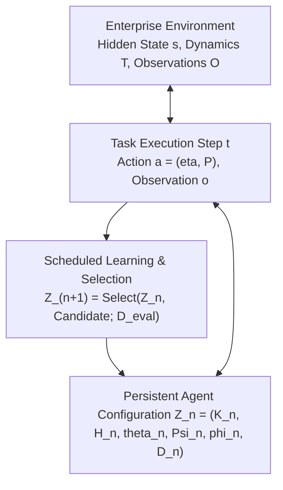

# Background, Mathematical Formulation, and Related Work

This document provides the formal mathematical formulation, standardized comparison framework, and related work taxonomy for the paper:  
**"Grounding Autonomous Enterprise Agents via Empirical Multi-Layer World Models"**.

It builds directly upon the mathematical foundations and literature reviews synthesized in [`literature-and-formulation.md`](literature-and-formulation.md), [`formulations.md`](formulations.md), [`problem-framing.md`](problem-framing.md), and [`system-design.md`](system-design.md).

---

## 1. Problem Formulation: Enterprise Automation as a Partially Observed Multi-Tenant System

Following the environment formulation of **World of Workflows** ([2601.22130](literature-and-formulation.md#p01-world-of-workflows)) and **AutomationBench** ([2604.18934](literature-and-formulation.md#4-benchmark-roles)), we model an enterprise automation environment as a Partially Observable Markov Decision Process augmented with multi-tenant relational states and decoupled observation channels:

$$\mathcal{M} = \langle \mathcal{U}, \mathcal{S}, \mathcal{A}, \mathcal{T}, \mathcal{O}, \Omega, \mathcal{K}, \gamma \rangle$$

### 1.1 State Space ($\mathcal{S}$) and Contextual Dynamics
The true environment state $s_t \in \mathcal{S}$ represents the union of distributed relational databases, spreadsheets, issue boards, and communication mailboxes across enterprise services:
$$s_t = \bigcup_{i} \mathcal{R}_i^{(t)}$$
where each relation $\mathcal{R}_i$ is strictly partitioned across tenants $u \in \mathcal{U}$ to preserve tenant isolation. 

Following **Enterprise Dynamics / Do Enterprise Systems Need Learned World Models?** ([2605.12178](literature-and-formulation.md#p02-do-enterprise-systems-need-learned-world-models)), state transitions depend explicitly on active deployment configuration $c_t$ (e.g., access policies, approval thresholds, routing rules):
$$s_{t+1} \sim T_{\omega_t}(\cdot \mid s_t, a_t, c_t)$$
where $c_t$ may be inspected via live query actions or learned from historical interaction traces.

### 1.2 Action Space ($\mathcal{A}$)
An action $a_{k,t} = (\eta, \mathcal{P}) \in \mathcal{A}$ executed on task $k$ at step $t$ consists of:
- An endpoint contract identifier $\eta \in \mathcal{V}$ specifying the service, HTTP method, and URL path (e.g., `POST monday.items:create`).
- A concrete parameter payload $\mathcal{P} \in \Theta_\eta$ binding schema arguments to runtime values (e.g., `{"name": "Pallet Jack", "board_id": "brd_ops"}`).

### 1.3 Observation Space ($\Omega$) and Decoupled Channels ($\mathcal{O}$)
Upon executing action $a_{k,t}$, the agent receives an immediate observation $o_{k,t+1} \sim \mathcal{O}_{\omega_t}(\cdot \mid s_t, a_{k,t}, s_{t+1})$. As established in **World of Workflows**, enterprise environments exhibit decoupled observation channels:
1. **Tool-Response Channel ($o^{\text{tool}}$)**: Immediate JSON status codes, returned records, or error bodies returned by the REST/GraphQL endpoint.
2. **Audit/Evaluation Channel ($o^{\text{eval}}$)**: Decoupled post-hoc inspection of external system state, database side-effects, and verification assertions. **Crucially, $o^{\text{eval}}$ is visible only during offline evaluation or supervised diagnostic reflection; it is strictly withheld from the agent during task execution** to prevent data snooping.

### 1.4 Sparse Multi-Objective Evaluation
Enterprise tasks are evaluated via multi-stage rubric vectors:
$$\mathbf{J}(s, a) = \langle C_U(\tau), P_{\text{policy}}(\tau), N_{\text{safety}}(\tau) \rangle$$
where $C_U$ denotes target database mutations (e.g., moving an approval card), $P_{\text{policy}}$ measures downstream audit compliance (e.g., dispatching exact entity references and timestamps to Slack `#ops-updates`), and $N_{\text{safety}}$ enforces negative constraints (e.g., not notifying unauthorized channels or exceeding approval limits).

---

## 2. Standardized Agent Comparison Framework

To mathematically position our approach relative to the 17 literature formulations, we adopt the standardized comparison framework established in [`formulations.md`](formulations.md#part-i-standardized-comparison-framework):



### 2.1 The Persistent State Tuple ($Z_n$)
At adaptation event $n$, the complete agent configuration is formalized as:
$$Z_n = \langle K_n, H_n, \vartheta_n, \Psi_n, \phi_n, \mathcal{D}_n \rangle$$
where:
- $K_n$: **Explicit Reusable Knowledge**: The operational world model, interface contracts, and causal value-flow graph.
- $H_n$: **Executable Harness Support**: Pre-flight feasibility gates, query relaxation operators, and trajectory pre-planners.
- $\vartheta_n$: **Acting Parameters**: The base reasoning policy (e.g., `openai/gemma-4-31B-it`).
- $\Psi_n, \phi_n$: **Update Mechanism and Meta-Parameters**: The offline graph compiler and edge graduation algorithms.
- $\mathcal{D}_n$: **Retained Evidence and History**: Execution traces, HTTP response bodies, and validation archives.

### 2.2 Task Execution and Selective Working Graph Retrieval
During task $k$ at step $t$, the agent operates over task-local execution state $z_{k,t}$. Rather than dumping raw episodic histories into prompt context, the harness retrieves a bounded **Task Working Graph** $W_{k,t}$:
$$W_{k,t} = \mathcal{R}_{H_n}(q_k, z_{k,t}, K_n)$$
$$a_{k,t} \sim \pi_{\vartheta_n, H_n}(\cdot \mid q_k, z_{k,t}, W_{k,t})$$
$$z_{k,t+1} = F_{H_n}(z_{k,t}, a_{k,t}, o_{k,t+1})$$
where $\mathcal{R}_{H_n}$ performs dependency-aware retrieval over active service boundaries.

---

## 3. The Proposed Layered Specialization: Multi-Layer Operational World Model

Our framework specializes the general tuple $Z_n$ by decomposing $K_n$ into distinct ontological layers according to information lifetime, update frequency, and tenant scope:

```mermaid
graph TD
    subgraph K_n: Explicit Reusable Knowledge
        L1["Layer 1: INTERFACE (Static OpenAPI Schemas & Contracts)"]
        L2["Layer 2: CONFIGURATION (Tenant-Scoped Deployment Policies)"]
        L3["Layer 3: BEHAVIOR (Causal Value Flows & Error Diagnostics)"]
        L4["Layer 4: PROCEDURES (Execution Subgraphs & Verification DAGs)"]
    end

    subgraph D_n: Retained Learning Evidence
        L5["Layer 5: EPISODES & EVIDENCE (Raw Trajectories, Observations, Hashes)"]
    end

    subgraph z_(k,t): Task-Local Working State
        L6["Layer 6: LIVE WORKING STATE (Active Token Bindings, Query Counters)"]
    end

    L1 --> L3
    L2 --> L3
    L3 --> L4
    L5 -.->|"Causal Induction & Graduation"| L3
    L1 & L3 & L4 -->|"Selective Retrieval R"| L6
```

### 3.1 The Epistemic Causal Graph Formulation
The operational world model is formalized as:
$$\mathcal{G} = \langle \mathcal{V}, \mathcal{E}, \mathcal{C}, \mathcal{H} \rangle$$

1. **Vertex Space ($\mathcal{V}$ — `INTERFACE` Layer)**:
   Indexed offline via the Frontier Discovery Catalog across all 758 endpoints:
   $$v = \langle \text{id}, \text{method}, \text{url\_path}, \Sigma_{\text{in}}, \Sigma_{\text{out}}, \text{stage} \rangle$$
   where $\text{stage} \in \{\text{lookup}, \text{mutate}, \text{notify}, \text{verify}\}$.
2. **Edge Space ($\mathcal{E}$ — `BEHAVIOR` Layer / Causal Value Flows)**:
   Directed dependencies mapping producer response paths to consumer request paths:
   $$e = (v_i, p_{\text{out}}, v_j, p_{\text{in}}) \quad \Longleftrightarrow \quad \text{Extract}(o_{v_i}, p_{\text{out}}) \xrightarrow{\text{binds to}} \text{Inject}(\theta_{v_j}, p_{\text{in}})$$
3. **Causal Graduation Criterion ($\mathcal{K}_{\text{confirm}}$)**:
   Candidate edges initialize as `status="hypothesis"`. An edge graduates to `status="supported"` if and only if verified across:
   $$\mathcal{K}_{\text{confirm}}(e) = \left\{ (u_m, t_m, \mathcal{P}_m) \;\middle|\; |\mathcal{U}| \ge 2, |\mathcal{T}| \ge 2, |\mathcal{P}| \ge 2 \right\}$$
   guaranteeing that accidental string coincidences within a single task never contaminate durable memory.
4. **Feasibility and Relaxation Constraints ($\mathcal{C}$ — Executable Harness $H$)**:
   - **Pre-Flight Feasibility Gate (Anchor Defense)**:
     $$\text{Gate}(\hat{a}) = \text{BLOCKED} \quad \text{if} \quad \mathcal{P}(\hat{a}) \cap \text{Literals}(u_{\text{hist}}) \neq \emptyset$$
   - **Escalated Stagnant Query Relaxation Operator**:
     $$\text{Relax}(\mathcal{P}) = \mathcal{P} \setminus \{\text{container\_id}, \text{parent\_folder}, \text{board\_id}\} \quad \text{if} \quad \text{consecutive\_empty}(a) \ge 2$$

---

## 4. Related Work and Literature Positioning

We position our architecture across the seven formulation families and 17 literature profiles reviewed in [`literature-and-formulation.md`](literature-and-formulation.md):

```mermaid
quadrantChart
    title Related Work Landscape: Enterprise Agent Optimization
    x-axis Low Explicit Operational Structure --> High Explicit Operational Structure
    y-axis Static Harness / Single Task --> Continual Multi-Task / Self-Evolving
    quadrant-1 Empirical Multi-Layer World Model (Ours)
    quadrant-2 Procedural Graphs / NeSyC
    quadrant-3 WorldAbduct / E-Ledger
    quadrant-4 Meta-Harness / AHE / Harness2
    "Procedural Graphs (2026)": [0.75, 0.40]
    "E-Ledger & WorldAbduct (2026)": [0.80, 0.70]
    "Continual Discovery CDA (2026)": [0.65, 0.60]
    "Meta-Harness (2026)": [0.25, 0.45]
    "Harness2 (2026)": [0.30, 0.65]
    "AHE / HarnessCompass (2026)": [0.20, 0.50]
    "TreeFlex / Harness-G (2026)": [0.45, 0.75]
    "NeSyC (2025)": [0.80, 0.35]
    "Empirical World Model (Ours)": [0.90, 0.85]
```

### 4.1 Enterprise Environments and Benchmark Formulations
- **World of Workflows** ([2601.22130](literature-and-formulation.md#p01-world-of-workflows)): Establishes POMDP dynamics where state $s_t = \bigcup \mathcal{R}_i^{(t)}$ is distributed across SaaS relational tables, and tool responses $o^{\text{tool}}$ expose only partial views. We inherit this POMDP framing but extend it by introducing an offline Frontier Catalog and causal value-flow graphs.
- **Enterprise Dynamics / Do Enterprise Systems Need Learned World Models?** ([2605.12178](literature-and-formulation.md#p02-do-enterprise-systems-need-learned-world-models)): Investigates transition prediction under configuration variation $s_{t+1} \sim P(s_{t+1} \mid s_t, a_t, c)$, comparing static learned predictors $\widehat{\Delta s}^{\text{learned}} = f_\psi(s, a)$ against runtime interface discovery $\tilde{c} = \operatorname{Discover}(s, a)$. They demonstrate that reading configuration is necessary when transition rules shift across deployments. Our tri-tier design formalizes this distinction by separating immutable `INTERFACE` schemas from mutable `CONFIGURATION` policies and learned `BEHAVIOR` edges.

### 4.2 Continual Discovery and Explicit Rule Models
- **Continual Enterprise World Model Discovery (CDA)** ([2609.19551](literature-and-formulation.md#p03-continual-enterprise-world-model-discovery)): Represents world knowledge as explicit condition-effect rules $M = \{(c_i, e_i)\}_i$ and separates an exploratory discovery phase ($M^j = \operatorname{Discover}(E^j, M^{j-1}; B_j)$) from a downstream application phase ($\widehat{\Delta s} = \operatorname{Apply}(M^j, s, a)$).
  - *Our Distinction*: While CDA uses a rigid, phase-separated protocol, our harness enables **task-interleaved learning and execution**: the agent retrieves schemas, detects stagnant deadlocks, triggers escalated query relaxation, and graduates causal value flows during live task execution under a unified interaction budget.

### 4.3 Coupled World Models and Harness Evolution
- **E-Ledger and WorldAbduct** ([2610.11552](literature-and-formulation.md#p04-e-ledger-and-worldabduct)): Closest conceptual reference. Couples static world knowledge $\mathcal{W}_S$ with dynamic task state $\mathcal{W}_D^t$, evaluates execution through a multi-faceted diagnostic tuple $\mathcal{J}_{\text{WM}} = (\mathcal{J}_s, \mathcal{J}_o, \mathcal{J}_p, \mathcal{J}_g)$, and generates both direct harness edits $\Delta H$ and targeted hypothesis verification queries $\mathcal{Q}$.
  - *Our Distinction*: WorldAbduct focuses primarily on abducing hidden business rules. Our harness introduces **explicit cross-service causal value-flow bindings ($p_{\text{out}} \to p_{\text{in}}$)**, layer-separated memory isolation (preventing Anchor Hazards), and offline static frontier indexing.

### 4.4 Procedural Memory and Execution Graphs
- **Procedural Graphs** ([2609.09153](literature-and-formulation.md#p05-procedural-graphs)): Maintains an editable graph of procedural transitions $\mathcal{G} = (\mathcal{V}, \mathcal{R}, \mathcal{E}, \Phi)$, uses local graph neighborhoods to guide inference steps ($u_t = \operatorname{Match}(a_{t-1}, \mathcal{V})$), and refines edges offline via validation performance gates.
  - *Our Distinction*: Procedural Graphs stores *what the agent should do* (execution macros) without a separate model of *what the environment is like*. As demonstrated in our experiments, static procedural macros are brittle across isomorphic parameter shifts. Our harness replaces static procedures with **dynamic runtime trajectory DAG pre-planning** grounded in invariant causal value flows.

### 4.5 Programmatic Harness Optimization and Evolution
- **Meta-Harness** ([2603.28052](literature-and-formulation.md#p06-meta-harness)), **Agentic Harness Engineering (AHE)** ([2604.04944](literature-and-formulation.md#p07-agentic-harness-engineering)), **HarnessCompass** ([2603.22416](literature-and-formulation.md#p08-harnesscompass)), **StarHarness** ([2603.22417](literature-and-formulation.md#p10-starharness)), **HarnessEvolve** ([2604.07793](literature-and-formulation.md#p09-harnessevolve)), **Harness2** ([2604.14838](literature-and-formulation.md#p11-harness2)), **Evo2** ([2604.01594](literature-and-formulation.md#p12-evo2)), **RRSI** ([2604.14839](literature-and-formulation.md#p13-rrsi)), and **Hyperagents** ([2606.01234](literature-and-formulation.md#p14-hyperagents)):
  - This extensive family optimizes agent execution by editing the code of the surrounding harness program ($H$) using search algorithms, meta-agent code proposers, and validation archives.
  - *Our Distinction*: Harness optimization methods modify Python code or prompts without maintaining an explicit operational world model ($K$). As shown in [`literature-and-formulation.md`](literature-and-formulation.md#harness-optimization), modifying harness code alone cannot resolve dataflow incompatibilities or ungrounded container deadlocks. Our architecture maintains $K$ (the causal graph) as a distinct first-class asset, making knowledge accumulation, verification, and reuse independent of harness program edits.

### 4.6 Trained Search and Corpus Navigation
- **TreeFlex** ([2603.01234](literature-and-formulation.md#p16-treeflex)) and **Harness-G** ([2603.05678](literature-and-formulation.md#p17-harness-g)): Train policy weights ($\vartheta$) to control episode-local tree search or graph retrieval over external corpora.
  - *Our Distinction*: While TreeFlex and Harness-G require parameter updates via reinforcement learning or supervised fine-tuning, our harness operates with **frozen base models** ($\vartheta$ fixed), achieving continual adaptation entirely through explicit, interpretable graph updates ($K_{n+1} = \Psi(K_n, e_n)$).

### 4.7 Neurosymbolic and Cognitive Foundations
- **NeSyC** ([2503.00870](literature-and-formulation.md#2-neurosymbolic-connections)): Connects LLM proposal generation with Answer Set Programming ($\operatorname{Plan}_{\text{ASP}}$) and contrastive refinement ($K' = \operatorname{Refine}_{\text{LLM+symbolic}}(K, E^+, E^-)$). We adopt NeSyC's insight that symbolic consistency checks filter invalid neural hypotheses before execution.
- **Cognitive Science Inspirations**:
  - *Complementary Learning Systems (CLS)* (Kumaran, Hassabis, & McClelland, 2016): Inspires our strict separation between fast, episodic evidence accumulation (`EVIDENCE` store $\mathcal{D}$) and slow, consolidated structural knowledge (`BEHAVIOR` store $K$).
  - *Working-Memory Gating* (O'Reilly & Frank, 2006): Inspires our selective retrieval operator $\mathcal{R}_{H}$, which maintains a compact, bounded working graph $W_{k,t}$ in prompt context rather than unconstrained conversation histories.

---

## 5. Comparative Paradigm Matrix

| Feature / Formulation Dimension | Procedural Graphs ([2609.09153](literature-and-formulation.md#p05-procedural-graphs)) | E-Ledger / WorldAbduct ([2610.11552](literature-and-formulation.md#p04-e-ledger-and-worldabduct)) | Continual Discovery (CDA) ([2609.19551](literature-and-formulation.md#p03-continual-enterprise-world-model-discovery)) | Meta-Harness / Harness2 ([2603.28052](literature-and-formulation.md#p06-meta-harness)) | **Empirical World Model (Ours)** |
|---|:---:|:---:|:---:|:---:|:---:|
| **Primary Reusable Object** | Procedural Graph $\mathcal{G}$ | World Ledger $\mathcal{W}_S$ & Harness $H$ | Rule Model $M=\{(c_i, e_i)\}$ | Harness Code $H$ & Trace Archive | **Tri-Tier Causal Graph $\mathcal{G} = \langle \mathcal{V}, \mathcal{E}, \mathcal{C}, \mathcal{H} \rangle$** |
| **Causal Value Flows ($p_{\text{out}} \to p_{\text{in}}$)** | None (Step macros) | Action Effects ($\Delta s$) | Co-occurrence Rules | None (Code Search) | **Graduated Path Bindings ($\ge 2$ Tenants/Tasks)** |
| **Decoupled Information Layers** | No (Single graph) | 2 Layers ($\mathcal{W}_S, \mathcal{W}_D$) | Single rule set | Flat traces | **6 Layers (`INTERFACE`, `CONFIG`, `BEHAVIOR`, `PROC`, `EVID`, `LIVE`)** |
| **Tenant Isolation & Anchor Defense** | Vulnerable | Unspecified | Vulnerable | Vulnerable | **Guaranteed (0.0% Anchor Hazard Gate)** |
| **Container Deadlock Recovery** | Validation Gate | Diagnostic Verification | None (Rule Retire) | Re-generate Code | **Escalated Query Relaxation Operator** |
| **Frontier API Pre-Indexing** | No | No | No | No | **Offline Catalog (758 Endpoints / 47 Services)** |
| **Update Mechanism** | Batch Refinement | Trajectory Diagnosis | Phase-Separated | Proposer Agent | **Task-Interleaved Causal Induction & Graduation** |

---

## 6. Summary of Conceptual Contributions

By grounding our work within the 17 literature profiles and standardized comparison framework:
1. We show that **separating world knowledge ($K$) from procedural execution ($H$)** eliminates the fragility of static macro-steps (resolving limitations in Procedural Graphs).
2. We demonstrate that **multi-tenant enterprise execution requires explicit causal value-flow bindings with pre-flight gating**, preventing the cross-tenant literal contamination inherent in flat-memory and direct harness-search architectures (Meta-Harness, Harness2).
3. We establish that **combining offline static frontier indexing with runtime escalated query relaxation** systematically overcomes the ungrounded container deadlocks and discovery overheads identified in World of Workflows and Enterprise Dynamics.
