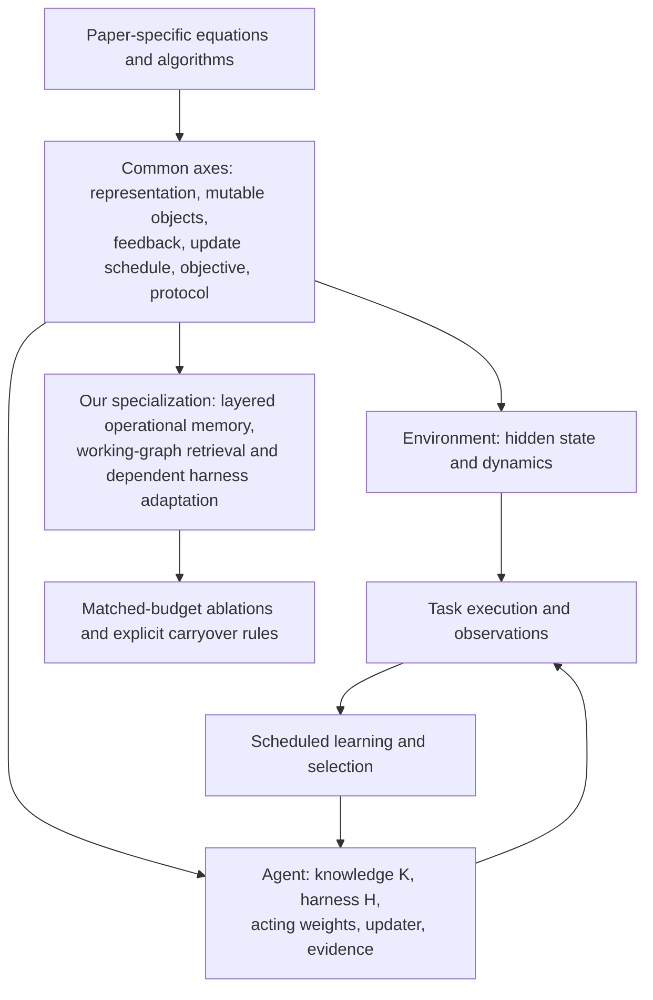
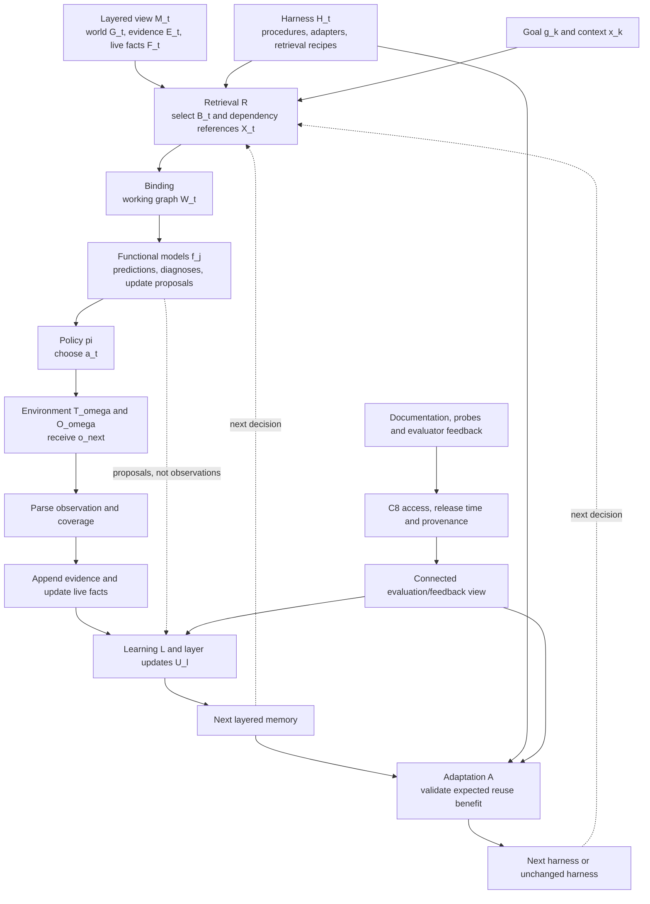

# Standardized formulations and operational world learning

The [paper-by-paper review](literature-and-formulation.md#paper-by-paper-mathematical-formulations) establishes the source formulations. Part I translates them into a common comparison framework without erasing their differences. Part II specializes that framework into our layered proposal for the [problem framing](problem-framing.md) and [system design](system-design.md). All equations in this document are our synthesis or proposal, not equations attributed to other authors. Exact probabilistic inference is an idealization; practical approximations are identified explicitly.

## Part I Standardized comparison framework

*Figure C1. Standardization preserves differences before specializing.* The common interface accommodates program search, explicit knowledge revision, and policy training; it does not equate their learning signals or claim novelty for the entire loop.

### A shared interface rather than a shared algorithm

A useful common formulation must distinguish **what exists in the environment**, **what the agent retains**, **how it acts**, and **what learning may change**. It should not force a benchmark, an RL method, and a program-search method into one asserted objective.

Let the environment have hidden state $s_t$ and dynamics/context $\omega_t$:

$$
s_{t+1}\sim T_{\omega_t}(\cdot\mid s_t,a_t),
\qquad
o_{t+1}\sim O_{\omega_t}(\cdot\mid s_t,a_t,s_{t+1}).
\tag{C1}
$$

Use $t$ for interaction steps, $k$ for tasks, and $n$ for adaptation events. The adaptation schedule may be per step, per task, per batch, or offline. Agent configuration and working state are

$$
Z_n=(K_n,H_n,\vartheta_n,\Psi_n,\phi_n,\mathcal D_n),
\qquad z_{k,t}=\text{task-local execution state}.
\tag{C2}
$$

| Symbol | Meaning | Examples |
| --- | --- | --- |
| $K$ | Reusable represented knowledge or predictive model, if present | World rules, procedural/corpus graph, experience library, parameterized transition predictor |
| $H$ | Executable orchestration and interfaces | Prompts, tools, adapters, interpreter, retrieval policy, routing |
| $\vartheta$ | Acting-model parameters | Frozen executor or RL-trained navigation/reflection policy |
| $\Psi,\phi$ | Update procedure and its learned parameters, if any | Coding-agent search, editable meta-agent, trained proposer/reflector |
| $\mathcal D$ | Retained learning evidence/search state | Traces, scores, labels, reference trajectories, candidate archive |
| $z$ | Episode-local state | Context, live ledger, current tree, selected evidence |

These are **functional roles**, not necessarily disjoint files. A procedure graph can be stored under $K$ and executed through $H$; an experience library can contain both knowledge and code. A method need not expose a separate $K$. “Not separately represented” does not imply its executor knows nothing about the environment.

### Acting learning and acceptance

A general execution interface is

$$
W_{k,t}=\mathcal R_{H_n}(q_k,z_{k,t},K_n),
\qquad
a_{k,t}\sim\pi_{\vartheta_n,H_n}(\cdot\mid q_k,z_{k,t},W_{k,t}),
$$

$$
z_{k,t+1}=F_{H_n}(z_{k,t},a_{k,t},o_{k,t+1}).
\tag{C3}
$$

$\mathcal R$ may be the identity, graph navigation, library lookup, or selective retrieval. These equations do not require every method to use retrieval.

At a scheduled update, permitted evidence $e_n$ produces candidates and a selection decision:

$$
\widetilde Z_{n+1}\sim
\Psi_{\phi_n}(\cdot\mid Z_n,e_n,\mathcal B_n),
\qquad
Z_{n+1}=\operatorname{Select}_{\Gamma_n}
(Z_n,\widetilde Z_{n+1};e_n^{\mathrm{eval}}).
\tag{C4}
$$

$\mathcal B_n$ is the budget; $\Gamma_n$ defines validity, score, cost, safety, and retention rules. $\operatorname{Select}$ may update an archive, take a gradient step, compose several edits, or retain the incumbent. It is not universally an accept/reject gate or an argmax. $\Psi$ itself may change in Hyperagents, while $\phi$ is trained in Evo2. This distinction avoids conflating inference-time code editing with model-weight training.

An explicit update mask identifies mutable coordinates:

$$
m_n\in\{0,1\}^{6},
\qquad
m_{n,j}=0\Longrightarrow Z_{n+1,j}=Z_{n,j}.
\tag{C5}
$$

Runtime state $z$ is separate from this persistent update mask. Evidence permissions and test-time update permissions are part of the method, not implementation footnotes.

### Objectives and protocols

Compare methods through an outcome vector before choosing a scalarization:

$$
\mathbf J_{\mathcal P}(Z)=
\left(
\mathbb E[R_{\mathrm{task}}],
-\mathbb E[C_{\mathrm{run}}],
-\mathbb E[C_{\mathrm{learn}}],
-\mathbb E[L_{\mathrm{prediction}}],
-\mathbb E[V_{\mathrm{constraint}}]
\right).
\tag{C6}
$$

A paper may optimize one coordinate, use a weighted sum, impose hard constraints, apply a lexicographic rule, or only evaluate a benchmark. This vector is **our comparison device**, not a source equation or a claim that every paper measures all five components. Undefined/unmeasured components stay unspecified.

The protocol is

$$
\mathcal P=(\mathcal Q,\mathrm{Reset},\mathrm{Shift},
\mathrm{EvidenceAccess},\mathrm{UpdateSchedule},
\mathrm{Carryover},\mathrm{Budget},\mathrm{EvaluationSplit}).
\tag{C7}
$$

Without $\mathcal P$, identical-looking objectives can describe incomparable experiments. Training answers in HarnessEvolve, frozen-answerer supervision in Harness-G, hidden selection in StarHarness, and unlabeled contrasts in Harness2 cannot be treated as interchangeable feedback. A benchmark's audit channel must not become an inference-time observation by notation alone.

### Evidence channels and access rules

Make the EvidenceAccess coordinate of C7 explicit:

$$
\mathcal C=\{\mathrm{documentation},\mathrm{trajectory},\mathrm{probe},
\mathrm{score},\mathrm{diagnostic},\mathrm{demonstration}\}.
$$

An evidence item is $\epsilon_i=(\chi_i,y_i,\sigma_i,p_i,t_i^{\mathrm{event}},t_i^{\mathrm{release}},v_i)$:
channel, payload, scope, provenance, event time, release time, and source/evaluator version.
For role $r\in\{\mathrm{actor},\mathrm{learner},\mathrm{selector},\mathrm{reporter}\}$, define

$$
\mathcal E_t^r=\{\Pi_{\mathcal P,r}(\epsilon_i):\epsilon_i\in E_t,\ 
t_i^{\mathrm{release}}\le t,\ 
A_{\mathcal P}(\chi_i,r,t,\sigma_i)=1\}.
\tag{C8}
$$

The projection $\Pi_{\mathcal P,r}$ exposes only allowed fields: allowing a scalar score does not release its assertions or answer key. The mask controls channel/role/scope/time access. Unavailable channels contribute no items. Documentation and probes also obey environment permissions. An unreleased future verdict is not current history.

Specialize C3–C4 using role-visible projections:

$$
W_{k,t}=\mathcal R_{H_n}(q_k,z_{k,t},K_n,\mathcal E_t^{\mathrm{actor}}),
\quad
\widetilde Z_{n+1}\sim\Psi_{\phi_n}(\cdot\mid Z_n,\mathcal E_t^{\mathrm{learner}},\mathcal B_n),
$$
$$
Z_{n+1}=\operatorname{Select}_{\Gamma_n}
(Z_n,\widetilde Z_{n+1};\mathcal E_t^{\mathrm{selector}}).
\tag{C9}
$$

C8–C9 unpack the common interface rather than replacing C1–C7 or any paper's native equations. Scores used for selection are supervision even if proposer and actor never see them. Tag derived claims/artifacts with source lineage and permitted deployment: access control covers derived products according to the declared training-to-deployment policy. In C9, each role receives the permitted projection of retained knowledge/state as well as newly released evidence; storing a forbidden label in $K$ does not bypass the mask. Model predictions are not observations.

Trajectory-only, score-assisted, diagnostic-assisted and demonstration-assisted protocols instantiate different masks. Neither a score nor an unmet requirement implies a causal operational rule. Outcomes influenced by earlier feedback or feedback-based selection are reported as **feedback-assisted**, not independent evaluation. Record pre-feedback execution and post-feedback retries separately.

### Mapping every local paper

Read each row together with its [source profile](literature-and-formulation.md#paper-by-paper-mathematical-formulations). This table is an overview; the [constructive mappings below](#method-instantiations) substitute each method into C1–C7 and explain what the standardization preserves.

| Paper | Reusable object and mutable coordinates | Runtime object / update timing | Feedback or selection |
| --- | --- | --- | --- |
| World of Workflows | Environment specification; no proposed agent update mask | Task state and tool observations | Benchmark scores/audits under specified access |
| Enterprise learned world models | Predictor parameters versus runtime configuration grounding | Transition-prediction context | Prediction quality under configuration shift |
| Continual discovery | $K$: explicit rules; discovery evidence | Discovery then application; carry model across worlds | Observed transitions and prediction evaluation |
| E-Ledger / WorldAbduct | $K$: static rules; $H$: execution components | Dynamic ledger $z$; verification/evolution loop | Policy/task outcomes and world diagnostics |
| Procedural Graphs | $K$: procedural graph | Local guidance $z$; graph edits offline | Validation task score |
| Meta-Harness | $H,\mathcal D$: program and search history | Task execution under fixed $\vartheta$ | Task rewards plus rich traces |
| AHE | $H,\mathcal D$: components, manifests, traces | Round-based rollout/debug/edit | Attribution, rollback, task performance |
| HarnessCompass | $H,\mathcal D$: structure/guidance candidates | Separate edit tracks, then merge | Grounded feedback, generalization gate, winning-track score |
| HarnessEvolve | $H,\mathcal D$: snapshots and references | Mini-batch edits; epoch selection | Verified answer-informed references, current/recent batches, validation |
| StarHarness | $H,\mathcal D$: edits and ledger | Search/probe/select rounds | Scope/leakage tests, hidden selection, verifier tie-break |
| Harness2 | Library spans $K,H$; $\mathcal D$ contrasts | Per-task harness reset; after-task library updates | Unlabeled execution contrasts and deliverable selection |
| Evo2 | $H,\phi,\mathcal D$: candidates, evolver weights, strategies | Proposal/reflection and interleaved training | Execution gains and shaped RL rewards |
| RRSI | $H,\mathcal D$: regularized program/search history | Budgeted candidate rounds | Noisy score estimates, cost gates, pruning |
| Hyperagents | $H,\Psi,\mathcal D$: task/meta programs and archive | Branching self-modification | Empirical candidate performance |
| Mixture of branches | $\{H_b\}$, branch guidance, task allocation, router | Branch search then routed deployment | Per-branch score and coverage margins |
| TreeFlex | $\vartheta$: trained policy | Episode-local tree/context/environment snapshots | Tree-aware RL objective with process penalties |
| Harness-G | Fixed corpus $K$; trained $\vartheta$ | Menu-driven episode retrieval | Outcome and provenance-sensitive step credit |

Thus there are several distinct axes: representation, mutable object, evidence, timescale, and objective. “Harness only versus world model” is too coarse. Harness2 already retains reusable experience; WorldAbduct explicitly couples world knowledge and harness changes; TreeFlex and Harness-G train acting policies.

### What makes the formulation standardized

The table above is an index. The stronger justification is a **constructive mapping**: for each method, specify its state in C2, substitute its execution and learning operators into C3–C4, identify the mutable coordinates in C5, and retain its objective and information-access rules in C6–C7. The common notation is useful only if those substitutions recover the method's distinguishing behavior.

For method $i$, let $S_i$ be its native agent state and $U_i$ its native update. Define a representation map and its common-coordinate update:

$$
\iota_i:S_i\longrightarrow Z,\qquad
\widehat U_i=\operatorname{Select}_{\Gamma_i}\circ\Psi_i.
$$

A faithful state/update mapping should satisfy, at the chosen level of abstraction,

$$
\iota_i(U_i(S_i,e))
\ \overset{d}{=}\ 
\widehat U_i(\iota_i(S_i),e),
\tag{M1}
$$

and its execution mapping should preserve the distribution of observable actions/outputs given the same permitted evidence. Equality in distribution accommodates stochastic proposals. M1 is a **fidelity criterion**, not a theorem proved here. The mappings below reconstruct the published mechanisms at the level of their mathematical profiles; they do not reproduce every prompt, hyperparameter, or implementation detail.

Three conventions prevent a vacuous “everything is an updater” argument:

- **Objects and mutability:** name what each coordinate stores and what is fixed. $K=\varnothing$ means no separately represented reusable knowledge in the mapping, not an ignorant model. A learned transition predictor can occupy $K$ as $(f,\psi)$; its weights are not acting weights $\vartheta$.
- **Observable restrictions:** preserve reset/carryover, feedback permissions, branching, rollback, and acceptance rules. Replacing Harness2's contrasts with labeled validation, or TreeFlex's policy update with a harness edit, fails the mapping.
- **Objective scope:** C6 organizes outcomes, but method-specific training surrogates and diagnostics remain inside $\Psi_i$ and $\Gamma_i$. It does not assert that all source objectives are scalarizations of five coordinates. Benchmark-only mappings leave unspecified agent coordinates unspecified.

In the entries below, $\mu_i\subseteq\{K,H,\vartheta,\Psi,\phi,\mathcal D\}$ is the set of coordinates permitted to change at the stated learning stage, equivalent to the support of C5. Task-local $z$ may change even when $\mu_i$ is empty. Training and deployment can have different masks. All equations in this section are **our mappings**, with the linked profiles providing the source mathematics.

### Families of similar formulations

The standardization has three levels: **C1–C7 define the common coordinates; the families below restrict those coordinates and specify a shared mathematical structure; individual mappings supply the method-specific operators, gates, and protocols.** A family is an analytical grouping, not a claim that its members implement the same algorithm or optimize the same scalar objective.

The following equations are our templates, not additional equations attributed to the papers. Families overlap: a method can instantiate a base update structure and add a second learning timescale or population structure. Evidence state $\mathcal D$ can change in every learning family; the table emphasizes the substantive learned object.

| Family | Shared structure | Primary members | Important overlap |
| --- | --- | --- | --- |
| F1 Environment and prediction | Contextual dynamics, partial observations, prediction evaluation | World of Workflows; Enterprise learned world models | Supplies the environment for all other families |
| F2 Explicit knowledge and procedure learning | Revise $K$ while retaining the execution machinery | CDA; Procedural Graphs; NeSyC | WorldAbduct also revises knowledge |
| F3 Harness-program search | Propose, evaluate, and retain changes to $H$ with fixed acting weights | Meta-Harness; AHE; HarnessCompass; HarnessEvolve; StarHarness; RRSI | Inner loop of Harness2, Evo2, Hyperagents, and branch specialization |
| F4 Cross-task reuse and coupled adaptation | Reusable knowledge/experience informs execution adaptation | WorldAbduct; Harness2; our proposal | Combines knowledge/experience updates with F3-style execution changes |
| F5 Adaptation-mechanism learning | Change proposer weights $\phi$ or update code $\Psi$ | Evo2; Hyperagents | Outer learning process around harness search |
| F6 Population specialization | Retain multiple harnesses, allocate tasks, and route execution | Mixture of Self-Improving Branches | Extends harness search; an archive alone is insufficient |
| F7 Acting-policy learning | Optimize $\vartheta$ under structured execution/retrieval | TreeFlex; Harness-G | NS-CL shares parameter learning, but uses a different supervised architecture |

#### F1 Environment and prediction

This family specifies what the agent must predict and what evidence is available, rather than prescribing a reusable harness update:

$$
s'\sim T_\omega(\cdot\mid s,a),\qquad
o\sim O_\omega(\cdot\mid s,a,s'),\qquad
\hat y=f_K(s,a,W),\qquad
L_{\mathrm{pred}}=\mathbb E_{\mathcal P}[\ell(\hat y,y)].
\tag{T1}
$$

Here $s$ is latent unless the protocol supplies the relevant state; a predictor receives only permitted state information or its estimate. $y$ is the evaluated outcome and $W$ may contain freshly discovered configuration. Fitting $K$ is optional: an environment benchmark need not define a learner.

**Substitutions.** [World of Workflows](#m01-world-of-workflows) supplies the state/action/observation specification and benchmark evaluation; it does not instantiate every predictor term. [Enterprise learned world models](#m02-enterprise-learned-world-models) sets $\omega=c$ and contrasts a fitted predictor with runtime configuration grounding. The commonality is contextual prediction under defined observation access, not a common training algorithm.

**Role in our argument.** This motivates distinguishing actual state, reusable knowledge, and fresh evidence before defining any learning loop.

#### F2 Explicit knowledge and procedure learning

Hold the interpreter/harness and acting weights fixed for the represented learning stage, and revise the reusable representation:

$$
\widetilde K=\operatorname{ProposeKnowledge}_i(K,\mathcal D,e),\qquad
K^+=\operatorname{Commit}_i(K,\widetilde K;\mathcal D,e),
\qquad H^+=H,\quad\vartheta^+=\vartheta.
\tag{T2}
$$

Execution uses $W=\mathcal R_H(q,z,K)$ and the unchanged C3 control interface. Commit may mean rule revision, symbolic validation, or task-score selection; it is not necessarily greedy acceptance.

| Method | Substitute for $K$ | Learning/commit mechanism | Schedule and evidence distinction |
| --- | --- | --- | --- |
| [CDA](#m03-continual-discovery) | Condition–effect rules | Interaction-based discovery and revision | Discovery precedes application; model carries across worlds |
| [Procedural Graphs](#m05-procedural-graphs) | Attributed procedural graph | Graph-edit proposal and validation-score gate | Offline edits; graph fixed during task inference |
| [NeSyC](#additional-neurosymbolic-mappings) | Actionable logical rules | Formulation, contrastive validation, monitoring-triggered refinement | Retained positive/negative experience informs revisions |

Their mathematical similarity is changing an external representation, not semantic equivalence of that representation. An edge meaning “do this next” is not a transition rule meaning “this action causes that effect.”

**Role in our argument.** F2 supplies the fixed-harness knowledge-learning control for Q1–Q2; it does not establish that adapting the harness adds value.

#### F3 Harness-program search

Keep acting-model weights fixed; use evaluation evidence to revise executable support:

$$
\widetilde{\mathcal H}_n
\sim\operatorname{Propose}_i(\cdot\mid H_n,\mathcal D_n),\qquad
(H_{n+1},\mathcal D_{n+1})
=\operatorname{Retain}_i(H_n,\widetilde{\mathcal H}_n,\mathcal D_n,e_n^{\mathrm{eval}}),
\qquad \vartheta_{n+1}=\vartheta_n.
\tag{T3}
$$

A candidate set may contain one edit, several alternatives, or a merged artifact. Retain includes rejection, rollback, archive updates, and best-candidate bookkeeping. This is a search/update template, not a claim that all methods maximize the Meta-Harness objective.

| Method | Proposal specialization | Retention/feedback specialization |
| --- | --- | --- |
| [Meta-Harness](#m06-meta-harness) | Code search conditioned on programs, scores, and traces | Task evaluation and search history |
| [AHE](#m07-agentic-harness-engineering) | Clean traces, debug failures, propose component changes | Delayed attribution, rollback, and performance bookkeeping |
| [HarnessCompass](#m08-harnesscompass) | Separate structure/guidance tracks and merge | Generalization checks and winning-track improvement test |
| [HarnessEvolve](#m09-harnessevolve) | Reference-guided diagnosis and clustered errors | Quality/current/recent-batch gates, then epoch validation selection |
| [StarHarness](#m10-starharness) | Trace/ledger-conditioned edits and probes | Scope/leakage/smoke and flip tests, hidden selection, optional verifier tie-break |
| [RRSI](#m13-rrsi) | History-conditioned edits with budget and pruning | Noise-aware score floor and cost-sensitive rules |

Any knowledge embedded in prompts, tools, or memories remains part of the candidate program unless explicitly separated. These methods can learn environmental regularities without maintaining our proposed graph.

**Role in our argument.** F3 is the direct-adaptation alternative for Q4. Its varying evidence permissions must be controlled, not erased by the shared template.

#### F4 Cross-task reuse and coupled adaptation

Separate persistent knowledge/experience updates from execution-support updates, while allowing each to inform the other:

$$
K^+=\mathcal U_i(K,\mathcal D,e;H),\qquad
H^+=\mathcal V_i(H,K,K^+,\mathcal D,e),\qquad
\vartheta^+=\vartheta.
\tag{T4}
$$

These are dependency equations, not a mandatory update order. $\mathcal P_i$ specifies when each operator runs, what carries over, and what resets. Either operator may leave its object unchanged; within-task and boundary updates can occur in opposite orders.

| Method | Persistent knowledge/experience | Harness use/change | Distinguishing schedule |
| --- | --- | --- | --- |
| [WorldAbduct](#m04-e-ledger-and-worldabduct) | Static world rules and verification evidence | World-aware execution plus direct component changes | Dynamic ledger during tasks; verification/evolution at their designated stages |
| [Harness2](#m11-harness2) | Improvement library of components and supported experience | Propose–Probe–Compose for the current task | Library fixed within task; update it afterward; next harness starts from $H_0$ |
| [Our proposal](#deriving-our-formulation-from-the-common-interface) | Scoped operational graph and evidence | Selective retrieval plus dependent procedures, adapters, and checks | Immediate live updates, evidence-assessed durable learning, selective artifact adaptation |

Harness2's library is not asserted to be an environment world model. F4's commonality is reusable information informing execution changes, not identical knowledge semantics or persistence.

**Role in our argument.** Our proposal primarily specializes F4, with F1's observation distinction, F2's explicit representation, and F3's execution adaptation. The layered structure, selective refresh, and dependency handling are the hypotheses to test within that combination—not evidence that the combination itself is new.

#### F5 Adaptation-mechanism learning

F3 treats the improvement mechanism as given. This family adds an outer update to the mechanism that generates future changes:

$$
\widetilde H\sim\Psi_{\phi_n}(\cdot\mid H_n,\mathcal D_n),\qquad
e_n=\operatorname{Evaluate}(\widetilde H),
\qquad
(\Psi_{n+1},\phi_{n+1})
=\operatorname{MetaUpdate}_i(\Psi_n,\phi_n,\mathcal D_n,e_n).
\tag{T5}
$$

**Substitutions.** [Evo2](#m12-evo2) keeps the role structure of $\Psi$ but trains $\phi$ for proposal/reflection using execution-derived and shaped rewards. [Hyperagents](#m14-hyperagents) edits the meta-agent program $\Psi$ alongside task code and retains descendants in an archive; this does not require gradient training of $\phi$.

Both can change the process of improvement. They are not the same optimizer, and their learning is not acting-weight training merely because each improves future task performance.

**Role in our argument.** Keeping $\Psi,\phi$ fixed initially isolates our representation/adaptation claim. Learning a better learner is a possible extension, not an unacknowledged requirement.

#### F6 Population specialization

A candidate archive is not by itself specialization. This family maintains differentiated harnesses and a mechanism for assigning work:

$$
H=(\{H_b\}_{b=1}^{B},R),\qquad
H_b^+\in\operatorname{Search}_b(H_b,\mathcal D_b,\mathcal X_b),
$$

$$
\{\mathcal X_b^+\}
=\operatorname{Allocate}(\{\mathcal X_b\},\{c_b(x)\}),\qquad
a_t\sim\pi_{\vartheta,H_{R(q)}}(\cdot\mid q,z_t,W_t).
\tag{T6}
$$

$R$ is the deployment router; its construction has its own schedule. Branch-specific objectives need not coincide because branches see different task subsets.

**Substitution.** [Mixture of Self-Improving Branches](#m15-mixture-of-self-improving-branches) supplies $J_b$, frontier coverage $c_b$, the ownership margin, solved-case removal, and evolving branch guidance. Hyperagents and Evo2 have archives, but are not assigned to F6 solely on that basis.

**Role in our argument.** Routing to a specialized harness is an alternative to binding a general executor to an environment-specific working graph. They may be combined, but task ownership and knowledge relevance are different quantities.

#### F7 Acting-policy learning

Keep the structural harness fixed during the relevant training phase and update the parameters that choose actions:

$$
\tau_i\sim\pi_{\vartheta,H}(\cdot\mid q_i,K),\qquad
\vartheta^+=\operatorname{Optimize}_i
(\vartheta;\{\tau_i\},J_i^{\mathrm{train}}),\qquad
H^+=H.
\tag{T7}
$$

Task-local state $z$ can have substantial structure even when no cross-task knowledge is being learned. The training objective is method-specific; it is not replaced by the comparison vector C6.

| Method | Structured execution | Training specialization | Persistent versus local |
| --- | --- | --- | --- |
| [TreeFlex](#m16-treeflex) | Reflection/execution over a restorable search tree | Causal-context-aware clipped objective, terminal reward, process penalties | Trained weights persist; tree is episode-local |
| [Harness-G](#m17-harness-g) | Finite-menu navigation over a corpus graph | Outcome advantage plus normalized provenance-sensitive step credit | Corpus graph is constructed offline; navigation policy is trained |

[NS-CL](#additional-neurosymbolic-mappings) shares the broader parameter-learning structure, but its supervised perception/parsing and program execution are not the same RL template instantiated by these two methods.

**Role in our argument.** A structured runtime or graph input does not by itself establish online world-model learning. Freezing $\vartheta$ in our initial experiments distinguishes external operational learning from policy training.

#### From family templates to individual methods and our proposal

For a method $i$, the construction is

$$
\text{C1--C7}
\ \xrightarrow{\text{coordinate restrictions and shared operators}}\
\text{family template}
\ \xrightarrow{\text{native representations, rules, and protocol}}\
\widehat U_i.
$$

The [fidelity criterion](#what-makes-the-formulation-standardized) still applies after both substitutions. Family membership alone is not a faithful mapping: F3 without the StarHarness gates, F4 without Harness2's reset, or F7 without TreeFlex's context-aware loss would omit consequential behavior.

The [method instantiations](#method-instantiations) below keep those distinctions and link back to the original equations. Our subsequent derivation specializes F4 and tests Q1–Q5 against the relevant alternatives: F2-style fixed-harness knowledge use, F3 direct adaptation, and existing F4 coupled methods. F5–F7 identify additional improvement axes rather than requirements to add more components to our initial system.

### Method instantiations

#### M01 World of Workflows

Family template: [F1 Environment and prediction](#f1-environment-and-prediction).

[Native formulation P01](literature-and-formulation.md#p01-world-of-workflows).

**C1 and C7:** substitute the database state for $s$, the platform transition for $T_\omega$, and the selected tool/audit channel for $O_\omega$. Tool arguments form $a$ and the instruction forms $q$. Audit visibility is a protocol choice, not extra knowledge in $K$.

$$
(s,a,T_\omega,O_\omega)\leftarrow
\left(\bigcup_j\mathcal R_j,(\eta,\mathcal P),\mathcal T,\Omega_{\mathrm{allowed}}\right).
$$

**C2–C5:** unspecified by this benchmark mapping; there is no native learning update to recover. **C6:** instantiate the benchmark's task/prediction scores as applicable, rather than inventing a harness objective. This is an environment/protocol instantiation, not an algorithmic special case.

#### M02 Enterprise learned world models

Family template: [F1 Environment and prediction](#f1-environment-and-prediction).

[Native formulation P02](literature-and-formulation.md#p02-do-enterprise-systems-need-learned-world-models).

**C1:** $\omega=c$, so transitions depend on deployed configuration. **C2–C4:** the learned-model arm stores $K=(f,\psi)$; fitting updates its predictive parameters, not necessarily $\vartheta$. The runtime-grounding arm puts retrieved $\tilde c$ in task-local $W$ and uses a fixed prediction harness:

$$
\widehat{\Delta s}_{\mathrm{learned}}=K(s,a),
\qquad
W=\operatorname{Discover}(s,a),\qquad
\widehat{\Delta s}_{\mathrm{read}}=\pi_{\vartheta,H}(s,a,W).
$$

**C5:** the fitted arm has $\mu_{\mathrm{fit}}=\{K\}$, with training evidence supplied to fitting; prediction need not update persistent state. Configuration queries in the grounding arm update $z,W$, not a required cross-task $K$. **C6–C7:** prediction error under deployment/configuration variation is central. A submitted prediction is an output of C3, not a claim that the predicted write occurred. This is a two-arm prediction comparison, not a harness-evolution method.

#### M03 Continual discovery

Family template: [F2 Explicit knowledge and procedure learning](#f2-explicit-knowledge-and-procedure-learning).

[Native formulation P03](literature-and-formulation.md#p03-continual-enterprise-world-model-discovery).

**C2–C3:** $K=M=\{(c_i,e_i)\}$; $H$ interprets applicable rules, $\vartheta$ is the fixed underlying model, and $z$ holds the current query/discovery context. Application is $\widehat{\Delta s}=\operatorname{Apply}(K,s,a)$.

$$
K^{j}=\Psi_{\mathrm{discover}}(K^{j-1},e^j;\mathcal B_j),
\qquad \mu_{\mathrm{discovery}}=\{K,\mathcal D\}.
$$

**C4–C7:** $\mathcal D$ is discovery evidence, with retention/reset following the source protocol; the rule model carries across worlds while the discovery record does not. Application does not continue experimentation, and its persistent learning mask is empty. Prediction quality evaluates the model; adding, refining, or retiring a rule is not a task-score harness-edit gate. This recovers phase separation and continual knowledge carryover simultaneously.

#### M04 E-Ledger and WorldAbduct

Family templates: [F4 Cross-task reuse and coupled adaptation](#f4-cross-task-reuse-and-coupled-adaptation); [F2 Explicit knowledge and procedure learning](#f2-explicit-knowledge-and-procedure-learning); [F3 Harness-program search](#f3-harness-program-search).

[Native formulation P04](literature-and-formulation.md#p04-e-ledger-and-worldabduct).

**C2:** $K=\mathcal W_S$, $z=(\mathcal W_D,h)$, $H$ contains execution components, and $\mathcal D$ retains diagnosed execution evidence. **C3** produces both the action and predicted effect; its state updater is the source ledger updater.

$$
\Psi(Z,e)\leadsto(\Delta H,\mathcal Q_{\mathrm{hyp}}),
\qquad
K'=\operatorname{Revise}(K,\operatorname{Verify}(\mathcal Q_{\mathrm{hyp}})).
$$

**C4–C5:** $\mu=\{K,H,\mathcal D\}$; direct component changes and verified-rule changes meet in the validation/selection loop. **C6:** preserve $C_U(\tau)\prod_tP(s_t,a_t)$ and the separate diagnostic tuple $\mathcal J_{\mathrm{WM}}$, rather than summing the diagnostics into a fabricated reward. **C7:** dynamic ledger updates occur during execution; hypothesis verification and harness selection follow their own evolution schedule. This mapping recovers the existing knowledge/harness coupling that our proposal must improve upon.

#### M05 Procedural Graphs

Family template: [F2 Explicit knowledge and procedure learning](#f2-explicit-knowledge-and-procedure-learning).

[Native formulation P05](literature-and-formulation.md#p05-procedural-graphs).

**C2:** $K=\mathcal G$; $H$ implements matching, neighborhood extraction, guidance generation, and solver invocation; $z=\mathcal T_t$. **C3:** set $W$ to the selected graph neighborhood and guidance:

$$
W_t=(\mathcal G_t,g_t),\qquad
a_t\sim P_{\mathrm{solver}}(\cdot\mid q,\mathcal T_t,g_t).
$$

**C4–C5:** propose $K'=K\oplus\Delta\mathcal G$ and select $K'$ iff $S_{\mathrm{val}}(K')\ge S_{\mathrm{val}}(K)$; $\mu_{\mathrm{offline}}=\{K,\mathcal D\}$, with fixed solver weights and graph-use harness. **C6–C7:** use validation task score for refinement; online inference changes $z,W$, not $K$. Substitution recovers both localized guidance and the frozen-online graph.

#### M06 Meta-Harness

Family template: [F3 Harness-program search](#f3-harness-program-search).

[Native formulation P06](literature-and-formulation.md#p06-meta-harness).

**C2–C3:** $H$ is the candidate program, $\vartheta$ is the source's fixed $M$, $z$ its execution state, and $\mathcal D$ the search history. Take $K=\varnothing$ as a separate coordinate; memories embedded in the candidate remain part of $H$.

$$
\Psi(Z,e)\leadsto H',\qquad
\mathcal D'=\mathcal D\cup\{H',\tau',\widehat r'\},
\qquad
\max_H\mathbb E_{q,\tau\sim\pi_{\vartheta,H}}[r(\tau,q)].
$$

**C4–C7:** $\mu=\{H,\mathcal D\}$; code, scores, and traces condition proposals. Candidate evaluation and deployment selection follow the search protocol, without requiring each proposal to replace the incumbent. The objective above is the source objective with renamed symbols, not a shared objective imposed on other methods.

#### M07 Agentic Harness Engineering

Family template: [F3 Harness-program search](#f3-harness-program-search).

[Native formulation P07](literature-and-formulation.md#p07-agentic-harness-engineering).

**C2:** $H$ contains the seven editable component types; $\mathcal D$ contains traces, change manifests, and attribution results. $K=\varnothing$ separately and $\vartheta$ is fixed. **C3:** execute the current harness to obtain the next trace.

$$
\Psi(Z,e)=\operatorname{Evolve}\!\left(
\operatorname{Rollback}(H,\operatorname{Attribute}(\mathcal D,e)),
\operatorname{Debug}(\operatorname{Clean}(e)),\operatorname{Attribute}(\mathcal D,e)
\right).
$$

This is shorthand for the staged algorithm, not a requirement to run attribution twice. **C4–C7:** $\mu=\{H,\mathcal D\}$; retain manifests and task results for subsequent-round attribution and best-harness bookkeeping. Rollback is part of the update, not reducible to immediate greedy score acceptance. Feedback is task execution and the predicted-versus-observed consequences of edits.

#### M08 HarnessCompass

Family template: [F3 Harness-program search](#f3-harness-program-search).

[Native formulation P08](literature-and-formulation.md#p08-harnesscompass).

**C2:** partition $H=(H_{\mathrm{structure}},H_{\mathrm{guidance}})$; retain distilled traces and grounded self-feedback in $\mathcal D$. Acting weights stay fixed. **C4:**

$$
\Psi(Z,e)\leadsto(H_s,H_g),\qquad
w=\arg\max_{c\in\{s,g\}}\operatorname{Pass@1}(T_c),\qquad
\widetilde H=R^3(H_w,H_{\mathrm{other}}).
$$

**C5–C7:** $\mu=\{H,\mathcal D\}$. $\Gamma$ includes generalization/placement checks and the source's winning-track improvement test for incumbent update. It does not add an independent merged-candidate rescore. Separate edit tracks and their merge are preserved inside C4; they do not require different environment layers in $K$.

#### M09 HarnessEvolve

Family template: [F3 Harness-program search](#f3-harness-program-search).

[Native formulation P09](literature-and-formulation.md#p09-harnessevolve).

**C2:** $H$ is the execution harness and $\mathcal D=(\text{reference cache},\text{failures},\text{snapshot pool})$; $\vartheta$ stays fixed. **C4:**

$$
\Psi(Z,e)=\operatorname{Edit}(H,\operatorname{Cluster}(\operatorname{Diagnose}(e,\mathcal D))),
$$

$$
\Gamma=\operatorname{Quality}\land\operatorname{ImproveCurrentBatch}
\land\operatorname{NoRegressionRecentBatches}.
$$

**C5–C7:** $\mu=\{H,\mathcal D\}$ during training. Accepted snapshots enter the pool; validation selects the epoch's harness. Training-answer access is permitted for verified reference construction, not silently supplied at deployment. The mapping recovers both batch acceptance and epoch selection; neither alone describes the algorithm.

#### M10 StarHarness

Family template: [F3 Harness-program search](#f3-harness-program-search).

[Native formulation P10](literature-and-formulation.md#p10-starharness).

**C2:** $H$ is the current program and $\mathcal D$ contains search traces and ledger $L$; $\vartheta$ is fixed. **C4:** propose $\Delta H=\Psi(H,\mathcal D)$, then use

$$
\Gamma=\operatorname{ScopeLeakageSmoke}
\land\operatorname{FlipTest}
\land\operatorname{SelectionImprovement}.
$$

The last predicate uses selection score, with a verifier tie-break when available. **C5–C7:** $\mu=\{H,\mathcal D\}$; acceptance commits the edit and refreshes evidence, rejection restores the incumbent. Search, selection, and holdout roles stay distinct. Replacing $\Gamma$ with an unrestricted task-reward argmax would lose the method's central restrictions.

#### M11 Harness2

Family templates: [F4 Cross-task reuse and coupled adaptation](#f4-cross-task-reuse-and-coupled-adaptation); [F3 Harness-program search](#f3-harness-program-search).

[Native formulation P11](literature-and-formulation.md#p11-harness2).

**C1–C2 (State and Decomposition):** $K = R_k$ is the per-domain improvement library storing complete adopted component trees $H_j^\star$ and attributed `EXPERIENCE.md` records `(cue, lesson, evidence, confidence)` indexed by `INDEX.md`; $H = (c^1, \dots, c^8)$ is the current task's 8-file execution harness (`systemprompt.md`, `guardrails.md`, `LongTermMEMORY.md`, `tool_guidance.md`, `sub_agents`, `skills`, `scripts`, `plugin`/`.codex/hooks.json`); $\vartheta$ is the frozen executor model and $\phi$ the frozen editor/composer/selector/reflector model. $\mathcal D_k$ holds reference trajectories $\mathcal B$, scoped candidate probes $\mathcal P = \{(H^{\mathrm{inv}}_i, e^{\mathrm{inv}}_i), (H^{\mathrm{dom}}_i, e^{\mathrm{dom}}_i)\}_{i=1}^k$, and composition notes $\xi$.

**C3–C4 (Operators and Static Gates):** Within task $k$, starting from $H_{k,0} = H_0$:

$$
\text{Sequential:}\quad (H_{k,r},e^{(r)},\xi^{(r)})=\Phi(q_k,H_{k,r-1},\mathcal E_{k,r-1};K_k), \quad r=1,\dots,B_{\text{rec}},
$$

$$
\text{Parallel:}\quad H'_{k,j}=\operatorname{Compose}_j(q_k,H_0,\mathcal B_k,\mathcal P_k;K_k), \quad j=1,\dots,B_{\text{rec}},
$$

followed by anonymized deliverable selection $H_k^\star = \operatorname{Select}(\{e_j\})$ when $B_{\text{rec}} > 1$, and cross-task library update after task $k$:

$$
K_{k+1}=\operatorname{Update}(K_k,H_k^\star,\mathcal D_k).
$$

Candidate trees must pass a deterministic `SurfaceSpec` gate $\Gamma_{\mathrm{surface}}$ before rollout (every `skills/<name>/SKILL.md` must have its literal trigger line in always-on text, no Jinja `{{` template braces in always-on files, and every referenced `scripts/<file>.py` must exist in the tree; 1 retry on failure, else fallback to parent tree).

**C5 (Mutability Mask):** Within a task, $\mu=\{H,\mathcal D\}$ with $K_k$ fixed ( requiring $3k+1$ container rollouts in parallel mode or $3k+1$ sequential rollouts); at the task boundary, $\mu=\{K,\mathcal D\}$, followed by a mandatory protocol reset $H_{k+1,0} \leftarrow H_0$.

**C6–C7 (Evidence and Comparison to Our Proposal):** Adoption relies on behavioral contrasts between re-executed container trajectories and blind deliverable selection—never ground-truth grader scores—and the post-task reflector refuses to record a transferable `<experience>` entry when edits are `confounded` (multiple components modified simultaneously without isolation). Unlike our harness, which executes in a **single pass** over stateful enterprise APIs where writes (`POST`/`PATCH`) cannot be re-run $3k+1$ times in fresh containers at test time, Harness2 requires repeatable sandboxed container rollouts per task and stores untyped file trees rather than a typed relational graph $K = (G^{\mathrm{ont}}, G^{\mathrm{ep}}, G^{\mathrm{sem}}, G^{\mathrm{proc}}, G^{\mathrm{eval}})$ with prospective `ResponseRule` falsification and live staleness tracking.

#### M12 Evo2

Family templates: [F5 Adaptation-mechanism learning](#f5-adaptation-mechanism-learning); [F3 Harness-program search](#f3-harness-program-search).

[Native formulation P12](literature-and-formulation.md#p12-evo2).

**C2:** $H$ is the selected candidate harness, $\vartheta$ the fixed executor, $\phi$ the shared proposer/reflector weights, and $\mathcal D$ the candidate/strategy archive. The source's evolver parameter $\theta$ maps to **$\phi$**, not $\vartheta$.

$$
\Psi_\phi(Z,e)\leadsto(h_0,d,h_1),\qquad
\phi'=\operatorname{Train}_{\mathrm{SFT/GRPO}}(\phi;\mathcal D,\text{role rewards}).
$$

**C4–C7:** $\mu=\{H,\phi,\mathcal D\}$ across search/training events, with more restrictive masks per phase. Execution-gain terms and shaped role rewards stay in the training operator; C6 records downstream task/cost outcomes rather than replacing those rewards. Interleaved training and counterpart snapshots remain part of the schedule. This is learned optimization of harness search, not acting-policy training.

#### M13 RRSI

Family template: [F3 Harness-program search](#f3-harness-program-search).

[Native formulation P13](literature-and-formulation.md#p13-rrsi).

**C2:** $H$ is the incumbent and $\mathcal D$ contains edit outcomes and repeated score/cost estimates. **C4:** proposals obey the annealed edit budget; selection includes

$$
\widehat S(H')\ge S^\star-\delta,\qquad
\Delta S>\delta\Longrightarrow \Delta C\le\beta_0+\beta_1\Delta S.
$$

**C5–C7:** $\mu=\{H,\mathcal D\}$; $\Gamma$ also retains leakage checks and the source's within-noise-band rule, while $\Psi$ retains history-conditioned proposals and pruning. The two inequalities are named components, not a complete substitute for $\Gamma$. C6 keeps score and cost separate, and C7 preserves repeated evaluation and the evolve/transfer distinction. Standardization therefore retains regularization rather than replacing it with raw score maximization.

#### M14 Hyperagents

Family templates: [F5 Adaptation-mechanism learning](#f5-adaptation-mechanism-learning); [F3 Harness-program search](#f3-harness-program-search).

[Native formulation P14](literature-and-formulation.md#p14-hyperagents).

**C2:** a native program $h=(H,\Psi)$ splits into task-agent code and editable meta-agent code; the archive is $\mathcal D=\mathcal A$. The active parent supplies both coordinates.

$$
(H_p,\Psi_p)\sim\operatorname{Parent}(\mathcal D),\qquad
(H',\Psi')=\operatorname{Modify}_{\Psi_p}(H_p,\Psi_p,e).
$$

**C4–C7:** $\mu=\{H,\Psi,\mathcal D\}$; archive update retains evaluated children under the method's rules rather than discarding all but the latest candidate. Parent selection is part of $\Psi$'s surrounding search schedule. Empirical task performance evaluates descendants. The mapping needs an editable update procedure; fixing $\Psi$ would recover an ablation, not the full method.

#### M15 Mixture of Self-Improving Branches

Family templates: [F6 Population specialization](#f6-population-specialization); [F3 Harness-program search](#f3-harness-program-search).

[Native formulation P15](literature-and-formulation.md#p15-mixture-of-self-improving-branches).

**C2:** $H=(\{H_b\},R)$ contains branch harnesses and deployment routing, $K=\{S_b\}$ holds branch proposal guidance, and $\mathcal D$ holds frontiers, outcomes, and task subsets $\{\mathcal X_b\}$. **C3:** route $q$ to $H_{R(q)}$. **C4:**

$$
\Psi(Z,e)\leadsto
\left(\{H_b'\},\{S_b'\},\{\mathcal X_b'\}\right),
\qquad
\mathcal X_b'=\operatorname{Reassign}(\{\mathcal X_b\},\{c_b(x)\},\Delta).
$$

**C5–C7:** branch evolution changes $\{K,H,\mathcal D\}$; deployment freezes the selected collection and uses the router. Routing construction is a separate stage, not a claim that every search step trains the router. Preserve the branch-specific objective $J_b(H)$, global solved-case removal, and ownership-margin rule. A single shared $J(H)$ would erase specialization.

#### M16 TreeFlex

Family template: [F7 Acting-policy learning](#f7-acting-policy-learning).

[Native formulation P16](literature-and-formulation.md#p16-treeflex).

**C2–C3:** $z$ contains the tree and saved context/environment snapshots; $H$ implements navigation, checkpoint, commit, and restoration; $\vartheta$ controls Reflection and Execution. There is no required cross-task tree in $K$.

$$
z_{t+1}=F_H(z_t,a_t,o_{t+1}),\qquad
\vartheta'=\operatorname{RLUpdate}
(\vartheta;\{\tau_i\},\{\widehat A_{i,b,t}\},\{w_u\}).
$$

**C4–C7:** training changes $\vartheta$ (and rollout evidence $\mathcal D$); deployment changes $z$ but freezes learned weights. The clipped, causal-context-aware surrogate and process penalties belong to $\Psi$, not a harness-selection gate. Environment restoration is an operation provided by this task protocol; C1–C3 must include it when modeling these rollouts. It is not a generally available enterprise action.

#### M17 Harness-G

Family template: [F7 Acting-policy learning](#f7-acting-policy-learning).

[Native formulation P17](literature-and-formulation.md#p17-harness-g).

**C2:** $K$ is the offline corpus graph, $H$ the menu/navigation engine, and $\vartheta$ the retrieval policy. Native $H_t$ denotes history and maps to part of $z$, not to the common harness $H$. **C3:** $\mathcal R_H$ constructs the permitted menu/context from $K,z$, then the policy selects Select, Lookup, or Answer.

$$
\vartheta'=\operatorname{GRPO}
\left(\vartheta;\widehat A^{\mathrm{out}}
+\lambda\widehat A^{\mathrm{SNC}}\right).
$$

**C4–C7:** after graph construction, training changes $\vartheta$ and rollout evidence, not the corpus graph. $\Psi$ includes the frontier comparison, provenance credit propagation, normalization, and masking. Gold-answer-based scoring is a training permission; deployment does not acquire it. This recovers a graph-conditioned policy learner, not a method that learns environment effects from surprise.

#### Additional neurosymbolic mappings

[Native formulations and scope](literature-and-formulation.md#mathematical-connection-to-the-common-framework).

**NS-CL:** put learned perception/parsing parameters in $\vartheta$, program execution in $H$, and scene/program state in $z$. C3 becomes $\hat y=\operatorname{Execute}(p_{\vartheta_p}(q),f_{\vartheta_v}(I))$; when parsing is stochastic, retain the source's distribution over programs rather than substituting a deterministic parser. Training changes the relevant neural coordinates using supervision; there is no required cross-task operational-graph update. This is an architectural mapping, not a reconstruction of its complete training algorithm.

**NeSyC:** put actionable rules in $K$, ASP-based reasoning in $H$, observations/plans in $z$, and retained positive/negative experiences in $\mathcal D$. C4 becomes rule formulation, contrastive validation, and monitoring-triggered refinement; mutable external coordinates include $K,\mathcal D$, without requiring acting-weight updates. The source's open-domain success objective and experience/monitoring protocol remain attached. This maps the knowledge/action coupling, not every solver or prompting detail.

The cognitive references motivate component mechanisms; they are not presented as complete task-agent algorithms and therefore do not receive invented C1–C7 instantiations.

### What the mappings establish and leave open

The same coordinates distinguish explicit knowledge revision (CDA), procedural-memory revision (Procedural Graphs), harness-code search (Meta-Harness and variants), learned evolvers (Evo2), editable meta-programs (Hyperagents), acting-policy training (TreeFlex and Harness-G), and coupled knowledge/harness changes (WorldAbduct and our proposal). The same protocol slots express offline versus online updates, reset versus carryover, and labeled versus unlabeled feedback.

That is the justification for calling this a **standardized comparison formulation**: a common vocabulary with explicit substitutions that preserve consequential differences. It is not a universal optimality theorem, an exhaustive survey, or proof that the proposed graph architecture strictly contains every method. Exact implementation equivalence would require checking M1 and execution behavior against runnable source implementations.

The mappings also expose why each coordinate is needed. Removing $K$ merges world rules with program edits; removing $z$ confuses a task-local tree with persistent learning; merging $\vartheta$ and $\phi$ confuses actor and evolver training; fixing $\Psi$ excludes meta-agent modification; omitting $\mathcal P$ equates privileged training feedback with deployable evidence. Our layered proposal now specializes this shared space rather than defining it around its own architecture.

### Deriving our formulation from the common interface

The comparison leaves five empirical questions, not a deduction that a graph must be optimal. We derive the proposed choices by asking what must be represented and controlled to answer each question.

**Q1 — retain relationships that can be reused.** A successful episode does not by itself distinguish an input contract, a tenant-specific condition, and a one-off record value. To test transfer of operational knowledge, specialize the common $K$ into a graph $G$ of qualified claims, with evidence retained in $\mathcal D$. Claim scope and observation coverage prevent a task success from being promoted into an unrestricted rule. This yields the [claim representation](#2-persistent-graph-evidence-and-harness).

**Q2 — use only the knowledge needed for a decision.** More retained knowledge can increase context cost and introduce stale assumptions. Specialize the common retrieval function into selection, dependency expansion, binding, and costed refresh. Different handling of contracts, configuration, behavior, procedures, live facts, and evidence motivates the six [logical layers](#21-explicit-layer-decomposition). The layers make update/retrieval policies explicit; they are neither six disconnected models nor six fixed timescales. [Functional models](#22-functional-models-across-information-layers) reason across them.

**Q3 — learn when the information can improve execution.** Passive experience may never distinguish two failure explanations. Introduce information-seeking actions under the same permissions and budget as task actions. Their value comes from downstream decisions in the [stream objective](#8-overall-objective), not graph coverage. The [exploration rule](#6-exploration) is an approximation to that objective, not an additional independent goal.

**Q4 — reuse knowledge through execution support when it pays.** Retrieval into a fixed harness may already capture the benefit of $G$. To test the additional value of adaptation, expose bounded editable procedures, adapters, and retrieval recipes in $H$, while keeping acting weights and the interpreter fixed. The [adaptation rule](#7-procedure-and-harness-adaptation) estimates future utility gain after build, validation, and maintenance costs. Direct evidence-driven edits and diagnostic checks remain allowed; adaptation is not restricted to compiling certified facts.

**Q5 — repair the consequences of changed knowledge.** A revised claim can leave a previously useful procedure unsafe or ineffective. Typed dependencies connect claims to consumers so that [change propagation](#51-cross-layer-dependency-propagation) can identify what needs refreshing or revalidation. Reachability alone does not establish invalidity: scope and the actual changed assumption matter.

These choices jointly specialize C1–C7. The shared notation is retained: $\omega_t$ denotes environment behavior, $\vartheta$ acting-model weights, $H$ the harness, $W$ the working context, and $z$ runtime state. For our system, reusable world knowledge is $K=G$; the evidence log $E$ implements the source-tagged evidence part of $\mathcal D$ under C8–C9, and $F$ is the live-fact component of $z$. The layered view $\mathcal M$ references $G$, harness artifacts, $F$, and $E$ without duplicating them. Retrieved records are $B_t$, distinct from reusable knowledge $K$. $\mathcal L$ updates world knowledge and $\mathcal A$ adapts the harness, specializing the general update interface C4.

The [single canonical objective](#8-overall-objective) measures discounted task value minus all environment, compute, and adaptation costs under protocol $\mathcal P$. Retrieval scores, information bonuses, prediction losses, and edit-value estimates below are implementation surrogates or diagnostics for that objective. They do not redefine success.

A concrete ITSM instantiation learns tool-to-record access, identifiers, permissions, diagnostic evidence paths, and remediation checks. An AutomationBench instantiation learns output-to-input compatibility, entity identity across applications, side effects, and error/recovery relations. In both, the standard benchmark reset/visibility rules determine what can persist; custom continual protocols are reported separately.

**Identifying the contribution.** Cross matched non-graph claim memory versus graph organization with fixed versus adaptive harnesses. This separates the adaptation effect, representation effect, and their interaction. First hold claim content fixed and fit adaptations on development tasks; then evaluate the coupled online loop. Episode memory is an additional consolidation baseline, not the only non-graph control. The [research questions](research-questions.md) define the four-arm contrasts, separate retrieval ablations, and notified-change versus end-to-end repair experiments. Match starting evidence, access, and resource ceilings without forcing identical realized expenditure. “More components” is not the contribution.

## Part II Proposed layered specialization

*Figure F1. The notation as a computation graph.* Solid arrows show information flow; dashed arrows distinguish proposals and continuation. Live-state updates and evidence append occur independently of whether durable learning or adaptation commits a change. Sections below define each symbol and distinguish costed environment queries from retrieval.

## 1. Task stream and environment

The common task input is $q_k=(g_k,x_k)$. Task $k$ provides goal $g_k$ and observable context $x_k$, including environment identity, available tools, and supplied constraints. Configuration and permissions may be only partly known. Let $\mathcal Q$ denote the task-stream distribution and $t$ index interactions across tasks.

$$
s_{t+1}\sim T_{\omega_t}(\cdot\mid s_t,a_t),\qquad
o_{t+1}\sim O_{\omega_t}(\cdot\mid s_t,a_t,s_{t+1}).
$$

$s_t$ is hidden current state; $\omega_t$ includes interface semantics, configuration, and operational behavior. State changes, task resets, and changes to $\omega_t$ are distinct. A protocol specifies which occur and what knowledge may persist.

The ideal belief is joint:

$$
b_t(s,\omega)=P(s_t=s,\omega_t=\omega\mid h_t,x_k).
$$

State and behavior uncertainty need not be independent. The graph is an approximate, inspectable representation of relevant knowledge, not necessarily a sufficient statistic for this belief.

## 2. Persistent graph, evidence, and harness

$$
G_t=(V_t,C_t),\qquad
H_t=(H_0,P_t,A_t,R_t).
$$

$V_t$ contains typed entities: systems, operations, object types, fields, conditions, and error types. $C_t$ contains qualified claims connecting them. $H_0$ is the fixed interpreter; $P_t$ procedures, $A_t$ adapters, and $R_t$ retrieval recipes are adaptable artifacts.

A claim $c_i$ is:

$$
c_i=(r_i,\mathbf v_i,\kappa_i,\sigma_i,\zeta_i,\eta_i,
\mathcal E_i^+,\mathcal E_i^-,\nu_i,d_i).
$$

| Symbol | Meaning |
| --- | --- |
| $r_i,\mathbf v_i$ | Relation and participating objects; supports more than two participants |
| $\kappa_i$ | Applicability conditions |
| $\sigma_i$ | Scope, including tenant, API version, and role where relevant |
| $\zeta_i$ | Hypothesis, supported, disputed, or retired status |
| $\eta_i$ | Confidence estimate or transparent evidence summary |
| $\mathcal E_i^+,\mathcal E_i^-$ | Supporting and contradicting evidence references |
| $\nu_i$ | Observation/verification times and validity conditions |
| $d_i$ | Dependencies, invalidation events, and dependent artifacts |

Documentation, direct observation, and inference are distinguished in evidence provenance. Evidence counts do not automatically define probabilities.

$E_t$ is the append-only, source-tagged evidence log; trajectory episodes form its interaction subset. Interaction records include pre-action context, bindings, prediction, raw response, observed facts and coverage. Evaluation records identify task/attempt, assessed requirements, evaluator version, released payload and access policy. Corrections are linked new records. Unknown values remain unknown; evaluator results are not fabricated tool observations.

The evaluation view is $\mathcal G_t^{\mathrm{eval}}=\operatorname{View}(E_t,z_t,H_t,X_t)$, linking requirements, attempts, feedback, hypotheses and procedure versions. It introduces no duplicate record authority and no new mandatory information-lifetime layer. It can be empty when no evaluator feedback is released.

### 2.1 Explicit layer decomposition

Define the layer index set:

$$
\mathsf L=\{\mathrm{interface},\mathrm{configuration},\mathrm{behavior},
\mathrm{procedures},\mathrm{live},\mathrm{evidence}\}.
$$

The layered memory is:

$$
\mathcal M_t=\left(\{L_t^\ell\}_{\ell\in\mathsf L},X_t\right).
$$

The interface, configuration, and behavior layers are views of $G_t$. The procedures layer contains the adaptable artifacts $(P_t,A_t,R_t)$ of $H_t$; the live layer is $F_t$; the evidence layer is $E_t$. $H_0$ executes these artifacts and is not a learned information layer.

Shared entity IDs connect these views. A record has an authoritative home and other layers reference it; a view may expose the same record without creating a second copy.

$X_t$ is the set of typed cross-layer references:

$$
x=(u,v,\rho,\kappa,\sigma,\upsilon).
$$

$u,v$ identify records or artifacts, $\rho$ is the relation, $\kappa$ its applicability conditions, $\sigma$ its scope, and $\upsilon$ its relevant version information. Relations include supports, contradicts, specializes, binds, depends-on, verifies, and produces-evidence. These are distinct semantics, not interchangeable graph edges.

For each layer:

$$
(L_{t+1}^{\ell},\Delta X_t^\ell)
=\mathcal U_\ell(L_t^\ell,\Delta E_t,Q_t^\ell,X_t,x_k).
$$

$\Delta E_t$ is newly available evidence and $Q_t^\ell$ is a set of proposed updates. $\mathcal U_\ell$ checks scope, evidence requirements, dependencies, and the evaluation mode; it may make no change. A coordinated commit combines accepted record and reference updates into a consistent version. Evidence updates append records; they do not overwrite past events. The live layer updates current facts; durable layers require appropriate claim or artifact validation.

Layer membership does not impose a constant update rate. Triggers and validity conditions apply to individual records, while the layer defines default handling.

### 2.2 Functional models across information layers

Let $j$ identify a functional model such as error diagnosis or input/output composition. Its declared access sets are $\mathsf{Read}_j$ and $\mathsf{Propose}_j$, subsets of $\mathsf L$:

$$
(d_t^j,Q_t^j)=
f_j\left(g_k,x_k,\{W_t^\ell\}_{\ell\in\mathsf{Read}_j},
X_t|_{W_t}\right),
\qquad
\operatorname{Targets}(Q_t^j)\subseteq\mathsf{Propose}_j.
$$

$d_t^j$ is a prediction, diagnosis, binding, or action proposal. $Q_t^j$ proposes changes; the functional model does not bypass $\mathcal U_\ell$. $W_t^\ell$ is the selected information from layer $\ell$ and $X_t|_{W_t}$ contains available connections and explicit unresolved references. The [model access map](system-design.md#51-which-layers-each-model-reads-and-updates) defines the proposed responsibilities.

An error model can therefore read interface, configuration, behavior, live state, and evidence while proposing a behavioral claim. Its immediate diagnosis can stay task-local. Predicted experiment outcomes never count as observed evidence.

## 3. Task working graph

Let $F_t$ be task-local facts and hypotheses. Retrieval selects records from the persistent graph, evidence, and reusable harness artifacts:

$$
B_t=\mathcal R(g_k,x_k,G_t,E_t,H_t,h_t;b_{\mathrm{ctx}}),\qquad
W_t=\operatorname{Bind}(B_t,F_t).
$$

$B_t$ contains relevant claims, procedures, evidence pointers, dependencies, and explicit gaps. Binding creates the working graph $W_t$ for the current entities and execution state.

The layer-wise retrieval view is:

$$
B_t^\ell=\operatorname{Select}_\ell(g_k,x_k,L_t^\ell,X_t,h_t;b_t^\ell),
\qquad
B_t=\operatorname{ExpandDependencies}\left(\bigcup_{\ell\in\mathsf L}B_t^\ell,X_t\right).
$$

$b_t^\ell$ is an adaptive allocation within the total context budget, not a permanent quota. Expansion and selection are jointly budgeted and may be iterated. Token cost counts unique selected records, including dependency expansions, rather than duplicated layer references. Mandatory missing dependencies stay explicit and can require another retrieval or a costed refresh.

$$
W_t=\left(\{W_t^\ell\}_{\ell\in\mathsf L},X_t|_{W_t}\right)
=\operatorname{Bind}(B_t,F_t).
$$

This is a task-local view over several layers, not an additional durable knowledge layer. No model is required to retrieve all six layers on every step.

A conceptual retrieval objective is:

$$
B_t^*=\arg\max_B\left[
\widehat V_{\mathrm{decision}}(B;g_k,x_k,F_t)
-\lambda_{\mathrm{ctx}}\operatorname{Tokens}(B)\right],
\quad \operatorname{Tokens}(B)\le b_{\mathrm{ctx}}.
$$

The feasible set respects scope and either includes action prerequisites or marks them unresolved. Semantic search, graph expansion, and reranking approximate this objective. Missing prerequisites are not assumed satisfied.

Live refresh requires a costed environment call. A heuristic for claim or fact $f$ is:

$$
\operatorname{Refresh}(f)
\quad\text{if}\quad
\widehat p_{\mathrm{stale}}(f\mid h_t)\,
\widehat L_{\mathrm{decision}}(f)
>
C_{\mathrm{check}}(f).
$$

$L$ is loss conditional on relevant staleness, in the same utility units as checking cost. This assumes an informative check; otherwise compare expected post-check decision loss explicitly. Required checks and invalidation events can override the heuristic. Age alone does not determine staleness.

## 4. Prediction, action, and observation

$$
\widehat p_t(y\mid a)=\operatorname{Predict}(G_t,W_t,a),\qquad
a_t\sim\pi(\cdot\mid g_k,x_k,W_t,H_t).
$$

$y$ includes usable output fields, error signatures, and effects that can be verified. The model need not generate the complete next database state. Admissible actions depend on supplied constraints and sufficiently established prerequisites; uncertainty does not establish permission.

Parse a response as:

$$
(y_{t+1}^{\mathrm{obs}},m_{t+1},u_{t+1})
=\operatorname{Parse}(o_{t+1},a_t,W_t).
$$

$y^{\mathrm{obs}}$ contains observed facts, $m$ describes what was actually observable, and $u$ contains unresolved or inferred propositions. Keep these categories separate.

For genuinely probabilistic predictions, an observable-outcome loss can be written:

$$
\ell_t=-\log \widehat p_t(y_{t+1}^{\mathrm{obs}}\mid a_t,m_{t+1}),
$$

where unobserved outcomes are marginalized rather than scored as absent. This diagnostic requires an adequate observation model. Structured consistency checks are an alternative when calibrated probabilities are unavailable.

## 5. Learning and consolidation

$$
E_{t+1}=\operatorname{Append}(E_t,e_{t+1}),\qquad
F_{t+1}=\operatorname{UpdateState}(F_t,y_{t+1}^{\mathrm{obs}},m_{t+1},u_{t+1}),
$$

$$
G_{t+1}=\mathcal L(G_t,\mathcal E_{t+1}^{\mathrm{learner}},x_k;\mathcal P).
$$

The learner can add hypotheses, support claims, narrow their scope, split alternatives, dispute or retire them. It may leave $G$ unchanged. Consolidation can use selected evidence batches rather than every episode immediately.

Append available channel records; change $F$ only from source-appropriate evidence of current facts. Scores update the evaluation view, not arbitrary live records. Feedback may prioritize hypotheses, contrast attempts or guide selection without proving a cause. Adaptation consumes its role-visible evidence projection and records whether acceptance depended on feedback.

Non-observation is only contradicting evidence when the observation process could establish absence within the relevant time window. Correlated repeats do not count as independent confirmation. A recovery instance is not a general recovery law.

Changes to claims notify dependent procedures. Notification triggers reconsideration, not automatic deletion: an uncertain shortcut and a diagnostic check require different responses.

### 5.1 Cross-layer dependency propagation

Let $D_t$ be the dependency projection of $X_t$, directed from an assumption or source record to its consumer. For changed record versions $A_t^{\mathrm{change}}$, compute the candidate affected set:

$$
\mathcal I_t=\operatorname{Reach}_{D_t}(A_t^{\mathrm{change}}).
$$

For each $v\in\mathcal I_t$, evaluate the relevant scope, changed fields, and dependency conditions:

$$
\operatorname{status}_{t+1}(v)
=\operatorname{Reassess}(v,A_t^{\mathrm{change}},X_t,\mathcal M_t).
$$

Possible responses include retain, refresh-needed, revalidation-needed, suspended, or retired, depending on artifact type. These are validity/availability responses; they are separate from the epistemic claim status $\zeta_i$. Reachability identifies candidates, not guaranteed invalidity.

Process records once per relevant version/change event to handle cycles, and reconsider the next affected action before execution. Live-state changes normally affect local decisions; they justify general behavioral revisions only through evidence assessment. Frozen-transfer mode permits invalidating local caches or refusing to use an inapplicable procedure, but does not persist changes to the frozen graph or harness.

## 6. Exploration

The long-term objective below values learning through its consequences. A practical short-horizon approximation is:

$$
U_t(a)=V_{\mathrm{progress}}(a\mid W_t)
+\beta I_{\mathrm{useful}}(a\mid W_t,G_t)
-\lambda C(a).
$$

$V_{\mathrm{progress}}$ excludes the long-term learning benefit approximated by the information term. If it already includes that benefit, the bonus would double count it.

For named relevant hypotheses $Z$:

$$
\operatorname{IG}_t(a)=
\mathbb E_{o\sim\widehat p(o\mid h_t,a)}
\left[
D_{\mathrm{KL}}\left(
\widehat p(Z\mid h_t,a,o)\,\|\,\widehat p(Z\mid h_t)
\right)\right].
$$

Useful information further depends on whether resolving $Z$ can change a present or anticipated decision. Information gain alone can favor irrelevant facts. With no calibrated distribution, enumerate plausible outcomes and decision changes as a heuristic instead of labeling arbitrary confidence scores Bayesian information gain.

Reads, documentation discovery, ordinary task calls, and permitted experiments can all inform. An action can explore and exploit simultaneously.

## 7. Procedure and harness adaptation

A procedure specifies a goal pattern, typed parameters, applicability conditions, conditional steps, verification and recovery paths, and dependencies on claims. Current record IDs are bound per task.

$$
H_{t+1}=\mathcal A(H_t,G_{t+1},E_{t+1},
\mathcal D_{\mathrm{dev}},\widehat{\mathcal Q}).
$$

$\widehat{\mathcal Q}$ estimates anticipated tasks, not hidden test cases. $\mathcal D_{\mathrm{dev}}$ is permitted development evidence. Adaptation may do nothing and may run at task boundaries.

Let $J_g(H,G)$ be expected task utility including execution costs. For a chosen reuse horizon of $N$ future tasks, estimate:

$$
\Delta_N(H')=
\mathbb E\left[
\sum_{j=1}^{N}\gamma^{j-1}
\left(J_{g_j}(H',G_j)-J_{g_j}(H,G_j)\right)
\right]
-C_{\mathrm{build+validate}}(H')
-C_{\mathrm{maintenance}}(H').
$$

Maintenance estimates reflect possible changes over that horizon. Independent development validation estimates benefit; the expression is not an oracle available to the agent. Keep costs in consistent utility units.

A proposed edit must be applicable and structurally valid. It may encode uncertainty by adding a query. Neither belief citations nor correct beliefs alone prove that a procedure improves performance.

## 8. Overall objective

This is the single task-level objective for Q1–Q5. Optimize learning, retrieval, action selection, and adaptation over $N$ tasks drawn under the declared protocol $\mathcal P$. Optimizing $\pi$ here means choosing the action-control rule and its use of knowledge, not necessarily training the fixed acting-model weights $\vartheta$:

$$
\max_{\mathcal L,\mathcal R,\pi,\mathcal A}
\mathbb E_{\mathcal P}\left[
\sum_{k=1}^{N}\gamma^{k-1}
\left(
S_k-\lambda_{\mathrm{env}}C_k^{\mathrm{env}}
-\lambda_{\mathrm{compute}}C_k^{\mathrm{compute}}
-\lambda_{\mathrm{adapt}}C_k^{\mathrm{adapt}}
\right)\right].
$$

$S_k$ is verified task success or a stated task reward; $0<\gamma\le1$ discounts later tasks. Authorization, applicable task constraints, and total resource limits restrict the feasible policies. Use one cost ledger: $C^{\mathrm{env}}$ counts environment calls for task progress, probes, and refresh; $C^{\mathrm{compute}}$ counts ordinary retrieval, prediction, reasoning, and graph-learning compute; $C^{\mathrm{adapt}}$ counts additional artifact construction, validation compute, and maintenance. Validation calls already charged to $C^{\mathrm{env}}$ are not charged again. Bootstrap costs belong to the evaluated horizon or an explicitly reported amortization.

Sections 3, 6, and 7 approximate this objective at different decision points: what to retrieve, which action to take, and whether to retain an edit. Their costs must use the same accounting and utility scale. Prediction/calibration, dependency retrieval, and stale-use errors diagnose *why* task value changes; they are not substitutes for the objective.

## 9. Evaluation modes and identifying the mechanism

| Mode | Persistent updates | Task-local reasoning |
| --- | --- | --- |
| Frozen transfer | $G,H$ fixed from development; no test-to-test carryover | Retrieval, fresh reads, disposable hypotheses, and plans |
| In-sample checkpoint reliability | Snapshot $G_r,H_r$ fixed across measurement replicates; learning resumes between checkpoints | Reset task environment and local state each replicate; same learning tasks allowed, explicitly labeled |
| Online learning | $G,H$ may change from permitted earlier observations | Normal local updates; task order reported |
| Controlled shift | Online protocol plus specified environment changes | Measure detection, recovery, and maintenance cost |

In frozen mode, logging for offline analysis cannot influence later test tasks. Orthogonally to update schedule, declare the C8 mask: trajectory-only, score-assisted, diagnostic-assisted or demonstration-assisted. Hidden assertions and solutions remain inaccessible unless that exact payload is authorized. Feedback-assisted frozen training and feedback-assisted online learning are both representable.

For the initial repeated-50-task experiment, all selected tasks are used for learning and scoring; no held-out split is required. Once feedback changes knowledge, artifacts, selection or retries, subsequent influenced outcomes are feedback-assisted in-sample outcomes, not independent evaluation. Record the score before releasing same-attempt feedback. A frozen, uncontaminated evaluation would be a different protocol.

Budget feedback generation, retrieval, interpretation and teacher/reference construction. Include feedback compute in $C^{\mathrm{compute}}$, adaptation-specific processing in $C^{\mathrm{adapt}}$, and real tool calls in $C^{\mathrm{env}}$ exactly once. Report evaluator-only measurement cost separately from feedback consumed by the system; free tokens do not imply zero time or unlimited feedback.

Match base model, tools, permitted observation channels, task split, and resource ceilings. Use episodes and matched consolidated non-graph claims to separate consolidation from graph organization; cross representation with adaptation as specified above. Independently test layer-aware selection, dependency expansion, and optional refresh. For exploration, keep the learner fixed and vary action selection's valuation of future learning; task-needed diagnosis remains allowed in both arms. Separate repair after a common change notice from detecting change through permitted observations. Online policies may gather different evidence despite equal access.

Vary the declared horizon and reuse/shift regimes, report component costs and success alongside weighted value, and quantify uncertainty using independent streams/worlds/runs rather than treating dependent tasks as independent samples. The [measurement protocol](research-questions.md#measurement-and-uncertainty) distinguishes negligible effects from inconclusive results. Standalone effects and interactions require separate contrasts.

The question is whether the explicit $G\rightarrow H$ pathway improves outcomes beyond using $G$ during ordinary reasoning. Controlled changes to relevant claims and removal of that pathway test the mechanism more directly than counting graph nodes or accepted edits.
