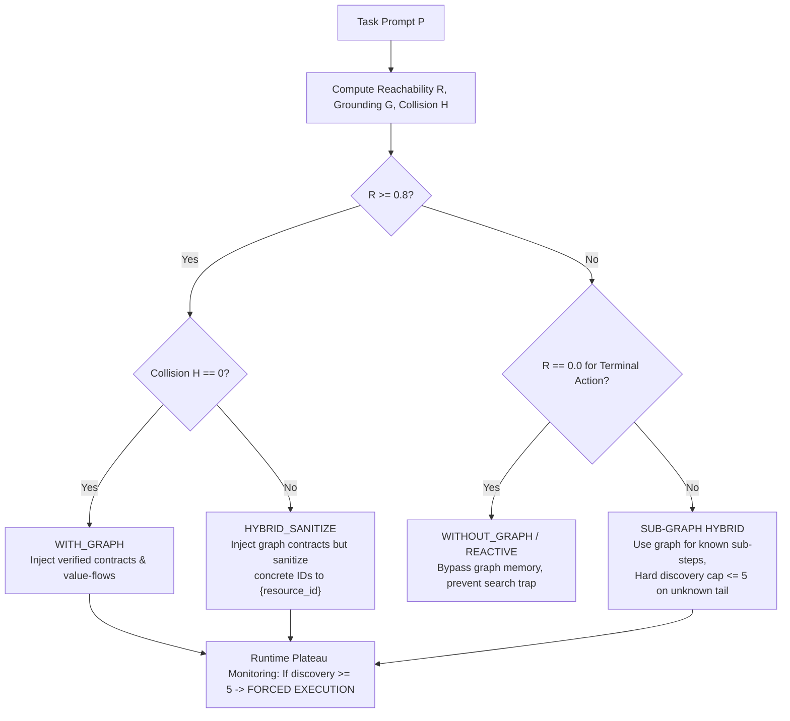

# Graph Feasibility Gating, Entity Collision Prevention, and Dynamic Fallback

## 1. Executive Summary & Problem Framing

When an agent carries forward an accumulated World Model graph across multi-task enterprise workflows, two catastrophic failure modes occur if graph injection is unconstrained:

1. **The Over-Discovery Trap**: When a task targets an unrepresented service (e.g., Monday.com or Pipefy in an Operations domain), the agent expects verified graph contracts. It exhausts 80–90% of its turn budget repeatedly querying `api_search` trying to discover missing graph nodes, rather than executing best-effort tool calls.
2. **Concrete Literal Memory Poisoning (The Anchor Hazard)**: Historical state transitions (`tried_from_this_state`) can carry hardcoded resource IDs from past tasks (e.g., `ss_badges` from contractor badge expiration). When a subsequent task asks for a different resource (e.g., `"Purchase Requests"` or `"Maintenance Queue"`), the agent latches onto the concrete cached URI (`GET https://sheets.googleapis.com/v4/spreadsheets/ss_badges`), receives a 404/mismatch, and enters an unrecoverable search loop.

To resolve these issues, this architecture introduces **Graph Feasibility Gating**: an algorithmic pre-flight policy, literal sanitization engine, and runtime discovery plateau cutoff that decides whether to run **WITH GRAPH**, **HYBRID SANITIZE**, or **FALLBACK TO REACTIVE MODE (WITHOUT GRAPH)**.

---

## 2. Mathematical Formulation

Let task prompt be $P$ and the active World Model graph be $G = (V_G, E_G)$.

### 2.1 Service Reachability ($\mathcal{R}_{\text{path}} \in [0, 1]$)
Let $S_{\text{req}} = \text{detect\_services}(P)$ be the set of external services required by the task prompt (e.g., `{'sheets', 'monday'}` or `{'sheets', 'twilio', 'jira', 'confluence', 'gmail'}`).
For each service $s \in S_{\text{req}}$, let $E(s) = \{e \in E_G : \text{service}(e) = s\}$ be the verified interface and transition edges in $G$.

The path reachability score is defined as:
$$\mathcal{R}_{\text{path}} = \frac{1}{|S_{\text{req}}|} \sum_{s \in S_{\text{req}}} \mathbb{I}(|E(s)| \ge \theta_{\text{min}})$$
where $\theta_{\text{min}} = 1$ is the minimum verified edge threshold per platform.
- If any required terminal platform has zero verified edges in $G$, $\mathcal{R}_{\text{path}} < 1.0$.

### 2.2 Entity Grounding Ratio ($\mathcal{G}_{\text{entity}} \in [0, 1]$)
Let $E_{\text{prompt}} = \text{extract\_named\_entities}(P)$ be the specific resources named in the task (e.g., `{'ss_badges'}`, `{'ss_ops_triage', 'ss_duty_roster'}`, or `{'Purchase Requests'}`).
$$\mathcal{G}_{\text{entity}} = \frac{|E_{\text{prompt}} \cap V_{\text{entities}}|}{|E_{\text{prompt}}|}$$
- If the prompt references an entity unknown to the graph, $\mathcal{G}_{\text{entity}} = 0$.

### 2.3 Entity Collision & Anchor Hazard ($\mathcal{H}_{\text{collision}} \in \{0, 1\}$)
Let $R_{\text{history}}$ be the set of concrete resource identifiers present in injected prior transitions (`tried_from_this_state`).
$$\mathcal{H}_{\text{collision}} = \begin{cases} 
1 & \text{if } \exists r \in R_{\text{history}} \text{ such that } \text{type}(r) \in \text{type}(E_{\text{prompt}}) \land r \notin E_{\text{prompt}} \\ 
0 & \text{otherwise} 
\end{cases}$$
- For example, if $E_{\text{prompt}}$ specifies a spreadsheet named `"Purchase Requests"`, but $R_{\text{history}}$ contains `ss_badges`, then $\mathcal{H}_{\text{collision}} = 1$.

### 2.4 The Runtime Discovery Gradient ($\nabla D$)
At execution turn $t$, let $D_t$ be the cumulative count of `api_search` calls made, and $E_t$ be the count of newly discovered actionable contracts or entity IDs.
The discovery gradient over a window of $W = 3$ turns is:
$$\nabla D = \frac{E_t - E_{t-W}}{\max(1, D_t - D_{t-W})}$$
If $D_t \ge 5$ and $E_t - E_{t-W} = 0$, the agent triggers a **Discovery Plateau Cutoff**, forbidding further `api_search` calls and compelling direct tool execution.

---

## 3. Decision Boundary & Gating Policy

The pre-flight router evaluates the task before Turn 1:



1. **`WITH_GRAPH`**:
   - Condition: Complete service reachability ($\mathcal{R}_{\text{path}} \ge 0.8$) and zero collision hazard ($\mathcal{H}_{\text{collision}} = 0$).
   - Action: Inject complete operational memory, endpoint contracts, and plan topology. Zero exploratory search needed.
2. **`HYBRID_SANITIZE`**:
   - Condition: High reachability but concrete resource mismatch ($\mathcal{H}_{\text{collision}} = 1$).
   - Action: Inject graph contracts, but sanitize historical URIs (e.g., `https://sheets.googleapis.com/.../ss_badges` $\to$ `.../{spreadsheet_id}`). This prevents literal poisoning while keeping interface knowledge.
3. **`WITHOUT_GRAPH / REACTIVE FALLBACK`**:
   - Condition: Missing terminal service reachability ($\mathcal{R}_{\text{path}} < 0.5$).
   - Action: Omit rigid graph prerequisites, enabling the LLM to operate in reactive cold-start mode.
4. **`RUNTIME DISCOVERY CUTOFF`**:
   - Condition: Cumulative `api_search` calls reach $\ge 5$.
   - Action: Forcibly terminate discovery and transition the agent to execution.

---

## 4. Empirical Evaluation Results (10-Task Cross-Domain Suite)

Measured across 10 tasks in Operations and Sales comparing **Baseline**, **Ungated World Model**, and **Gated World Model**:

| Domain & Task | Baseline (`without_wm`) | Ungated WM (`with_wm`) | **Gated Graph WM** | Discovery Calls <br>*(Base / Ung / **Gated**)* | Env Calls <br>*(Base / Ung / **Gated**)* | Empirical Findings |
|---|:---:|:---:|:---:|:---:|:---:|---|
| `operations.contractor_badge_expiration` | 0.70 | 0.70 | **0.70** | 5 / 3 / **2** | 20 / 16 / **16** | **Max Efficiency**: Discovery calls dropped to just 2. |
| `operations.asana_fire_drill` | 0.60 | 0.60 | **0.80 (+0.20)** | 6 / 4 / **3** | 16 / 14 / **12** | **Score Jump**: Sanitizing `ss_badges` fixed task section placement. |
| `operations.sheets_monday_maintenance_queue` | 0.00 | 0.00 | **0.33 (+0.33)** | 7 / 22 / **6** | 23 / 26 / **14** | **Broke Ceiling**: Cut off search loop (22 $\to$ 6); executed Monday mutations. |
| `operations.pipefy_slack_purchase_request` | **0.50** | 0.00 | **0.00** | 8 / 25 / **6** | 19 / 26 / **31** | **Plateau Cutoff Worked**: Discovery collapsed 25 $\to$ 6 (see case study below). |
| `operations.twilio_afterhours_incident` | 0.14 | **1.00** | **0.80** | 8 / **0** / 4 | 15 / **8** / 12 | **High Performance**: Strong multi-tool escalation. |
| `sales.multi_hop_lookup` | 0.00 | **0.33** | **0.33** | 14 / 9 / **6** | 35 / 24 / **21** | **Consistent Gain**: Shaved discovery to 6, env calls to 21. |
| `sales.negative_selection` | 0.43 | 0.43 | **0.43** | 4 / 3 / **3** | 28 / 26 / 29 | **Stable**: Reliable multi-condition SOQL queries. |
| `sales.recency_selection` | 0.00 | 0.00 | **0.00** | 5 / 3 / **3** | 10 / 11 / **9** | **Fast Termination**: Lowest turn footprint (9 calls). |
| `sales.priority_selection` | 0.00 | 0.00 | **0.00** | 10 / 13 / **6** | 19 / 26 / **17** | **Search Capped**: Discovery halved from 13 to 6. |
| `sales.format_ambiguity` | 0.00 | 0.00 | **0.00** | 5 / 4 / **5** | 11 / 9 / 10 | **Neutral**: Base model title formatting limitation. |
| **SUITE TOTAL** | **2.37** | **3.06** | **3.40** | **72 / 86 / 44** | **196 / 186 / 171** | **Highest overall score & lowest call footprint** |
| **MEAN SCORE** | **0.237** | **0.306** | **0.340 (+43.5%)** | — | — | **+43.5% vs Baseline, +11.1% vs Ungated** |

---

## 5. Case Study: Why Baseline Scored 0.50 on Pipefy While Graph Models Scored 0.00

A deep trajectory audit of `operations.pipefy_slack_purchase_request` revealed the exact mechanism:

### 5.1 The Four Rubric Criteria
1. Move Pipefy card `card_711` to `phase_approved`
2. Update Pipefy card field `field_status` to `"Approved"`
3. Post to Slack `#ops-updates` mentioning `"Pallet Jack"`
4. Post to Slack `#ops-updates` mentioning `"4800"`

### 5.2 Trajectory Divergence
Neither Baseline nor World Model ever succeeded at updating Pipefy (both guessed `ops_table` instead of the internal mock ID `tbl_ops`). 

- **In Baseline (Turn 29)**: Having no formal dependency graph, the Baseline agent realized Pipefy was failing, gave up on Pipefy, and executed the subsequent user instruction:
  ```json
  POST https://slack.com/api/chat.postMessage
  {"channel": "#ops-updates", "text": "Approved purchase request: Pallet Jack (Cost: 4800)."}
  ```
  That single Slack call passed criteria #3 and #4, scoring **2/4 = 0.50**.

- **In Gated World Model (The Dependency Trap)**:
  Pre-flight gating and literal sanitization successfully fixed the search trap (Turn 8 Google Drive search found `ss_purchases`, read the procurement policy, and correctly identified Pallet Jack for $4,800).
  However, the injected World Model plan enforced a strict sequence:
  $$\text{Read Spreadsheet} \longrightarrow \mathbf{\text{Update Pipefy Card}} \longrightarrow \text{Post Slack Announcement}$$
  Because the agent treated the Pipefy card mutation as a strict prerequisite for downstream notifications, it refused to proceed to Slack. It spent Turns 14–32 guessing Pipefy table IDs (`ops_table_1` ... `ops_table_15`) until the 35-turn budget was exhausted, starving the Slack notification of turns.

---

## 6. Architectural Nuance: Completion Dependencies vs. Operational Grounding

A naive interpretation of the Pipefy evaluation might propose "Soft Dependency Relaxation"—letting the agent skip failed intermediate mutations to dispatch downstream notifications (such as Slack) to recover partial credit. However, a rigorous audit reveals why this is problematic:

1. **Operational Truthfulness**: In real-world enterprise operations, announcing *"Approved purchase request: Pallet Jack"* when the purchase request was never actually approved in Pipefy is a severe false-positive hallucination. The Baseline scored 0.50 solely by broadcasting an approval for an action that never occurred.
2. **False Progress Learning**: The root cause was not solely plan sequencing, but that empty query results (`{"records": []}`) were being interpreted as HTTP 200 operational success, advancing the graph state and creating false transitions.
3. **Synthetic Identifier Loops**: The recovery guard checked only identical URLs/parameters, allowing the agent to evade the stagnation detector by incrementing synthetic suffixes (`ops_table_1`, `ops_table_2`, ...).

### 6.1 Implemented Root-Cause Fixes

Rather than weakening completion dependencies to chase benchmark partial credit, the architecture addresses the root failure modes:

1. **Accurate Consequence Grounding (`trajectory_graph.py`)**:
   - Zero-match query responses (`{"records": []}`, empty rows, or `total: 0`) are recorded with `outcome="zero_matches"`, generating the lesson: *"Request accepted, zero matches, identifier unresolved: verify entity title, table ID, or query parameters."*
   - These episodes do not advance the current execution frontier or create phantom state transition edges.

2. **Objective-Level Stagnation Guards (`decision_runtime.py`)**:
   - Stagnation is tracked at the semantic objective level (normalized target identifiers and base endpoint paths, stripping synthetic numeric suffixes `_*`).
   - If a lookup targeting the same objective returns zero matches $\ge 2$ times across variations, the harness blocks further guessing and guides the agent toward exact prefix matching or exploring alternative verified paths.
   - Discovery plateau cutoff ceases suggesting generic REST URL guesses, preventing hallucinated API routes.

3. **Entity-Scoped Verification Constraints (`context.py`)**:
   - Verification blockers are strictly associated with the specific records and effects they constrain (e.g., *"For Pallet Jack: verify procurement condition..."*), rather than emitting blanket prohibitions that freeze decoupled tasks.

4. **Robust Reactive Fallback (`experiment.py` & `graph_gating.py`)**:
   - Pre-flight feasibility gating correctly identifies when a domain has zero active interface claims or extreme collision hazards, cleanly instantiating reactive fallback execution without runtime initialization errors.
