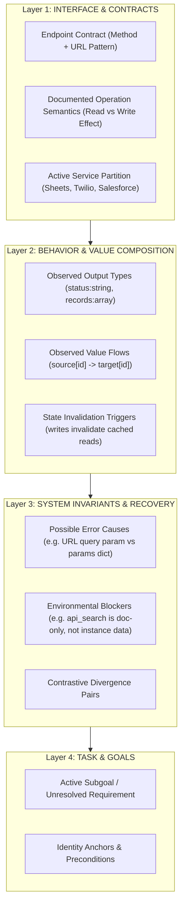
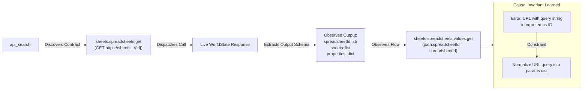

# Architecture & Topology of the Learned World Model (Environment Layer)

A learned **World Model** in this harness is not a generic free-text summary or raw token cache. It is a **grounded, multi-layer typed knowledge graph** that captures the real environment's interfaces, capabilities, output schemas, causal failure modes, and data-flow dependencies.

---

## 1. Topological Graph of the Real Learned Model

The plot below is rendered directly from the SQLite store (`runs/focused-env-audit/store.sqlite`) populated by our runs on `operations.contractor_badge_expiration` and `sales.zoom_meeting_followup`:

### Key Visual Components:
- **Service Hubs (Blue)**: Partition boundaries (e.g. `SHEETS`, `TWILIO`, `SALESFORCE`, `ZOOM`). These enforce strict service scoping and eliminate cross-service lexical leakage.
- **Read Endpoints (Green)**: Verified inspect/read operations (`sheets.spreadsheets.get`, `salesforce.query`, etc.).
- **Write Endpoints (Orange)**: Verified state-mutating actions (`twilio.messages.create`, `salesforce.sobjects.opportunity.update`, etc.).
- **Observed Output Schemas (Gray Nodes, Dashed Green Edges)**: Concrete response structures confirmed against the live environment (`records:array`, `spreadsheetId:string`, `status:string`).
- **Value Flows / Composition Edges (Orange/Red Arrows)**: Causal dependencies where an output parameter from one call binds directly to the input parameter of another (e.g., `spreadsheetId -> path.spreadsheetId`).

---

## 2. The 4-Layer World Model Ontology

The environment layer is structured hierarchically across 4 complementary layers:

---

## 3. Concrete Example: How a Learned Action Loop Operates

When the agent explores and acts in the environment, the World Model records, verifies, and connects claims in a closed feedback loop:

---

## 4. Graph Node & Edge Taxonomy

| Element | Graph Representation | Role in Decision Making | Ground-Truth Check |
|---|---|---|---|
| **Service Hub** | Large Blue Node | Restricts context retrieval strictly to the active task domain | `world.meta.allowed_services` |
| **Endpoint Contract** | Green/Orange Node | Precondition gate for invoking `api_fetch` | AutomationBench URL router handler |
| **Documented Semantics** | Node Effect Attribute | Distinguishes harmless inspection from state mutation | `effect in {"read", "write"}` |
| **Output Type** | Small Gray Node (Dashed) | Informs the planner which keys exist in the response payload | Checked against live response JSON keys |
| **Value Flow Edge** | Directed Orange/Red Arrow | Allows the agent to automatically chain multi-step pipelines | Validates parameter input/output types |
| **Error Cause / Invariant** | Graph Annotation / Gate | Blocks repeated harness errors before execution | Evaluated against precondition check |
