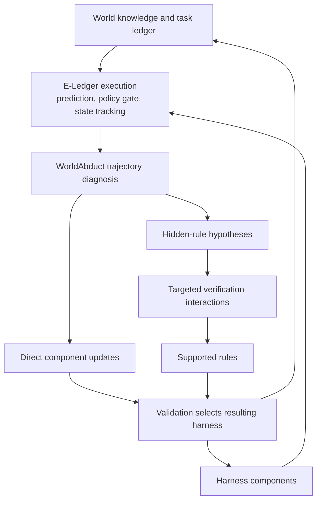
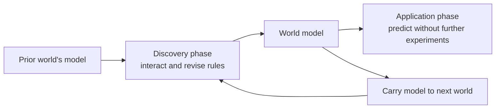

# Literature formulations and positioning

The project studies learned connections among tools, data, inputs, outputs, errors, and recoveries, together with task-time retrieval and harness adaptation. The literature clarifies overlapping problems and candidate mechanisms. It does not prescribe the architecture or establish novelty by omission.

The [problem framing](problem-framing.md), [system design](system-design.md), and [canonical formulation](formulations.md) describe our proposal. This document separates source claims from their implications for that proposal.

The companion [methods, prompts, and code audit](methods-prompts-and-code.md) preserves all 17 papers and the cognitive/neurosymbolic references, locates published prompts and released implementations, and maps candidate mechanisms to our code. Its proposed improvements are hypotheses to test, not demonstrated gains.

## Feedback is a configurable source, not an architectural incompatibility

Our architecture accepts multiple evidence channels. The current trajectory-only runtime is one configuration. Preserve each paper's actual access assumptions when comparing or importing its method; replacing supervised feedback with observations creates an adaptation, not an exact reproduction.

| Method family/example | Published feedback use | Mapping into our design |
| --- | --- | --- |
| Procedural Graphs | Success/failure traces and validation-based graph selection | Trajectory evidence plus selector-visible outcome channel |
| Meta-Harness, AHE, RRSI | Performance-guided search with trace/history evidence; attribution and selection differ by method | Score/diagnostic channels with the paper's proposal-versus-selection access retained |
| StarHarness | Search assertion feedback and traces inform proposals; selection evidence is separately controlled | Diagnostic-assisted proposer plus separately scoped selection feedback |
| HarnessEvolve | Answer-conditioned reference trajectories and verified contrasts | Demonstration-assisted learning, not merely scalar reward |
| Harness2 | Improvement context excludes grading rubrics/scores; experience comes from traces and deliverables | A trajectory-oriented configuration; do not add labels and call it the same method |
| TreeFlex / Harness-G | Training rewards; Harness-G has training-only preview/answerer signals | Role/phase-specific training access, not automatic deployment access or weight-training equivalence |

The [C8–C9 access formulation](formulations.md#evidence-channels-and-access-rules) makes these differences explicit without removing any of the 17 mathematical profiles. Grader feedback can guide evaluation or investigation, but task success is not proof of a world rule. If feedback affects retained knowledge or candidate selection, subsequent influenced performance is feedback-assisted even when the actor never sees the original feedback.

## Mathematical reading guide

Follow the synthesis below for the argument; consult the [paper-by-paper mathematical profiles](#paper-by-paper-mathematical-formulations) for its technical basis. Then read the [standardized framework](formulations.md#part-i-standardized-comparison-framework) and its [layered specialization](formulations.md#part-ii-proposed-layered-specialization). The synthesis explains why the distinctions matter; the profiles preserve the methods rather than replacing them with our interpretation.

**Equation labels.** **Source** means a displayed mathematical definition or equation in the cited PDF, with notation lightly normalized. **Reconstruction** means our mathematical summary of a described algorithm, not an equation attributed to its authors. **Proposal** denotes our own formulation in the companion document. Source locators refer to PDF pages or named method sections. Each profile identifies the reusable object, feedback, update schedule, and limits of the comparison. All 17 local papers remain in scope.

## From existing formulations to our research question

The starting problem is repeated operational discovery. An agent can complete one task yet fail to retain which tool accesses which records, how an output supplies the next input, or how to distinguish a failed write from an unobserved success. Our goal is **better execution across tasks through learned operational relationships**, after paying for learning, retrieval, and maintenance. The literature contributes successive parts of that argument; it does not form a progression in which each newer method subsumes the others.

First, we need to distinguish the world from what an agent observes. [World of Workflows](#p01-world-of-workflows) formalizes hidden state and observation channels. [Enterprise dynamics](#p02-do-enterprise-systems-need-learned-world-models) makes configuration part of transition behavior and compares learned prediction with runtime grounding. Together they motivate retaining scoped knowledge while querying consequential current facts. They do not justify remembering everything or trusting historical rules unconditionally.

Second, reusable knowledge need not be a weight update. [Continual discovery](#p03-continual-enterprise-world-model-discovery) retains and revises explicit rules; [Procedural Graphs](#p05-procedural-graphs) retains execution structure. Their different semantics motivate a distinction between **what an operation does** and **how an agent should use it**. [NeSyC](#2-neurosymbolic-connections) further establishes knowledge revision coupled to symbolic action reasoning. Our question is which operational relations and dependencies help enterprise execution, not whether explicit knowledge can be learned at all.

Third, a separately represented world model is not the only way to improve. [Meta-Harness](#p06-meta-harness) and the [harness-search profiles](#p07-agentic-harness-engineering) show alternative ways to change executable support from task evidence. [Harness2](#p11-harness2) makes experience-driven cross-task reuse particularly relevant. These are competing explanations for improved performance: perhaps a sufficiently capable harness learner captures the useful regularities without our graph. They therefore motivate a direct-adaptation baseline with comparable evidence and budget.

Fourth, the broad coupling is already present. [WorldAbduct](#p04-e-ledger-and-worldabduct) explicitly combines world knowledge, verification, and harness evolution. Our research question must consequently be narrower: **does organizing operational relationships by information lifetime, retrieving and refreshing them selectively, and linking them to dependent execution artifacts improve that coupling?** This is a hypothesis about representation and control, not a claim that world-model-guided adaptation is new.

Finally, different improvements change different objects. [Evo2](#p12-evo2) trains an evolver; [Hyperagents](#p14-hyperagents) changes meta-agent code; [TreeFlex](#p16-treeflex) trains control over episode-local search; [Harness-G](#p17-harness-g) trains retrieval over a corpus graph. [RRSI](#p13-rrsi) emphasizes improvement costs and noisy selection. These distinctions require a common framework with separate knowledge, harness, acting policy, update mechanism, evidence, and protocol—not a single “harness optimization” equation.

The [standardized formulation](formulations.md#part-i-standardized-comparison-framework) follows from these distinctions. Its [seven overlapping mathematical families](formulations.md#families-of-similar-formulations) express shared update structures before the individual method substitutions. The comparisons below visualize the closest mechanisms; the [mathematical profiles](#paper-by-paper-mathematical-formulations) retain every local paper's individual equations and update rules.

## 1. Closest conceptual and methodological references

The figures below show selected information and update paths, not complete implementations. A missing box is not proof that a paper cannot learn implicit environment knowledge. The proposed architecture is pictured in [Figure 1 of the framing](problem-framing.md#1-the-problem).

| Reference | What the work establishes | Relationship to our proposal |
| --- | --- | --- |
| Procedural Graphs | An editable procedural representation, localized guidance during inference, and offline refinement using traces and validation | Main conceptual reference for separating what the environment is like from what the agent should do |
| E-Ledger and WorldAbduct | Persistent world knowledge/state tracking, hidden-rule verification, and harness evolution | Close overlap; world models plus harness evolution are already studied |
| Continual Enterprise World Model Discovery | Interaction-based rule discovery and carryover across changing worlds, followed by model application | Comparison for maintaining environment knowledge; our scope also includes interfaces, mappings, errors, and task-interleaved learning |
| Meta-Harness | Search over harness programs using prior code, scores, and execution traces | Comparison for improving execution without requiring a separately evaluated operational graph |
| NeSyC | Continual formulation and validation of knowledge with LLMs and symbolic tools for embodied tasks | Relevant comparison for the neurosymbolic learning loop; enterprise and retrieval differences need specific evaluation |

### Procedural Graphs

Figure 1 contrasts factual knowledge graphs with graphs of procedures. Section 3 defines attributed procedural transitions, local guidance during inference, and graph refinement between training batches. The method does not implement joint learning of a world graph and a process graph. [Paper](https://arxiv.org/abs/2609.09153), [local PDF](../papers/2609.09153-procedural-graphs.pdf).

*Comparison A. Procedural Graphs learns execution structure.* The graph stays fixed during task inference; guidance responds to the live trajectory. Our proposed addition is an explicit operational-knowledge model with its own evidence, lifetime, and dependency links to procedures.

Our proposed relationship is explicit support between operational claims and procedures: input compatibility supports composition; an evidence path supports a diagnostic branch; a revised contract can invalidate an adapter. Using two graphs is optional. The meaning of their connections is the research issue.

### E-Ledger and WorldAbduct

Sections 3.2–3.3 combine a world ledger, prediction of action effects, policy checking, trajectory diagnosis, targeted hypothesis verification, and direct harness updates. Some updates revise world knowledge; others revise execution components. [Paper](https://arxiv.org/abs/2610.11552), [local PDF](../papers/2610.11552-eledger-worldabduct.pdf).

*Comparison B. WorldAbduct already couples world knowledge and harness evolution.* Our proposed distinction concerns the operational relation types, explicit information layers, task-time retrieval/refresh, and continuing allocation of interactions to learning. The figure does not support claiming that this broad coupling is new.

This rules out a broad claim that neighboring work only optimizes the harness. Our proposed emphasis is operational relationships beyond hidden effects, information lifetimes, selective retrieval/refresh, and the value of reusable execution support across a task stream. Those differences require evidence, not just additional component names.

### Continual discovery and configuration reading

CDA's Section 4 represents the world as inferred rules and separates discovery from application. It carries knowledge across changed environments. Its reported failures to retire rules do not imply that its design forbids retirement; the method explicitly permits adding, refining, and retiring rules. [Paper](https://arxiv.org/abs/2609.19551), [local PDF](../papers/2609.19551-continual-enterprise-wm.pdf).

*Comparison C. CDA separates discovery and application.* Our proposed task loop can retrieve, verify, learn, and execute within the same task, while preserving a distinction between immediate state updates and durable knowledge.

Do Enterprise Systems Need Learned World Models? shows why active configuration matters when transition logic can be read and changes across deployments. It supports combining retained knowledge with runtime discovery, rather than trusting historical transitions unconditionally. [Paper](https://arxiv.org/abs/2605.12178), [local PDF](../papers/2605.12178-enterprise-learned-wm.pdf).

Our implication is to store provenance, scope, and invalidation conditions, and to treat reading configuration as an action. Neither a fresh read nor an old learned rule is universally superior.

### Harness optimization

Meta-Harness Section 3 optimizes the program around a fixed model using a rich history of code, scores, and traces. It is not a scalar-score-only optimizer. [Paper](https://arxiv.org/abs/2603.28052), [local PDF](../papers/2603.28052-meta-harness.pdf).

*Comparison D. Meta-Harness searches the surrounding program.* Our proposed route makes operational claims and their use in retrieval and adaptation explicit and separately testable. Its strongest control is a fixed harness using the same learned world graph.

The comparison to test is therefore:

| Formulation | Primary explicit reusable object | Distinguishing question for our experiments |
| --- | --- | --- |
| Direct harness search | Harness program and candidate history | Does an explicit operational graph improve adaptation over the same execution evidence? |
| Procedural Graphs | Procedural graph | Does separating world claims from procedures improve transfer and repair? |
| CDA | Environment rule model | Does interleaved learning help complete tasks under a shared interaction budget? |
| WorldAbduct | World ledger and evolving harness | Do layered operational relations and selective refresh add measurable value? |
| Our proposed design | Layered operational memory and dependent execution artifacts | Does the full coupling repay retrieval, learning, and maintenance costs? |

AHE, HarnessCompass, HarnessEvolve, StarHarness, Harness2, Evo2, RRSI, Hyperagents, and Mixture of Self-Improving Branches provide a broader comparison set for editable agent programs, evolution, and specialization. Their local PDFs are indexed in the [paper guide](../papers/README.md). We do not assume they are mathematically equivalent or that none can acquire implicit environment knowledge.

The proposed baseline is direct harness adaptation with comparable evidence and budget. The stronger baseline gives a fixed harness access to the same learned graph, isolating the additional benefit of persistent procedural adaptation.

## 2. Neurosymbolic connections

The Neuro-Symbolic Concept Learner combines learned representations and language parsing with symbolic program execution. Its setting is visual concept learning, but it gives a concrete precedent for integrating neural interpretation with structured computation. [Mao et al., 2019](https://arxiv.org/abs/1904.12584).

NeSyC studies continual knowledge formulation and validation with LLMs and symbolic tools in embodied environments. Its knowledge-refinement loop overlaps our interest in updating explicit representations from experience. A detailed method comparison is needed before claiming a new general neurosymbolic learning principle. [NeSyC, 2025](https://arxiv.org/abs/2503.00870).

Our design uses neural components for language interpretation, proposal, and ranking. Typed graph structures, compatibility checks, dependencies, and a conditional-program interpreter participate in execution. Symbolic validity establishes structural consistency, not the truth of a learned claim. Graph-as-text retrieval is a useful ablation, rather than equivalent evidence for this execution design.

### Mathematical connection to the common framework

**NS-CL — reconstruction of the architectural composition, not a quoted training equation:**

$$
v=f_{\theta_v}(\mathrm{image}),\qquad
p\sim p_{\theta_p}(\cdot\mid\mathrm{question}),\qquad
\hat y=\operatorname{Execute}(p,v).
$$

Learned perception and semantic parsing feed program execution. In the common framework, trainable neural components occupy $\vartheta$, the executor occupies $H$, and scene/program state occupies $z$. This is supervised concept/program learning, not evidence of cross-task enterprise-world maintenance. [Source](https://arxiv.org/abs/1904.12584).

**NeSyC — source formulation, Section 2.3, Eq. 3**, with mathematical operators normalized:

$$
\pi^\ast=\arg\max_\pi
\mathbb E_{d\sim\mathcal D}
\left[\sum_t\operatorname{SR}(s_t,\pi(\cdot\mid o_t,i_d))\right].
$$

**Reconstruction of the learning interface:**

$$
K'=\operatorname{Refine}_{\mathrm{LLM+symbolic}}
(K,E^+,E^-),\qquad
a=\operatorname{Plan}_{\mathrm{ASP}}(K',o,i).
$$

Here $K$ stands for actionable rules, not the paper's hypothesis notation. Contrastive validation and memory-based monitoring connect knowledge revision to action errors. This maps to explicit $K$ updates with symbolic execution in $H$ and retained experience in $\mathcal D$. It overlaps our knowledge-learning loop; layered enterprise relations and selective refresh are proposed specializations, not a new general neurosymbolic principle. [Source, Sections 2–3](https://arxiv.org/html/2503.00870v1).

## 3. Cognitive connections and their limits

| Research | Source claim or model | Proposed engineering use |
| --- | --- | --- |
| Complementary learning systems | Distinguishes rapid learning of particular experiences and integration of structured regularities | Separate episode evidence from consolidated reusable claims |
| Working-memory gating | Models task-dependent control of information maintenance and updating | Retrieve and maintain a bounded working graph |
| Predictive cognitive maps | Models state representation through predicted future occupancy | Make relations useful for anticipating actions and observations |
| Arbitration between control systems | Examines tradeoffs between economical and flexible behavioral control | Decide when to reuse a procedure and when to reason again |

Sources: [Kumaran, Hassabis, and McClelland, 2016](https://stanford.edu/~jlmcc/papers/KumaranHassabisMcClelland16FinalMS.pdf); [O'Reilly and Frank, 2006](https://ccnlab.org/papers/OReillyFrank06.pdf); [Stachenfeld, Botvinick, and Gershman, 2017](https://www.nature.com/articles/nn.4650); [Daw, Niv, and Dayan, 2005](https://www.nature.com/articles/nn1560).

These are functional inspirations, not anatomical assignments. A typed enterprise graph is not the successor representation in the predictive-map paper. A reusable conditional procedure can remain model-dependent and goal-directed; it is not automatically a model-free habit. Knowledge volatility is separate from biological learning rate.

Each inspiration should change a mechanism and have an ablation: immediate promotion versus consolidation; flat retrieval versus dependency-aware working graphs; descriptive links versus predictive contracts; and unconditional reuse versus applicability-sensitive reuse.

## 4. Benchmark roles

[ITSMBench](https://www.atomicwork.com/itsm-bench) motivates cross-system investigation, tool discovery, and complete remediation. [AutomationBench](https://github.com/zapier/AutomationBench/blob/main/README.md) and its [paper](https://arxiv.org/abs/2604.18934) motivate API discovery, cross-application composition, business-rule adherence, and verification of final state.

World of Workflows additionally motivates effects that are not fully exposed by immediate tool responses. [Paper](https://arxiv.org/abs/2601.22130), [local PDF](../papers/2601.22130-world-of-workflows.pdf).

Use these as complementary settings. Do not assume all failures arise from hidden cascades, or that task-specific simulated worlds share one tenant. Define carryover, reset, and shift semantics before claiming continual learning. Standard task scores and custom online-learning results should be reported separately.

## 5. Research questions implied by the comparison

We can propose that operational relationships, evidence-aware retrieval, and procedure dependencies form a useful architecture. We can test whether this architecture improves transfer, cost, or recovery relative to direct adaptation and fixed-harness graph use.

We cannot yet claim that the combined idea is unprecedented, that a graph is necessary, that symbolic execution always helps, or that any baseline must fail. A generic harness with good retrieval may capture most of the benefit.

The relevant distinction is an explicit, evaluable pathway from environment evidence to operational claims to improved execution, together with a policy for selecting and refreshing the knowledge needed for each task. The experiments must establish which parts earn their cost.

### What the proposal must establish

The comparison yields five questions used throughout the framing, formulation, and design:

| Question | Reason it follows from the comparison | What would support our proposal |
| --- | --- | --- |
| Q1 Retained operational knowledge | Rules, procedures, episodes, and programs retain different kinds of experience | Qualified operational relations improve held-out execution over episode retrieval |
| Q2 Selective use | Current configuration can matter more than old experience; retrieval itself consumes resources | Dependency-aware selection and refresh reduce decision errors at equal budgets |
| Q3 Useful learning | Discovery and task execution can compete for the same interactions | Deliberate information gathering improves total stream value over incidental learning |
| Q4 Reusable execution support | Fixed-harness knowledge use and direct harness search are credible alternatives | Knowledge-dependent harness changes add value beyond both controls |
| Q5 Adaptation under change | Knowledge and the procedures that use it can become stale together | Scoped revision and dependency propagation improve recovery without excessive maintenance |

These questions justify investigating a layered operational model, not requiring one in advance. A practically negligible adaptation effect can support a fixed harness in the tested regime; a retrieval package's negative result does not establish that every constituent mechanism is useless. Effects can depend on reuse, volatility, horizon, and interactions. The [research questions](research-questions.md) distinguish consolidation from graph organization, define the four-arm representation/adaptation comparison, and separate repair from detection. The [derivation](formulations.md#deriving-our-formulation-from-the-common-interface) turns the questions into mathematical choices, and the [design tests](system-design.md#12-evaluation) summarize their controls.

## Paper-by-paper mathematical formulations

The profiles below are the technical reference for the argument above. P01–P03 establish environment and knowledge-learning formulations; P04–P05 distinguish coupled world learning from procedural memory; P06–P15 preserve the alternatives for harness and update-mechanism improvement; P16–P17 distinguish runtime structure from trained policy. These are analytical groups, not claims that a method belongs exclusively to one family.

### P01 World of Workflows

[Instantiation in the standardized formulation](formulations.md#m01-world-of-workflows).

**Source — task/environment formulation.** [Local PDF](../papers/2601.22130-world-of-workflows.pdf), task formulation.

$$
\mathcal M=(\mathcal U,\mathcal S,\mathcal A,\mathcal T,\mathcal O,\Omega),
\qquad a_t=(\eta,\mathcal P),\qquad
s_t=\bigcup_i\mathcal R_i^{(t)}.
$$

The action consists of a tool and arguments; state spans database relations. Tool responses and audit observations expose different information about transitions. This is a benchmark/environment formulation, not an optimizer of a persistent agent artifact. It motivates distinguishing hidden state, effects, and observation coverage in ours; audit access used for scoring must not silently become agent input.

### P02 Do Enterprise Systems Need Learned World Models

[Instantiation in the standardized formulation](formulations.md#m02-enterprise-learned-world-models).

**Source — contextual dynamics, Eq. 1, p. 4.** [Local PDF](../papers/2605.12178-enterprise-learned-wm.pdf).

$$
s_{t+1}\sim P(s_{t+1}\mid s_t,a_t,c).
$$

Configuration $c$ includes deployed business rules and workflows. The comparison concerns transition prediction under configuration variation: fitting a predictor from transitions versus consulting active configuration at inference.

**Reconstruction — comparison interface.**

$$
\widehat{\Delta s}^{\,\mathrm{learned}}=f_\psi(s,a),
\qquad
\tilde c=\operatorname{Discover}(s,a;\text{live interfaces}),
\qquad
\widehat{\Delta s}^{\,\mathrm{read}}=f_{\mathrm{LLM}}(s,a,\tilde c,\text{history}).
$$

The learned predictor persists through its parameters; discovered configuration grounds a prediction. Prediction accuracy, rather than harness-edit acceptance, is the central feedback. Readable configuration need not reveal every engine-internal behavior. Our formulation therefore allows both fresh reads and learned behavioral claims, with different provenance and expiry.

### P03 Continual Enterprise World Model Discovery

[Instantiation in the standardized formulation](formulations.md#m03-continual-discovery).

**Source — rule representation, Section 4.** [Local PDF](../papers/2609.19551-continual-enterprise-wm.pdf).

$$
M=\{(c_i,e_i)\}_i.
$$

Conditions select applicable effects. Discovery interacts with a world; application uses the resulting model to predict. The benchmark carries the model across worlds that revise, add, and retire rules.

**Reconstruction — phase-separated learning.**

$$
M^{j}=\operatorname{Discover}(E^j,M^{j-1};B_j),
\qquad
\widehat{\Delta s}=\operatorname{Apply}(M^j,s,a).
$$

$B_j$ is the discovery budget. The persistent object is an explicit rule model, updated through interaction evidence. Retirement is permitted: a reported failure to retire a rule is not an architectural prohibition. Our difference to test is task-interleaved retrieval, verification, execution, and learning over richer operational relations—not the invention of continual rule revision.

### P04 E-Ledger and WorldAbduct

[Instantiation in the standardized formulation](formulations.md#m04-e-ledger-and-worldabduct).

**Source — Sections 3.2–3.3, pp. 4–6.** [Local PDF](../papers/2610.11552-eledger-worldabduct.pdf).

$$
J(\tau)=C_U(\tau)\prod_{t=0}^{L-1}P(s_t,a_t),
\qquad
r:(a,s,c)\longrightarrow\Delta s.
$$

$C_U$ measures task completion and $P$ action-policy compliance. Static world knowledge $\mathcal W_S$ is distinct from dynamic task state $\mathcal W_D$:

$$
(a_t,\widehat{\Delta s}_t)
=\mathcal A_\theta(U,P,A,\mathcal W_S,\mathcal W_D^t,h_t),
$$

$$
\mathcal W_D^{t+1}
=\mathcal R_\theta(\mathcal W_D^t,a_t,o_{t+1},\mathcal W_S).
$$

The world-model diagnostics form a tuple, not a scalar reward:

$$
\mathcal J_{\mathrm{WM}}=(\mathcal J_s,\mathcal J_o,\mathcal J_p,\mathcal J_g).
$$

**Reconstruction — two update paths.**

$$
(\Delta H,\mathcal Q)=\operatorname{Diagnose}(\tau,\mathcal J_{\mathrm{WM}}),
\quad
\mathcal W_S'=\operatorname{Revise}(\mathcal W_S,\operatorname{Verify}(\mathcal Q)),
\quad
H'=\operatorname{Select}_{\mathrm{val}}(H,\Delta H,\mathcal W_S').
$$

Hypotheses can trigger verification interactions; execution components can also change directly. Both knowledge and harness persist. This is already world-model-guided harness evolution. Our narrower hypothesis concerns layered operational relations, selective retrieval/refresh, dependency-aware repair, and budgeted learning across tasks.

### P05 Procedural Graphs

[Instantiation in the standardized formulation](formulations.md#m05-procedural-graphs).

**Source — Section 3, Eqs. 1–5.** [Local PDF](../papers/2609.09153-procedural-graphs.pdf).

$$
\mathcal G=(\mathcal V,\mathcal R,\mathcal E,\Phi),
\qquad \mathcal E\subseteq\mathcal V\times\mathcal R\times\mathcal V.
$$

Edges represent procedural transitions; attributes describe conditions, guidance, and pitfalls. At inference:

$$
u_t=\operatorname{Match}(a_{t-1},\mathcal V),\qquad
\mathcal G_t=
\begin{cases}
\mathcal N_h(u_t)&u_t\ne\varnothing,\\
\mathcal G&\text{otherwise},
\end{cases}
$$

$$
g_t=\Psi(\mathcal G_t,q,\mathcal T_{t-w:t}),
\qquad
a_t\sim P_{\mathrm{solver}}(\cdot\mid q,\mathcal T_t,g_t).
$$

Offline refinement proposes $\mathcal G_k^{\mathrm{cand}}=\mathcal G_{k-1}\oplus\Delta\mathcal G_k$ and retains it when

$$
S_{\mathrm{val}}(\mathcal G_k^{\mathrm{cand}})
\ge S_{\mathrm{val}}(\mathcal G_{k-1}),\qquad
S_{\mathrm{val}}(\mathcal G)=
\frac1{|\mathcal D_{\mathrm{val}}|}
\sum_{(q,y)\in\mathcal D_{\mathrm{val}}}
S(f_{\mathrm{solver}}(q\mid\mathcal G),y).
$$

The graph persists but remains fixed during task inference; local guidance changes online. This is not joint learning of factual and procedural graphs. Our operational claims describe the environment, while procedures describe action organization; typed support/invalidation links connect them.

### P06 Meta-Harness

[Instantiation in the standardized formulation](formulations.md#m06-meta-harness).

**Source — Section 3, p. 4.** [Local PDF](../papers/2603.28052-meta-harness.pdf). Here $M$ denotes the frozen language model.

$$
H^\ast=\arg\max_H
\mathbb E_{x\sim\mathcal X,\ \tau\sim p_M(H,x)}[r(\tau,x)].
$$

**Reconstruction — search recurrence.**

$$
H'\sim\operatorname{Propose}(\cdot\mid\mathcal D_n),
\qquad
\mathcal D_{n+1}=\mathcal D_n\cup\{H',\tau',\widehat r'\}.
$$

The persistent search history includes code, traces, and scores, not just scalar feedback. The editable object is a harness program; executor weights remain fixed. An explicit, separately assessed world graph is not required by this objective, but environment knowledge may be encoded in programs or history. This is the direct-harness-search comparison, not proof that all other harness papers optimize exactly the same quantity.

### P07 Agentic Harness Engineering

[Instantiation in the standardized formulation](formulations.md#m07-agentic-harness-engineering).

**Reconstruction — Section 3 and Algorithm 1, pp. 3–5.** [Local PDF](../papers/2604.25850-ahe.pdf).

$$
T_n=\operatorname{Rollout}(M,H_{n-1},D),\qquad
V_n=\operatorname{Attribute}(C_{n-1},T_{n-1},T_n),
$$

$$
\widetilde H_{n-1}=\operatorname{Rollback}(H_{n-1},V_n),
\qquad
R_n=\operatorname{Debug}(\operatorname{Clean}(T_n)),
$$

$$
(H_n,C_n)=\operatorname{Evolve}(\widetilde H_{n-1},R_n,V_n).
$$

At the first round there is no previous change manifest to attribute. $C_n$ records changes and expected consequences; subsequent traces support attribution and rollback. Seven editable component types include prompts, tool descriptions/implementations, middleware, skills, subagents, and long-term memory. Frozen-model task rollouts supply feedback. The distinctive mechanism is trace-based debugging with delayed attribution, not a new universal scalar objective. Our dependency links could make attribution more localized; that benefit needs measurement.

### P08 HarnessCompass

[Instantiation in the standardized formulation](formulations.md#m08-harnesscompass).

**Reconstruction — preliminaries and Algorithm 1, pp. 3–4.** [Local PDF](../papers/2608.01918-harnesscompass.pdf).

$$
E_n=\operatorname{Distill}(T_n),\qquad
F_n=\operatorname{GroundSelfFeedback}(M,T_n),
$$

$$
H_c=\operatorname{GatedEvolve}(H^\ast,E_n,F_n,c),
\quad c\in\{\mathrm{structure},\mathrm{guidance}\},
$$

$$
w=\arg\max_c\operatorname{Pass@1}(T_c),
\qquad
H_n=R^3(H_w,H_{\mathrm{other}}).
$$

The generalization gate checks reusable changes and their placement. The algorithm updates the incumbent when the winning track beats the baseline; this is not equivalent to separately measuring the merged artifact before acceptance. Persistent state includes harness components and evolution evidence; the executor stays frozen. Structural versus guidance edits are an editing partition, not our six information layers.

### P09 HarnessEvolve

[Instantiation in the standardized formulation](formulations.md#m09-harnessevolve).

**Reconstruction — Sections 3.1–3.5, pp. 4–6.** [Local PDF](../papers/2609.00829-harnessevolve.pdf).

$$
F_i=\operatorname{Diagnose}(q_i,\tau_i^-,\tau_i^+),
\qquad
H'=\operatorname{Edit}(H,\operatorname{Cluster}(\{F_i\})).
$$

References $\tau_i^+$ are generated with training answers and verified for genuine execution; absent a valid reference, diagnosis uses the failure alone. The acceptance rule is:

$$
\operatorname{Accept}(H')=
\operatorname{Quality}(H')\land
[\widehat S_{B_j}(H')>\widehat S_{B_j}(H)]
\land
\operatorname{NoRegression}(H',H;B_{\mathrm{recent}}).
$$

Accepted snapshots enter a pool; validation selects the epoch's harness. The quality gate checks leakage and bloat. Persistent objects are the harness, verified-reference cache, and snapshot pool. This training-time answer access differs materially from unlabeled online learning; comparisons must match evidence or report that advantage.

### P10 StarHarness

[Instantiation in the standardized formulation](formulations.md#m10-starharness).

**Reconstruction — Algorithm 1, p. 4.** [Local PDF](../papers/2608.24804-starharness.pdf).

$$
\Delta H_n=\operatorname{Propose}(H_n,T_n,L_n),\qquad H'=H_n\oplus\Delta H_n,
$$

$$
\operatorname{Accept}(H')=
\operatorname{ScopeLeakageSmoke}(H')
\land\operatorname{FlipTest}(H')
\land
\big[(S_{\mathrm{select}}(H'),v(H'))>_{\mathrm{lex}}
(S_{\mathrm{select}}(H_n),v(H_n))\big].
$$

The verifier tie-break applies when available; without it a score tie does not satisfy that branch. Search traces, hidden selection feedback, and a ledger guide reusable environment adaptation. Holdout evaluation is separate from acceptance. The method searches programs; it can acquire environment knowledge, so “harness-only” cannot mean “no environment learning.” Ours makes the operational representation and its update quality explicit.

### P11 Harness2

[Instantiation in the standardized formulation](formulations.md#m11-harness2).

**Source — §2.1–2.3, Eqs. 1–4, pp. 3–7; App. D & H, pp. 20–22, 30–37.** [Local PDF](../papers/2610.14224-harness2.pdf), [arXiv:2610.14224](https://arxiv.org/pdf/2610.14224), [GitHub repository](https://github.com/google-research/harness2).

A frozen base model $\mathcal M$ composes with an editable execution harness $H = (c^1, \dots, c^K)$ ($K=8$: `systemprompt.md`, `guardrails.md`, `LongTermMEMORY.md`, `tool_guidance.md`, `sub_agents/<n>/AGENT.md`, `skills/<n>/SKILL.md`, `scripts/<n>.py`, and `plugin/<n>.ts` or `.codex/hooks.json`) to form an agent $\mathcal A(\cdot;\mathcal M,H)$, producing execution records $e = (\tau, y)$ with trajectory $\tau$ and deliverable $y$.

1. **Contrastive Improvement Step (Eq. 1):** Given task $q_t$, current execution harness $H$, task-local execution/improvement history $\mathcal E$, and fixed cross-task improvement harness $R_t$:

$$
(H',e',\xi)=\Phi(q_t,H,\mathcal E;R_t),
$$

where **Propose** samples a reference rollout $e^0 \sim \mathcal A(q_t;\mathcal M,H)$ and drafts two scoped candidate trees—an *invariant* candidate $H^{\mathrm{inv}}$ (how the agent works: tool errors, mechanical repetition scripts, triggered skills, loop hooks) and a *domain* candidate $H^{\mathrm{dom}}$ (what a practitioner knows: domain rules, reconciliation, artifact contracts); **Probe** executes each candidate on $q_t$ under matched container conditions ($e^{\mathrm{inv}}, e^{\mathrm{dom}}$); and **Compose** selectively merges, revises, adopts, or preserves (`KEEP_BASE`) edits backed by specific behavioral contrasts in $(\tau, y)$ before rolling out $e' \sim \mathcal A(q_t;\mathcal M,H')$.

2. **Parallel and Sequential Task-Level Recursion (Eqs. 2–3):** With exploration budget $k \ge 1$, parallel recursion collects $k$ reference executions $\mathcal B$ and $2k$ probed candidates $\mathcal P$ ($k$ `INV`, $k$ `DOM`), running $k$ independent composition sessions:

$$
H'_j = \operatorname{Compose}_j(q_t, H, \mathcal B, \mathcal P; R_t), \qquad j = 1, \dots, k,
$$

whereas sequential recursion chains $k$ contrastive updates over accumulating task-local history $\mathcal E^{(r-1)}$:

$$
(H^{(r)},e^{(r)},\xi^{(r)})
=\Phi(q_t,H^{(r-1)},\mathcal E^{(r-1)};R_t),
\qquad H^{(0)}=H_0, \quad r = 1, \dots, k.
$$

For $k > 1$, a blind selector chooses one anonymized deliverable against $(q_t, \text{source})$ without harness labels or grading rubrics, designating the adopted harness $H_t^\star$ (adoption, not verified optimality).

3. **Harnessing-Level Recursion (Eq. 4):** After task $t$ completes, an Experience Reflector diffs all candidate trees against $H_0$, assigns each component edit an attribution verdict $v \in \{\text{helped}, \text{hurt}, \text{no observed effect}, \text{confounded}\}$ (requiring `confounded` whenever multiple components changed without isolation), and updates the improvement library $R_t$ with the full adopted tree $H_t^\star$ plus at most one transferable `(cue, lesson, evidence, confidence)` entry (`NO_ENTRY` if only confounded):

$$
R_{t+1}=\operatorname{Update}(R_t,H_t^\star,\mathcal D_t).
$$

Every subsequent task $t+1$ resets its execution harness to $H_0$ and selectively copies/adapts components from $R_{t+1}$ while re-verifying task-specific workspace facts against current evidence.

### P12 Evo2

[Instantiation in the standardized formulation](formulations.md#m12-evo2).

**Source — Eqs. 1–2, pp. 5–6.** [Local PDF](../papers/2610.13025-evo2.pdf).

$$
e_0\sim\pi_\theta(\cdot\mid P_A,h_p,z_p),\qquad h_0=\operatorname{Apply}(h_p,e_0),
$$

$$
(m,d,j)\sim\pi_\theta(\cdot\mid R,h_p,h_0,z_0,\mathcal S),
\qquad
e_1\sim\pi_\theta(\cdot\mid P_B,h_0,d),\quad h_1=\operatorname{Apply}(h_0,e_1).
$$

Without the second edit, $h_1=h_0$. A shared evolver plays proposer and reflector roles; the executor remains fixed.

$$
r_P^{\mathrm{exec}}=\widehat V(h')-\widehat V(h),
\qquad
r_R^{\mathrm{exec}}=\widehat V(h_1)-\widehat V(h_0).
$$

These are execution-gain terms, not the complete shaped training rewards: invalid edits, adherence, and mechanism evidence also matter. SFT and interleaved GRPO train evolver weights; harness candidates and strategies are retained. Standardization must include optimizer parameters, not merely an editable $H$.

### P13 RRSI

[Instantiation in the standardized formulation](formulations.md#m13-rrsi).

**Source — Eqs. 1–7, pp. 3–6.** [Local PDF](../papers/2609.24972-rrsi.pdf).

$$
S(H;D)=\mathbb E_{x,\tau}[r(x,\tau)],
\qquad C(H;D)=\mathbb E_{x,\tau}[c(\tau)].
$$

The paper first describes unregularized candidate selection; its own regularization adds a ceiling on editable components:

$$
b_t=\left\lceil b_{\min}+(b_{\max}-b_{\min})
\frac{1+\cos(\pi t/T)}2\right\rceil,
\qquad
\widehat S(H')\ge S^\star-\delta.
$$

For gains beyond the empirical noise band,

$$
\Delta S=\widehat S(H')-\widehat S(H_t)>\delta,
\qquad
\Delta C=\frac{\widehat C(H')-\widehat C(H_t)}{\widehat C(H_t)}
\le\beta_0+\beta_1\Delta S.
$$

Scores/costs use repeated stochastic rollouts. Leakage checks, proposal history, reserved exploration, and pruning further constrain search. The within-noise-band case has its own rule; these equations are not the complete acceptance algorithm. The persistent object is a regularized harness plus search history. These gates motivate accounting for our graph and maintenance costs, but are not mandatory components of our proposal.

### P14 Hyperagents

[Instantiation in the standardized formulation](formulations.md#m14-hyperagents).

**Reconstruction — method, Section 3.** [Local PDF](../papers/2603.19461-hyperagents.pdf).

$$
h=(H,\Psi),\qquad
h_p\sim\operatorname{Parent}(\mathcal A_n),
\qquad
h'=\operatorname{Modify}_{\Psi_p}(h_p,\text{feedback}),
$$

$$
\mathcal A_{n+1}=\operatorname{ArchiveUpdate}
(\mathcal A_n,h',\operatorname{Evaluate}(h')).
$$

The executable program contains both task-agent and meta-agent logic; modification can change both. Parent selection and the retained archive support branching search rather than mandatory replacement by each child. Feedback is downstream empirical task performance. The reusable archive is a program population; our environment graph is a different representational commitment. A standardized formulation must permit the update operator itself to change.

### P15 Mixture of Self-Improving Branches

[Instantiation in the standardized formulation](formulations.md#m15-mixture-of-self-improving-branches).

**Source — Section 3, Eqs. 1–2, p. 4.** [Local PDF](../papers/2609.37834-mixture-branches.pdf).

$$
J_b^t(H)=\frac1{|\mathcal X_b^t|}
\sum_{x\in\mathcal X_b^t}\mathbb E[r(f_M(H,x),x)],
\qquad
c_b^t(x)=\sum_{H\in\mathcal F_b^t}\mathbf1[H\text{ solves }x].
$$

**Reconstruction of the stated ownership test:**

$$
c_b^t(x)-\max_{b'\ne b}c_{b'}^t(x)\ge\Delta.
$$

Cases solved by all frontier harnesses in all branches are removed everywhere. Otherwise an ownership margin removes a case from other branches; branch guidance also evolves from history. Deployment routes an input to a branch head. Persistent objects include branch harnesses, guidance, and task subsets; the base executor is fixed. Task specialization is not identical to retrieving an environment-specific knowledge slice.

### P16 TreeFlex

[Instantiation in the standardized formulation](formulations.md#m16-treeflex).

**Source — Section 2 and Eqs. 2–3, pp. 3–6.** [Local PDF](../papers/2610.20334-treeflex.pdf).

$$
v=(p_v,I_v,s_v,m_v,e_v),\qquad
\widehat A_{i,b,t}
=\frac{\operatorname{clip}(R_i+Q_{i,b,t},0,1)-\bar R_x}{s_x}.
$$

Nodes retain parent, instruction, summary, context, and environment snapshot. Reflection chooses where to navigate; the harness restores state. $s_x$ is replaced by one for a zero-variance reward group. The source's weighted clipped objective is

$$
J(\theta)=\mathbb E\left[
\sum_{u\in\mathcal U}w_u
\min\left(\rho_u(\theta)\widehat A_u,
\operatorname{clip}(\rho_u(\theta),1-\epsilon_{\mathrm{low}},1+\epsilon_{\mathrm{high}})
\widehat A_u\right)\right].
$$

The implementation also uses dual clipping for negative advantages. Generated tokens are trained under their actual causal contexts; copied/restored context is masked. The search tree is episode-local, while trained policy weights persist. This is not cross-task graph learning, but demonstrates why runtime structure and learned controller parameters must be distinct axes.

### P17 Harness-G

[Instantiation in the standardized formulation](formulations.md#m17-harness-g).

**Source — online navigation and SNC, Eqs. 4–7.** [Local PDF](../papers/2607.27652-harness-g.pdf).

$$
z_t=(q,C_t,U_t,V_t,H_t),\qquad
a_t\sim\pi_\theta(\cdot\mid o_t,M_t),\qquad a_t\in M_t.
$$

Here $H_t$ is navigation history, not our harness. The offline corpus graph supports a finite Select/Lookup/Answer menu. With frozen answerer score $g$:

$$
p_t(a)=g(O_t\cup\widetilde U(a))-g(O_t),\qquad
r_t^{\mathrm{fr}}=p_t(a_t)-\frac1{|\mathcal F_t|}\sum_{a\in\mathcal F_t}p_t(a),
$$

$$
R_u=p_u(a_u)+\gamma r_u^{\mathrm{en}},\qquad
r_t^{\mathrm{en}}=\sum_{u:(t,u)\in\mathcal D_\tau}
\frac{R_u}{|\operatorname{Pred}(u)|},\qquad
r_t^{\mathrm{SNC}}=r_t^{\mathrm{fr}}+r_t^{\mathrm{en}}.
$$

Outcome and normalized step-credit advantages combine for policy training:

$$
\widehat A_{i,k}=\widehat A_i^{\mathrm{out}}
+\lambda\widehat A_{i,k}^{\mathrm{SNC}}.
$$

Non-information actions and empty frontiers receive zero frontier-relative credit. Gold-answer scoring belongs to training, not unrestricted test-time evidence. The persistent graph is corpus-derived, and navigation weights are trained; it is not an online operational belief graph. Provenance-sensitive retrieval credit is the relevant connection.
