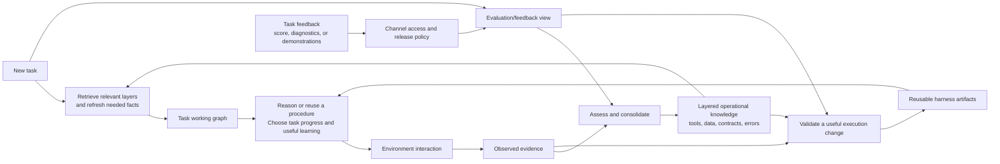

# Learning operational world graphs to improve agent execution

Status: working research framing. The goal is improved task-stream execution through learned operational relationships; the graph-centered architecture is the proposal to evaluate.

The mathematical argument proceeds from [individual paper formulations](literature-and-formulation.md#paper-by-paper-mathematical-formulations), through a [standardized comparison framework](formulations.md#part-i-standardized-comparison-framework), to [our layered specialization](formulations.md#part-ii-proposed-layered-specialization). The framing below states the proposed problem, not an established novelty claim over those methods.

## 1. The problem

An agent entering an enterprise environment encounters many tools, tables, fields, identifiers, policies, and application boundaries. Useful connections are distributed across API documentation, configuration, tool responses, errors, and previous interactions. The agent repeatedly has to discover which tool accesses which data, how one response supplies another operation, why a call failed, and how to establish that a workflow is complete.

We propose that it accumulate this understanding as an operational world graph and use it to improve future execution. This is a **multi-source learning architecture**: documentation, trajectories, permitted probes, and task-evaluation feedback can all supply evidence under a declared access policy. Trajectory-only learning is one experimental configuration, not the architecture's definition. This graph includes observable interfaces and relationships as well as uncertain behavior; hidden business rules are one part of the model.

> How should an agent learn and maintain the operational connections among tools, data, inputs, outputs, errors, and recoveries; retrieve the relevant and sufficiently fresh knowledge for each task; and use that knowledge to improve its execution harness?

The problem has four coupled decisions: what to retain, what to retrieve or refresh, which interaction to perform, and when to turn knowledge into reusable execution support.

The central hypothesis is that **qualified operational knowledge can reduce repeated discovery and support reusable execution improvements, provided the savings exceed learning and maintenance costs**. This is the same goal used in the [canonical objective](formulations.md#8-overall-objective). More graph nodes, more layers, or more harness edits are not success criteria.

Consider an illustrative workflow that creates a record and receives a timeout. The response does not tell the agent whether creation failed. To act well, it needs to connect the create operation, identity fields, a query that can establish the outcome, and the conditions under which retrying is safe. A later task may reuse that relationship but must bind new identifiers and check current state. Repeated successful use may justify a reusable verification/retry procedure; an API change may invalidate it. This one case motivates retained knowledge, selective refresh, useful exploration, harness adaptation, and dependency-aware repair.

### Why the literature leads to this question

Existing work already supplies several parts of this loop: partially observed enterprise dynamics, explicit rule discovery, procedural memory, direct harness search, and coupled world-model/harness evolution. The remaining question is not whether agents can learn or adapt, but whether making operational relations, lifetimes, and dependencies explicit improves the value of that adaptation. The [literature synthesis](literature-and-formulation.md#from-existing-formulations-to-our-research-question) establishes that argument; the common formulation separates the competing explanations before specializing our design.

*Figure 1. The proposed coupling.* Knowledge informs both the current decision and future execution support. Actual observations update knowledge through evidence assessment. Harness changes are selective; neither every interaction nor every graph update requires one. The [comparison figures](literature-and-formulation.md#1-closest-conceptual-and-methodological-references) show how neighboring formulations organize these pathways.

## 2. What the world model represents

| Connection | Example of useful knowledge |
| --- | --- |
| Tool to data | An endpoint reads user records and another modifies application assignments. |
| Output to input | A lookup returns the identifier required by a later operation. |
| Transformation | A value requires normalization or a cross-system lookup before reuse. |
| Identity | Two scoped records refer to the same employee or customer. |
| Preconditions and effects | An operation requires an approval and changes a related record. |
| Error to explanation | A failure signature is consistent with several causes. |
| Explanation to evidence | A particular query distinguishes those causes. |
| Recovery to context | A remedy succeeded under specified conditions and failed under others. |
| Verification to outcome | A read can establish whether an uncertain write took effect. |
| Alternative or compensation | Another operation reaches the goal, or reverses part of a change. |

These are qualified claims. They carry scope, provenance, applicability, uncertainty, and validity conditions. Seeing two events together does not establish causation. Matching types does not establish that two identifiers have the same meaning.

The input/output, error, recovery, effect, and execution models operate over shared objects and evidence. They need not be independent graphs. The world model is predictive when these relations help anticipate usable outputs, failure conditions, action consequences, and informative observations. It need not simulate every database transition.

## 3. Knowledge and procedure have different meanings

A world claim might say that an operation can time out after creating a record and that a certain query can resolve the outcome. A procedure decides to execute the operation, query after an ambiguous response, and retry only when justified.

A successful recovery is first an episode. A recovery model generalizes its applicability from evidence. A reusable procedure chooses when to apply it and what to check. Keeping these roles distinguishable prevents one workaround from becoming a universal rule.

The procedure depends on the goal, available tools, permissions, cost, and current state as well as the world model. Accurate world knowledge does not uniquely determine a procedure.

[Procedural Graphs](https://arxiv.org/abs/2609.09153) is a useful conceptual reference because it contrasts factual knowledge with procedural structure. Its implemented method evolves a procedural graph; it does not jointly learn an environment graph and a process graph. Our proposal studies operational knowledge and its explicit connections to procedure construction and revision.

## 4. Information lifetime and task relevance

The agent should distinguish interface knowledge, tenant configuration, learned behavior, reusable procedures, live task state, and historical evidence. These are logical layers with different update and retrieval policies.

There are three complementary axes. **Information layers** organize what is retained and how it remains valid. **Evidence channels** identify where it came from and who may use it when. **Functional models and learning mechanisms**—input/output prediction, effect modeling, diagnosis, recovery, execution, exploration, consolidation and adaptation—operate across those layers. Diagnosis may combine a contract, current observations, historical failures and permitted grader diagnostics; its output is a hypothesis, not an automatic permanent rule.

The **evaluation/feedback graph** connects task requirements, attempted trajectories, evaluator versions, feedback records, candidate explanations and procedure versions. It is a connected view over existing evidence, live state and artifacts, not a replacement for the six layers or a seventh fixed lifetime. A failed association check can identify an unmet requirement and motivate investigation; it does not by itself prove which tool, permission or business rule caused the failure.

Compare trajectory-only, score-assisted, diagnostic-feedback-assisted and demonstration-assisted configurations explicitly. Feedback received only by a learner or artifact selector still makes subsequent influenced performance **feedback-assisted**. Repeating the same 50 tasks for learning and scoring is our initial in-sample protocol; it is not independent evaluation, regardless of whether the actor sees the grader directly.

Connections between layers are explicit: evidence supports or contradicts claims; configuration specializes contracts; live values bind abstract inputs; procedures depend on claims and require fresh facts; execution produces new evidence. A changed claim can therefore identify the procedures and task bindings that require reconsideration. The [layer connection map](system-design.md#41-connections-between-information-layers) and [model readwrite map](system-design.md#51-which-layers-each-model-reads-and-updates) specify these relationships; the [layer-wise formulation](formulations.md#21-explicit-layer-decomposition) defines them mathematically.

Durability does not imply relevance. Freshness does not imply correctness. An old schema can remain valid; a newly read approval can become stale after a write. A historical episode remains evidence about the past even when its generalization is no longer applicable.

For a new task, construct a small working graph containing relevant operations, relationships, procedures, current bindings, uncertain hypotheses, and verification needs. Retrieve dependencies and refresh facts whose uncertainty or staleness could change the next decision. Expand when evidence exposes a missing connection.

What persists must be scoped: an application contract, a tenant relationship, and an episode-specific record are different kinds of knowledge. A test task must not inherit another task's live state by accident.

## 5. Exploration and exploitation

An ordinary task action can also teach the agent. An exploratory action targets a named uncertainty: an unknown input mapping, an unexplained error, an untested argument region, or a disputed dependency.

The agent should prefer useful learning: observations that change a current decision or improve anticipated future tasks. Broad graph coverage is not an objective by itself. Reads, documentation inspection, and permitted experiments are all possible information sources and have costs.

Every interaction is eligible to inform the model, but not every interaction justifies a graph revision. An omitted effect is not an observed absence; a timeout is not proof of failure. Evidence collection and observation coverage are part of the learning problem.

## 6. Why adapt the harness

A fixed harness may already retrieve and use the graph effectively. The reason to adapt it is to reduce repeated reasoning, binding errors, unnecessary discovery, or missed checks through reusable execution support.

The initial adaptation surfaces are input adapters, retrieval recipes, conditional procedures, and verification/recovery checks. Updating graph content or inserting it into one prompt is not itself a persistent harness change.

The testable hypothesis is that adaptation becomes more valuable as supported knowledge is reused and expensive reasoning can be avoided. Changing environments can reduce that benefit through revalidation and maintenance costs.

The coupling is bidirectional. The graph informs procedure choice and revision; procedures determine which evidence is gathered. Uncertainty itself may justify adding a check. We therefore do not require every edit to be a compilation of a verified rule.

## 7. Use cases

The following are illustrative designs, not claims about exact benchmark task implementations.

| | ITSMBench use case | AutomationBench use case |
| --- | --- | --- |
| Task | Investigate an application-access incident | Coordinate lead processing across applications |
| Relevant knowledge | Identity correspondences, system dependencies, diagnostic evidence paths | Endpoint contracts, transformations, prerequisites, outcome checks |
| Fresh state | Current account, assignment, and device evidence | Current contact, ownership, availability, and operation outcomes |
| Useful learning | Which queries distinguish causes and when a remediation applies | Which outputs compose, how failures behave, and how to verify uncertain writes |
| Harness improvement | A conditional diagnostic/remediation branch | An adapter or conditional workflow/recovery fragment |

ITSMBench describes cross-system investigation and remediation. AutomationBench describes API discovery and cross-application workflow execution with final-state grading. Their standard task setups do not establish a persistent shared tenant; an online-learning or controlled-shift protocol must define that explicitly. [ITSMBench](https://www.atomicwork.com/itsm-bench), [AutomationBench](https://github.com/zapier/AutomationBench/blob/main/README.md).

## 8. Contribution to investigate

The proposed contribution is the coupling of evidence-backed operational relationships, selective retrieval and refresh, informative interaction, and persistent execution improvements. A graph or memory store alone does not establish this contribution.

The same five questions guide the literature synthesis, mathematical derivation, and experiments:

1. **Q1 Retained operational knowledge:** do qualified relationships improve transfer beyond retrieving past episodes?
2. **Q2 Selective use:** do dependency-aware retrieval and refresh improve decisions under a fixed context and interaction budget?
3. **Q3 Useful learning:** does deliberate exploration repay its cost beyond incidental learning?
4. **Q4 Reusable execution support:** does adapting the harness add value beyond a fixed harness with the same graph and direct adaptation with comparable evidence?
5. **Q5 Adaptation under change:** do revised claims trigger useful repair of dependent procedures without excessive maintenance?

Q1 motivates the operational representation. Q2 motivates its layers and working graph. Q3 governs which interactions acquire evidence. Q4 governs when knowledge changes reusable execution support. Q5 closes the loop when the environment changes. Their value is measured by the same task-stream objective, not five independent optimization targets. The [research questions](research-questions.md) separate hypotheses from implementation requirements, define matched claim-memory and factorial adaptation controls, and state the limits of interpreting negative results.

Compare matched budgets and observation access. Measure task performance and cost alongside prediction, binding, recovery, stale-state errors, and dependency retrieval. Treat negative results as evidence about where the architecture is unnecessary or ineffective.

## 9. Position and design commitments

WorldAbduct already combines world knowledge and harness evolution, while NeSyC studies continual knowledge formulation and validation with neural and symbolic components. The broad combination is not our novelty claim. [Literature positioning](literature-and-formulation.md) explains the comparisons.

Our initial neurosymbolic design lets neural components interpret observations and propose hypotheses, while explicit structures support checked composition and procedure execution. Cognitive work motivates separate episode/consolidation processes, selective working memory, and conditional procedure reuse. These are engineering hypotheses to test, not claims of biological equivalence.

Keep fixed base weights initially to isolate external learning. Keep the procedure interpreter and permission enforcement fixed while bounded harness components adapt. Specific graph storage, uncertainty estimators, consolidation thresholds, and adaptation schedules remain implementation choices.

Continue with the [system design](system-design.md) for components and the [mathematical formulation](formulations.md) for canonical definitions.
