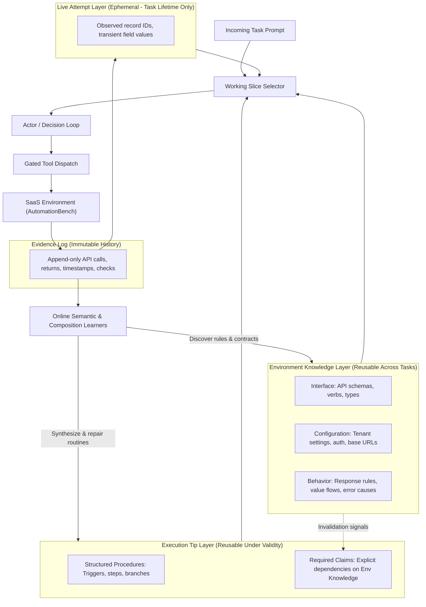

# SaaS Systems, Operational World Models, and Execution Architecture

Status: architectural reference and design rationale. This document formalizes the operational principles that distinguish SaaS agents from open-ended coding agents, and details how the components in `worldmodel-generation-harness` implement them.

---

## 1. Executive Summary and Five Core Propositions

Enterprise SaaS automation poses fundamentally different challenges from open-ended software engineering and code-generation tasks. Autonomous operation across enterprise tools (CRMs, ticketing systems, ERPs, messaging platforms) is governed by five structural principles:

1. **SaaS systems are bounded and structured:** Unlike Turing-complete coding sandboxes, SaaS systems operate through explicit API schemas, typed entities, relational integrity constraints, and role-based permissions.
2. **Consistency across tasks and users is paramount:** Non-deterministic execution that succeeds for one user and fails for another destroys trust. Multi-tenancy requires strict scoping, reproducible behavior, and objective verification.
3. **Repeated tasks must become amortized and easier:** The first execution of a workflow incurs exploration and discovery overhead. Subsequent similar requests should execute with fewer turns, fewer tokens, lower latency, and higher reliability.
4. **The agent must learn the environment continuously from execution traces:** Offline prompts or manual API mappings are insufficient for evolving, custom SaaS deployments. The system must extract contracts, value flows, and error recoveries directly from task traces.
5. **Execution must be strictly separated from environment knowledge and live state:** Conflating *how to achieve a goal* (procedure), *how the environment works* (world model), and *what is currently true* (ephemeral task state) causes prompt bloat, hallucinated constants, and fragile workflows.

The `worldmodel-generation-harness` repository was built as an experimental platform to validate this architecture.



---

## 2. Deep Dive: The Five Principles & Repository Implementation

### Proposition 1: Bounded & Structured Nature of SaaS Systems

#### Conceptual Foundation
Coding agents (e.g., SWE-bench, OpenCodeInterpreter, Meta-Harness) operate in unconstrained environments: arbitrary bash commands, arbitrary Python/C++ scripts, file modifications, and unbounded state spaces. In contrast, SaaS environments (e.g., Salesforce, HubSpot, Jira, Slack, Workday) are strictly bounded:
- **Defined Interfaces:** Endpoints accept specific JSON/form payloads and return typed HTTP status codes and responses.
- **Relational Integrity:** Entities have foreign key relationships, immutable primary keys, and strict data-type constraints (emails, phone numbers, timestamps).
- **Access Governance:** Actions are gated by OAuth scopes, RBAC roles, and rate limits.
- **Safety:** Unchecked code generation (`eval()`, dynamic scripts) poses catastrophic compliance and security risks in enterprise environments.

#### Implementation in `worldmodel-generation-harness`
* **Target Benchmark:** The repository targets [AutomationBench](file:///Users/masoud/Documents/Repos/worldmodel-generation-harness/src/worldmodel_harness/automationbench.py), which reproduces realistic multi-domain SaaS environments (CRM, ticketing, project management, email, Zapier tools) with real API constraints.
* **Bounded Data-Only Execution Artifacts (No `eval` or Python Scripts):**
  In [`src/worldmodel_harness/procedures.py`](file:///Users/masoud/Documents/Repos/worldmodel-generation-harness/src/worldmodel_harness/procedures.py#L1-L60), the harness explicitly rejects arbitrary code generation. Procedures are stored as declarative, structured abstract syntax trees (ASTs):
  ```python
  class Step(Record):
      name: str
      kind: Literal["call", "query", "transform", "branch", "verify", "stop"]
      tool: str | None = None
      arguments: dict[str, Any] = Field(default_factory=dict)
      ...
  ```
  Every procedure step routes through the exact same gated tool dispatcher as manual model decisions. Permission checks, budget ledgers, and telemetry cannot be bypassed.
* **Value Slot Abstraction:**
  [`src/worldmodel_harness/knowledge.py`](file:///Users/masoud/Documents/Repos/worldmodel-generation-harness/src/worldmodel_harness/knowledge.py) and [`src/worldmodel_harness/operational_tools.py`](file:///Users/masoud/Documents/Repos/worldmodel-generation-harness/src/worldmodel_harness/operational_tools.py) model structured entities through recognized value kinds (`email`, `phone`, `date`, `url`, `id`, `text`), preventing unstructured string confusion.

---

### Proposition 2: Consistency Across Task Types and Multi-Tenancy

#### Conceptual Foundation
In enterprise consumer or B2B SaaS, reliability is a prerequisite for adoption. An agent that resolves a ticket for User A but fails on an identical ticket for User B creates severe operational liabilities. Furthermore, enterprise SaaS is inherently **multi-tenant**:
- Knowledge discovered in Tenant A's private sandbox must never leak into Tenant B's execution.
- General regularities (e.g., "POST /contacts requires an email field") can be shared, but instance-level entity IDs or custom tenant schemas must remain scoped.
- Completion cannot rely on the model hallucinating "I am done"; it must be objectively validated against the SaaS environment.

#### Implementation in `worldmodel-generation-harness`
* **Explicit Scoping (`Scope`):**
  In [`src/worldmodel_harness/knowledge.py`](file:///Users/masoud/Documents/Repos/worldmodel-generation-harness/src/worldmodel_harness/knowledge.py#L58-L74), all knowledge records and claims carry an explicit `Scope`:
  ```python
  class Scope(Record):
      environment: str
      version: str
      role: str = "agent"
      tenant: str | None = None
      task_id: str | None = None
  ```
  A contract without a tenant is reusable across the environment. A behavioral regularity requires multi-tenant evidence before promotion. Task-local IDs can never match a scope outside their specific `task_id`.
* **Objective Direct Verification (`verify_goal`):**
  Instead of trusting the model's self-reported completion, [`src/worldmodel_harness/goal_checks.py`](file:///Users/masoud/Documents/Repos/worldmodel-generation-harness/src/worldmodel_harness/goal_checks.py) and [`src/worldmodel_harness/operational_tools.py`](file:///Users/masoud/Documents/Repos/worldmodel-generation-harness/src/worldmodel_harness/operational_tools.py#L35-L65) enforce ground-truth verification:
  * **Source grounding:** Confirms that source data was explicitly read and matched in task anchors.
  * **Effect grounding:** Enforces a non-root equality check against target SaaS records using fresh `GET`/`HEAD` calls to the declared resource.
* **Repeatable Reliability Measurement:**
  The evaluation framework mandates measuring consistency via $\text{pass}^k$ under frozen checkpoints with reset environments ([docs/system-design.md](file:///Users/masoud/Documents/Repos/worldmodel-generation-harness/docs/system-design.md#L98-L102)), isolating deterministic execution from stochastic LLM variance.

---

### Proposition 3: Amortized Execution and Task Learning

#### Conceptual Foundation
The economic viability of enterprise agents depends on amortized efficiency:
- **Round 1 (Discovery):** The agent spends significant resources (15–30 turns, documentation queries, failed schema exploratory calls) discovering how to fulfill a request.
- **Round 2+ (Amortization):** When a similar or identical task occurs, the system should retrieve known contracts, execute compiled subroutines, minimize LLM roundtrips, and achieve zero repeated discovery.
- If repeated tasks cost the same as novel tasks, the agent fails to accumulate operational intelligence.

#### Implementation in `worldmodel-generation-harness`
* **Multi-Round Learning Curve Engine:**
  [`src/worldmodel_harness/learning_curve.py`](file:///Users/masoud/Documents/Repos/worldmodel-generation-harness/src/worldmodel_harness/learning_curve.py) and [`src/worldmodel_harness/curve_report.py`](file:///Users/masoud/Documents/Repos/worldmodel-generation-harness/src/worldmodel_harness/curve_report.py) run tasks over repeated rounds (e.g., 50 tasks across 3 rounds with environment state resets between rounds). The system explicitly evaluates:
  1. Increase in strict pass rates.
  2. Decrease in environment API calls per solved task.
  3. Reduction in total token consumption.
* **Procedural Memory Compilation (`composition.py`):**
  Between task rounds, [`src/worldmodel_harness/composition.py`](file:///Users/masoud/Documents/Repos/worldmodel-generation-harness/src/worldmodel_harness/composition.py) scans execution trajectories for recurring successful step sequences, generalizes literals into parameter slots (`ArtifactInput`), and registers candidate [`Procedure`](file:///Users/masoud/Documents/Repos/worldmodel-generation-harness/src/worldmodel_harness/procedures.py#L47) objects.
* **Macro Execution:**
  On subsequent runs, the agent can call `artifact_tool(procedure_id="...", inputs={...})`, executing multi-step workflows deterministically in a single agent turn.

---

### Proposition 4: Continual Online Learning from Task Execution

#### Conceptual Foundation
Enterprise SaaS environments are dynamic:
- Custom fields are added or removed.
- API versions drift and rate-limit policies change.
- New integration workflows (e.g. connecting Jira issues to Zendesk tickets) emerge organically.
Agents cannot rely on static pre-training or manual prompt maintenance. They must learn causal regularities, schema requirements, and failure modes online as byproduct evidence of solving user requests.

#### Implementation in `worldmodel-generation-harness`
* **Immutable Evidence Logging:**
  Every tool dispatch, parameter payload, HTTP response, and error is recorded as an immutable [`Episode`](file:///Users/masoud/Documents/Repos/worldmodel-generation-harness/src/worldmodel_harness/knowledge.py#L100) in an append-only SQLite store (`evidence.sqlite`).
* **Semantic Rule Extraction (`semantic_learning.py`):**
  [`src/worldmodel_harness/semantic_learning.py`](file:///Users/masoud/Documents/Repos/worldmodel-generation-harness/src/worldmodel_harness/semantic_learning.py) consolidates episodes across tasks into structured knowledge:
  * **Input/Output Value Flow:** Infers that `output.data.user.id` from `GET /users` supplies the `assignee_id` required by `POST /issues`.
  * **Response Rules:** Learns preconditions and expected response shapes.
  * **Error Diagnoses & Recovery:** Associates error signatures (e.g., HTTP 409 or 400 with specific error keys) with remediation actions.
* **Prospective Hypothesis Testing (`observable_predictions.py`):**
  A learned hypothesis is not immediately promoted to a permanent fact. In [`src/worldmodel_harness/observable_predictions.py`](file:///Users/masoud/Documents/Repos/worldmodel-generation-harness/src/worldmodel_harness/observable_predictions.py), rules generate prospective predictions on subsequent tasks. Only after repeated confirmation across distinct episodes are rules deemed supported.

---

### Proposition 5: Decoupling Execution from Environment Knowledge and Live State

#### Conceptual Foundation
Conflating *execution logic*, *environmental dynamics*, and *task runtime state* is the root cause of fragility in standard LLM agent frameworks:
* **The "One Big Prompt" Failure Mode:** When an agent dumps the entire trajectory, all known schemas, and intermediate notes into the system prompt, context windows overflow, retrieval degrades, and token costs explode.
* **False Generalization (Memorization Leak):** If an agent solves a task for customer `cust_48102` and records that ID into its global planning prompt, future tasks will hallucinate that ID as a global constant.
* **Fragile Monoliths:** If an API endpoint's parameter changes, an agent whose prompts conflate execution with environment contracts breaks entirely.
* **The Solution:**
  * **Environment Model ($K$):** How the world behaves (stateless, shared, long-lived).
  * **Execution Tips ($H$):** How subgoals are composed (parameterized, dependent on $K$).
  * **Live State ($z$):** What is true right now in this attempt (ephemeral, short-lived).
  * **Evidence ($\mathcal{D}$):** What actually occurred (immutable audit trail).

#### Implementation in `worldmodel-generation-harness`
* **Six Explicit Information Layers:**
  Defined in [`src/worldmodel_harness/knowledge.py`](file:///Users/masoud/Documents/Repos/worldmodel-generation-harness/src/worldmodel_harness/knowledge.py#L49-L56):
  ```python
  class Layer(StrEnum):
      INTERFACE = "interface"         # API contracts, schemas, verbs
      CONFIGURATION = "configuration" # Tenant configs, base URLs, credentials
      BEHAVIOR = "behavior"           # Causal response rules, value flows, errors
      PROCEDURES = "procedures"       # Execution tips, workflows, recipes
      LIVE = "live"                   # Ephemeral bindings for the active attempt
      EVIDENCE = "evidence"           # Append-only interaction log
  ```
* **Different Lifetimes for Different Graphs:**
  Formulated in [docs/system-design.md](file:///Users/masoud/Documents/Repos/worldmodel-generation-harness/docs/system-design.md#L7-L20):
  | Component | Holds | Lifetime | Scope |
  | :--- | :--- | :--- | :--- |
  | **Environment Graph** | Contracts, schemas, regularities, error causes | Long-lived / across tasks | Environment / Version |
  | **Execution-Tip Graph** | Stored procedures, triggers, step sequences | Retained until dependent claims change | Cross-task / Task family |
  | **Live Bindings** | Observed field values, current IDs, session state | **Current attempt only (wiped after task)** | Single task attempt |
  | **Evidence Log** | Append-only calls, inputs, outputs, assertions | Permanent audit record | Historical |
* **Dependency-Aware Procedure Invalidation:**
  Every [`Procedure`](file:///Users/masoud/Documents/Repos/worldmodel-generation-harness/src/worldmodel_harness/procedures.py#L57) declares `required_claims: tuple[Dependency, ...]`. If an observation contradicts an environment claim (e.g., an endpoint schema changes or a field is deprecated), the environment knowledge is updated, and all dependent procedures are automatically flagged for review or suspended.
* **Bounded Working Slice Retrieval:**
  In [`src/worldmodel_harness/context.py`](file:///Users/masoud/Documents/Repos/worldmodel-generation-harness/src/worldmodel_harness/context.py), the actor never ingests the entire knowledge store. For each decision step, it receives a compact, task-relevant slice under strict character/token allowances, preserving context window hygiene.

---

## 3. Comparison Matrix: Coding Agents vs. SaaS Operational Agents

| Dimension | Coding Agents & Harnesses (e.g. SWE-bench) | SaaS Operational Agents (this repo) |
| :--- | :--- | :--- |
| **Action Space** | Open-ended: Bash commands, Python code, git, file diffs. | Bounded: REST/GraphQL HTTP methods, typed schemas, JSON bodies. |
| **Environment State** | Local filesystem, git repository, Docker sandbox. | Multi-tenant databases, external cloud APIs, relational entities. |
| **Execution Medium** | Code generation (`eval`, bash subprocesses, test runners). | Declarative AST procedures ([`Step`](file:///Users/masoud/Documents/Repos/worldmodel-generation-harness/src/worldmodel_harness/procedures.py#L24)), gated API tool dispatch. |
| **Safety & Governance** | Sandboxing / container isolation. | Scoped tenant isolation ([`Scope`](file:///Users/masoud/Documents/Repos/worldmodel-generation-harness/src/worldmodel_harness/knowledge.py#L58)), RBAC, strictly non-destructive operations. |
| **Success Verification** | Unit tests (`pytest`, exit codes). | Entity read verification ([`goal_checks.py`](file:///Users/masoud/Documents/Repos/worldmodel-generation-harness/src/worldmodel_harness/goal_checks.py)), GET/HEAD assertions on modified records. |
| **Learning Carryover** | Often single-turn episodic, or prompts updated via meta-coding. | Multi-layer operational memory: Environment Graph $\neq$ Execution Tips $\neq$ Live State. |
| **Failure Cost** | Retryable test failure in sandbox. | Real-world customer impact, dirty database records, broken user trust. |

---

## 4. Key Boundaries and Safeguards in this Repo

To ensure scientific rigor and operational safety, `worldmodel-generation-harness` enforces several hard design boundaries:
1. **Value/Binding Safeguards (v3.4):** Leaf parameters in response rules retain exact literals unless explicitly marked as `example` or `parameter` roles. This prevents customer-specific IDs or constants from silently generalizing into false environment rules.
2. **Grader Isolation:** Task evaluation scores and benchmark rubrics are strictly isolated from the learning loop. An agent cannot cheat by inspecting the test grader; all learning is derived exclusively from trajectory observations and self-grounded verification.
3. **Lossless Requirement Ledgers:** Goal checklists and pending verification states use lossless compression. The system will fail explicitly with `MandatoryContextOverflow` rather than silently truncating unfulfilled user requirements.
4. **Economic Viability Check:** A candidate procedure is only promoted if its amortized execution savings exceed its synthesis and validation costs.

---

## 5. Conclusion

The user propositions are not only valid—they articulate the core thesis of enterprise agent architecture. By treating SaaS environments as structured, bounded domains, enforcing rigorous multi-tenant consistency, learning incrementally from execution traces, and strictly decoupling execution procedures from environment models and live state, `worldmodel-generation-harness` provides a principled blueprint for resilient, self-improving enterprise automation.
