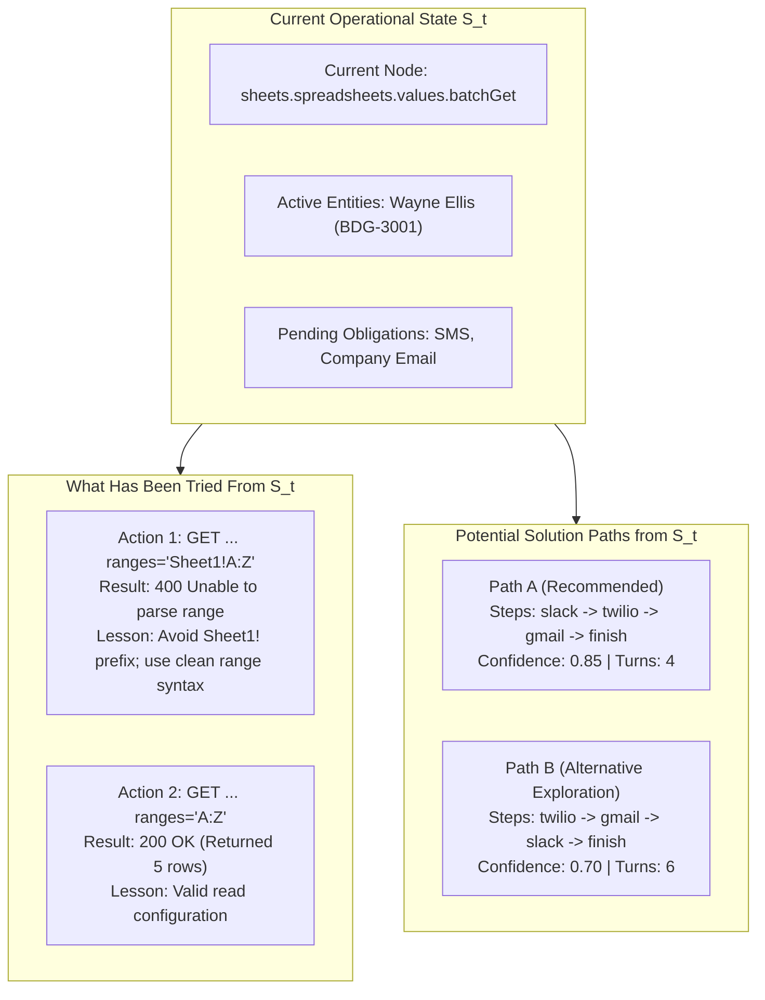
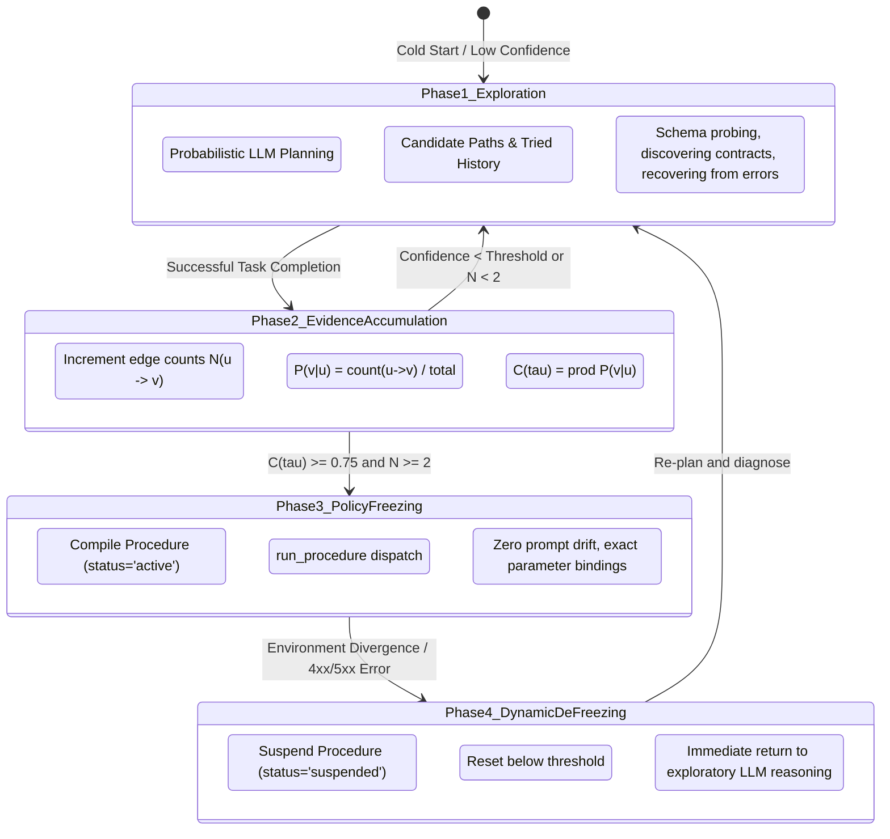

# State-Transition World Model: From Exploratory Branching to Confidence-Gated Policy Freezing

## Executive Summary

In enterprise environments, an effective agentic **World Model** is neither a static documentation cache nor a rigid, pre-scripted workflow engine. It is an **empirical Markov State-Transition System** ($S_t \xrightarrow{a_t} S_{t+1}$) that bridges two opposite failure modes:
1. **Premature Determinism**: Locking into a rigid sequence at Turn 0, before discovering schemas, handling parameters, or adapting to environment variations.
2. **Unconstrained Stochastic Drift**: Re-prompting the LLM at every step with no operational memory, causing the agent to drop outbound actions, repeat known parameter errors, or terminate prematurely.

This implementation provides a **grounded state-transition architecture** where the environment model explicitly informs the agent:
- **What has been tried from the current state** and the empirical result (errors, blocked calls, or verified successes).
- **What causal lesson** explains past errors (e.g. range formatting syntax vs. malformed HTTP methods).
- **What candidate solution paths** exist to achieve the remaining goals, along with their path confidence and estimated turn cost.
- **How confidence governs execution**: early trials freely explore viable paths; once an operational trajectory achieves high confidence without contradiction, it freezes into a **deterministic macro-procedure** (`Procedure`, `status="active"`). If the environment diverges, it dynamically de-freezes back to exploratory planning.

---

## 1. Why: Motivation & Architectural Alignment

### A. The Wrapper Blind Spot
In earlier iterations, the execution frontier recorded wrapper tool calls rather than canonical operations:
```json
// Flawed Planner Input
{
  "current_node": "tool_call:execute_decision",
  "completed_nodes": ["tool_call:execute_decision"]
}
```
Because `tool_call:execute_decision` was the current node, the planner could not advance along learned graph edges connecting Google Sheets reads to Slack or Twilio endpoints. The model had the raw response tokens in conversation history, but the structural world model was disconnected from the frontier.

### B. The Need for State-Local Negative and Positive Evidence
Knowing what *not* to do is as crucial as knowing what to do. When an agent attempts `api_fetch GET .../values:batchGet` with `ranges="Sheet1!A:Z"` and receives:
```json
{"error": {"code": 400, "message": "Unable to parse range: Sheet1!A:Z"}}
```
The world model must record that this specific action from this state yielded an HTTP 400 error. Without this state-local memory, an LLM often retries the same malformed range or falls into futile `api_search` queries trying to rediscover an endpoint it already knows.

### C. Multi-Path Exploration vs. Determinism
In enterprise workflows, multiple valid topological paths can solve a task:
* **Path A**: Post summary to Slack security channel $\to$ text contractor via SMS $\to$ email company contact $\to$ `finish`.
* **Path B**: Text contractor via SMS $\to$ email company contact $\to$ post summary to Slack $\to$ `finish`.

A robust world model must not artificially constrain the agent to a single arbitrary path at turn 0. Instead, it presents **multiple candidate solution paths** with empirical confidence scores and turn estimates, enabling the agent to explore and select the optimal sequence over time.

---

## 2. What: Ontology and Formal Model



### Mathematical Definitions

1. **State Node ($u$)**:
   The canonical operation or endpoint contract (e.g., `sheets.spreadsheets.values.batchGet`, `twilio.messages.create`). At cold start, $u = \text{root}$.

2. **Node Attempt ($\mathcal{A}$)**:
   A record of an action dispatched from state $u$:
   $$\mathcal{A} = \langle u, v, \text{action\_type}, \text{method}, \text{url}, \text{params}, \text{outcome}, \text{result\_summary}, \text{lesson}, N \rangle$$
   where $\text{outcome} \in \{\text{success}, \text{error}, \text{blocked}, \text{unproductive}\}$.

3. **Empirical Transition Probability ($P(v \mid u)$)**:
   $$P(v \mid u) = \frac{\text{count}(u \to v)}{\sum_{w} \text{count}(u \to w)}$$
   with edge cost $c(u, v) = -\ln P(v \mid u)$.

4. **Path Confidence ($\mathcal{C}(\tau)$)**:
   For an execution path $\tau = [u_1, u_2, \dots, u_m]$:
   $$\mathcal{C}(\tau) = \prod_{i=1}^{m-1} P(u_{i+1} \mid u_i) = \exp\left(-\sum_{i=1}^{m-1} c(u_i, u_{i+1})\right)$$

5. **Minimum Path Support ($N_{\text{min}}(\tau)$)**:
   $$N_{\text{min}}(\tau) = \min_{1 \le i < m} \text{count}(u_i \to u_{i+1})$$

6. **Confidence-Gated Policy Freezing**:
   $$\text{Freeze Condition} \iff \Big(N_{\text{min}}(\tau) \ge 2\Big) \;\land\; \Big(\mathcal{C}(\tau) \ge \tau_{\text{freeze}}\Big) \;\land\; \Big(\text{Contradictions}(\tau) = 0\Big)$$
   When satisfied, path $\tau$ compiles into an active `Procedure` in `store.procedures`.

---

## 3. How: Implementation Details

### A. Trajectory Graph Compilation (`trajectory_graph.py`)
* **`NodeAttempt` Indexing**: During `compile_trajectory_graph`, all historical episodes across tasks are analyzed chronologically. When an action fails or gets blocked, it is recorded under `node_attempts[current_state]` with its error message and causal diagnosis. When an action succeeds, it advances `current_state`.
* **Pareto Multi-Path Search (`find_all_candidate_paths`)**: Evaluates valid permutations of task target mutations. Rather than keeping only the single lowest-cost path, it returns up to $K=3$ distinct Pareto paths ranked by cost, confidence, and edge support.

### B. Grounded Frontier & Entity Obligation Tracking (`execution_state.py`)
* **Wrapper Unwrapping**: `advance_frontier` resolves `interaction.related_episode_ids` to canonical operations (e.g. `sheets.spreadsheets.values.batchGet`, `slack.chat.postMessage`), eliminating wrapper noise.
* **`EntityTracker`**: Extracts row-level entities (e.g. Wayne Ellis, Luis Moreno) from tabular reads, tracks channel obligations (`sms`, `company_email`, `security_channel`), and shifts retrieval focus as obligations are fulfilled.

### C. Precise Precondition Gating (`operational_requirements.py`)
* Differentiates unknown route contracts from malformed HTTP methods (e.g. `method="api_fetch"`).
* Suppresses futile `api_search` discovery loops when the endpoint contract is already present in the store.

### D. Process Planning & Context Injection (`process_planner.py` & `context.py`)
* `extract_workflow_plan` constructs:
  - `tried_from_this_state`: Recent attempts from this node with lessons learned.
  - `potential_solution_paths`: Ranked candidate paths with step counts and confidence.
* `render_context` injects this structured block under `workflow_process` into the prompt:

```json
"workflow_process": {
  "goal": "Execute multi-step workflow: sheets.spreadsheets.values.batchGet -> twilio.messages.create",
  "active_step_index": 2,
  "confidence": 0.85,
  "tried_from_this_state": [
    {
      "action": "api_fetch GET https://.../values:batchGet (ranges='Sheet1!A:Z')",
      "outcome": "error",
      "result": "HTTP 400: Unable to parse range: Sheet1!A:Z",
      "lesson": "Parameter syntax error: verify range syntax (e.g. use clean 'A:Z').",
      "observed_count": 1
    },
    {
      "action": "api_fetch GET https://.../values:batchGet (ranges='A:Z')",
      "outcome": "success",
      "result": "HTTP 200: Successfully returned 5 rows",
      "lesson": "Valid verified operational transition.",
      "observed_count": 2
    }
  ],
  "potential_solution_paths": [
    {
      "path": "Path A (Recommended - Highest Confidence)",
      "steps": ["slack.chat.postMessage", "twilio.messages.create", "gmail.users.messages.send", "finish"],
      "confidence": 0.85,
      "turns": 4,
      "strategy": "Execute: slack.chat.postMessage -> twilio.messages.create -> gmail.users.messages.send -> finish"
    },
    {
      "path": "Path B (Alternative Exploration Path)",
      "steps": ["twilio.messages.create", "gmail.users.messages.send", "slack.chat.postMessage", "finish"],
      "confidence": 0.70,
      "turns": 6,
      "strategy": "Execute: twilio.messages.create -> gmail.users.messages.send -> slack.chat.postMessage -> finish"
    }
  ],
  "exploration_guidance": "Multiple solution paths exist in the trajectory graph. The world model tracks outcomes and confidence over time. Choose the higher-confidence path or explore alternatives."
}
```

---

## 4. The 4-Stage Lifecycle: Exploration to Determinism



1. **Phase 1: Exploration (Low Confidence, $N < 2$)**:
   The agent is given candidate paths, entity obligations, and lessons from prior errors. Execution remains flexible and interactive via per-turn LLM reasoning.
2. **Phase 2: Evidence Accumulation**:
   As trials execute successfully, traversal counts $N(u \to v)$ increment, empirical transition probabilities update, and Pareto path costs decrease.
3. **Phase 3: Policy Freezing (Enterprise Determinism)**:
   Once path confidence exceeds threshold ($\mathcal{C}(\tau) \ge \tau_{\text{freeze}}$) across $\ge 2$ independent runs without contradiction, the sequence is compiled into an `active` [`Procedure`](file:///Users/masoud/Documents/Repos/worldmodel-generation-harness/src/worldmodel_harness/procedures.py#L47). In subsequent invocations, the procedure executes deterministically via `run_procedure`, eliminating token hallucinations or missed notifications.
4. **Phase 4: Dynamic De-Freezing on Divergence**:
   If a step in a frozen procedure fails due to a live schema change or unexpected environment error, the procedure transitions to `"suspended"` and the system drops back to **Phase 1 Exploration**, re-engaging the LLM with causal invariant diagnosis.

---

## 5. Verification & Test Coverage

All **425 unit tests** pass in **4.61s**:
* `tests/test_trajectory_graph.py`: Verifies `node_attempts` error/success capture, Pareto multi-path candidate extraction, Dijkstra cost computation, and edge support tracking.
* `tests/test_process_planner.py`: Verifies `tried_from_this_state` extraction, multi-path candidate packaging, and dynamic context rendering.
* `tests/test_execution_state.py`: Verifies canonical frontier resolution and entity obligation tracking.
* `tests/test_operational_repairs.py` & `tests/test_decision_runtime.py`: Verifies precise gate diagnostics and error-invariant routing.
