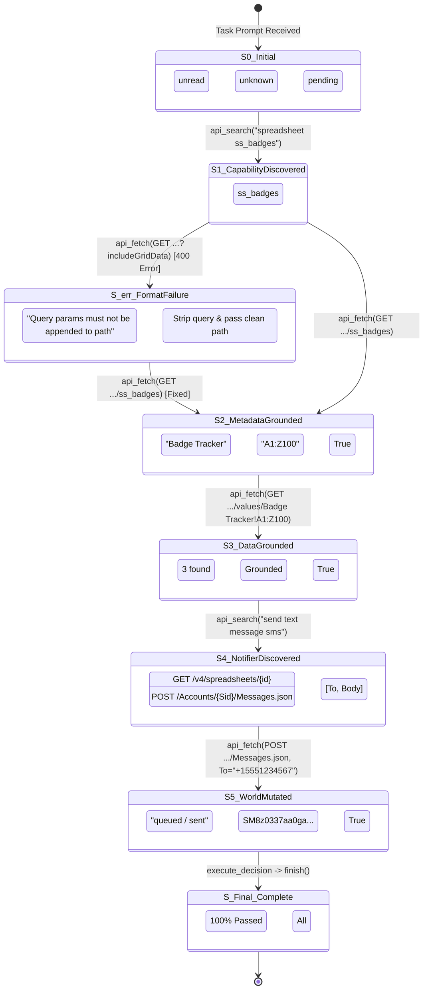

# The World Model as a State Transition System ($S_t \xrightarrow{a_t} S_{t+1}$)

In contrast to a static documentation catalog, a **World Model** in an agentic environment is fundamentally a **Markov Decision Process (MDP) / State Transition System**:

$$\text{State } S_t \xrightarrow{\text{Action / Tool Call } a_t} \text{State } S_{t+1}$$

Where:
- **State ($S_t$)**: The combined state of the environment (`WorldState`: CRM records, Google Sheets rows, sent messages) and the agent's grounded knowledge (discovered contracts, bound identifiers, invariants).
- **Edge ($a_t$)**: The executable action dispatched to the environment (tool name, HTTP method, URL, and arguments).
- **Transition ($\mathcal{T}$)**: The deterministic or observed mutation of world state and schema observations produced by that call.

---

## 1. Grounded Trajectory Plot

The diagram below maps the exact execution trajectory of `operations.contractor_badge_expiration` from [`runs/focused-env-audit/store.sqlite`](file:///Users/masoud/Documents/Repos/worldmodel-generation-harness/runs/focused-env-audit/store.sqlite):

---

## 2. State-Machine Diagram of the Execution Loop

---

## 3. Direct Connection to `graph-grounded-automationbench`

Your work in [graph-grounded-automationbench](https://github.com/masoudhashemi/graph-grounded-automationbench) establishes the precise formal foundation for this state-transition view:

### A. The 5 Typed Graph Edges as State Operators

| Edge Kind in `graph-grounded` | Role in State Transition | Trajectory Example |
|---|---|---|
| **`PRODUCES`** | $S_t \to S_{t+1}$ generates a typed value into state | `sheets.spreadsheets.get` **`PRODUCES`** `record_identifier` (`spreadsheetId`) |
| **`ACCEPTS_VALUE`** | State precondition requiring a grounded value | `sheets.spreadsheets.values.get` **`ACCEPTS_VALUE`** (`spreadsheetId`) |
| **`DATAFLOW_TO`** | Connects producer state to consumer action | `sheets.get[spreadsheetId]` $\xrightarrow{\text{DATAFLOW\_TO}}$ `values.get[spreadsheetId]` |
| **`MUTATES`** | Action that changes external environment reality | `twilio.messages.create` **`MUTATES`** `WorldState.twilio.messages` |
| **`PRECEDES`** | Directs macro workflow stage ordering | `Lookup Stage` $\xrightarrow{\text{PRECEDES}}$ `Mutation Stage` $\xrightarrow{\text{PRECEDES}}$ `Notification Stage` |

### B. Workflow Motifs as State Paths
In `graph-grounded-automationbench`, complex tasks match reusable motifs:
$$\text{Motif: } \text{cross\_service\_lookup\_then\_mutate\_then\_notify}$$

1. **Lookup State ($S_0 \to S_3$)**:
   - Discovers `sheets.spreadsheets.get` & `values.get`.
   - Reads rows, identifies expiring dates, binds phone numbers.
2. **Mutation / Notification State ($S_3 \to S_5$)**:
   - Authorizes `twilio.messages.create`.
   - Binds `To: +15551234567` from row data and dispatches SMS.
3. **Verification State ($S_5 \to S_{\text{final}}$)**:
   - Evaluates environment goal assertions before invoking `finish`.

---

## 4. How the World Model Harness Implements This

When the agent uses this harness:
1. **Preconditions Gate (`check_decision`)**:
   Checks whether the current state $S_t$ satisfies all mandatory fact bindings (e.g. valid `spreadsheetId` or `opportunity_id`) before the action edge is allowed to fire.
2. **Causal Invariants (`possible_error_cause`)**:
   When an action leads to an error state $S_{\text{err}}$, the reflection records the causal difference so future transitions bypass the failure.
3. **State Invalidation (`resource_invalidation`)**:
   When a mutating action fires along edge $a_t$ (`MUTATES`), the world model automatically invalidates stale cached reads of that entity, updating the state belief to reflect the mutation.
