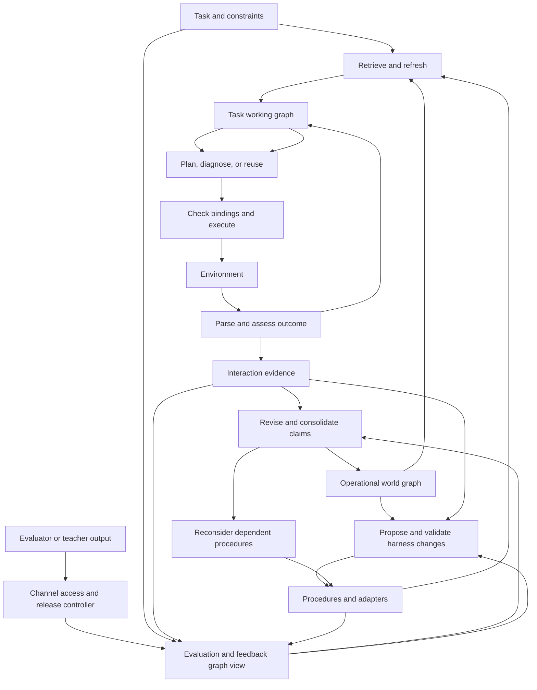
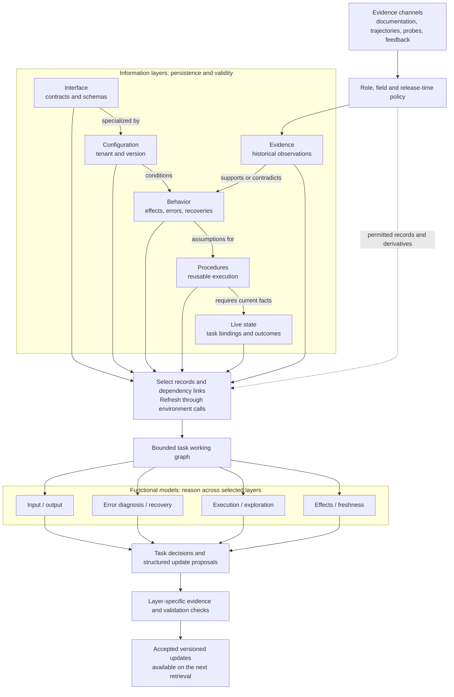
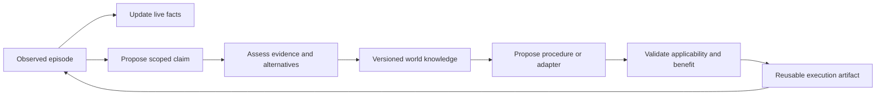
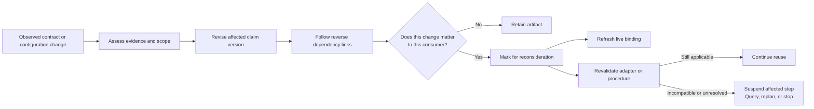
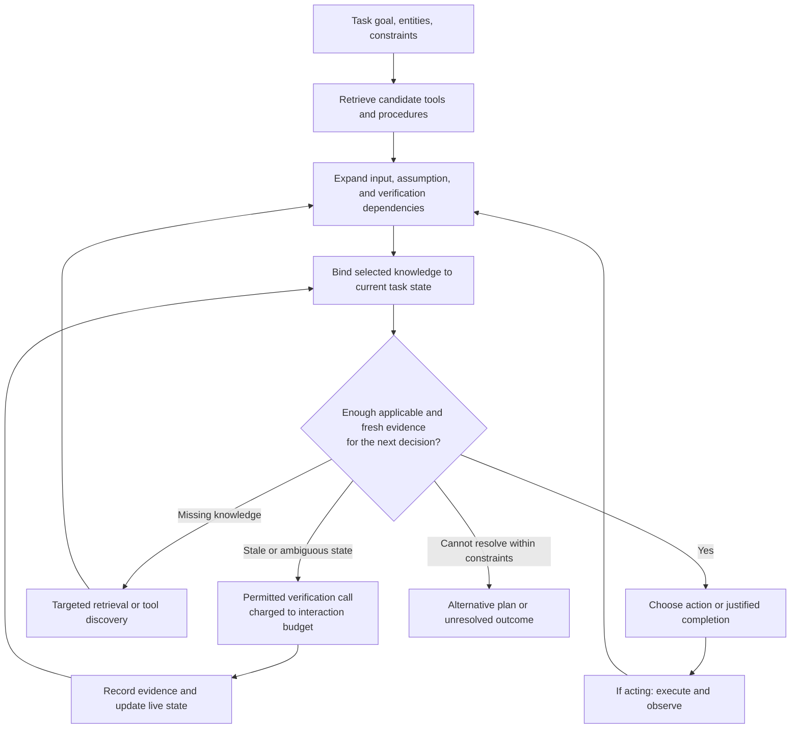

# Operational world graph and adaptive execution

Status: the environment graph, execution tips, task-local feedback, live bindings, and the evidence log are implemented. Evaluator feedback as a learning input is specified below and is not wired. This document is the architecture, not a performance or novelty claim.

The agent learns while it acts. Each interaction can update several graphs. They cite the same evidence, answer different questions, and expire on different schedules. The model sees a bounded working slice on the next call. The harness uses the longer-lived graphs to avoid rediscovery and repeated planning.

## Cooperating graphs

| Graph | Question it answers | What it holds | How long it lasts | Who it helps |
| --- | --- | --- | --- | --- |
| Environment | How does this environment work? | Contracts, output shapes, value flow between calls, errors, recoveries, and possible causes, each scoped and evidenced | Across tasks. Versioned. A contract with no tenant is reusable. A behavioral regularity becomes reusable only with evidence from more than one tenant. A contradiction disputes the claim and marks dependents for review; it does not delete history | The model, by retrieving how to call the environment instead of searching again |
| Execution tips | How should a recurring subgoal be carried out? | Procedures: trigger, parameter types, steps, required claims, stop condition, status | Across tasks, until a required claim changes or an experimental run fails. A tip does not outlive the environment facts it cites | The harness, by running a stored sequence through the same tools and budget instead of replanning those steps |
| Feedback | What did this attempt show? | Predicted observations, what came back, requirement checks, gate gaps, and unresolved outcomes. Evaluator results belong here when a channel is permitted | Mostly this attempt. A contradicted prediction can dispute an environment claim. A matched check is not a new permanent rule. Scores are recorded for evaluation and are not written back into learning | The model during the task, and the learners that revise the other graphs |
| Live bindings | What is true of the records in this attempt? | Observed field values for this task only | This attempt. A write drops cached reads. These values are never promoted into the environment graph | The current decision, so arguments bind to current ids |
| Evidence log | What happened? | Append-only calls, arguments, responses, coverage, and predictions | Retained as history. Repeating a log line is not new support | Every other graph, as the record they cite |

The working view is not another graph. It is the slice selected for the next model call: relevant environment claims, applicable tips, recent feedback, and current bindings, under one character budget. A dependency bundle is included whole or left out.

These graphs are separate because mixing their lifetimes hurts performance. A task id must not become an environment-wide rule. A stored tip must not keep running after its contract changes. A score or a matched response must not be treated as proof of a hidden effect. The six layers later in this document are the validity rules inside and across the graphs — interface, configuration, behavior, procedures, live state, and evidence — not six unrelated databases. Feedback is a graph of assessments over attempts and evidence, not a second copy of the trajectory.

Update schedules follow the lifetimes:

- During a call: append evidence, refresh live bindings, compare predictions, and revise environment claims when the observation justifies it.
- On the next model call: inject feedback from those checks and a retrieved slice of the environment and tip graphs.
- Between tasks or rounds: propose or suspend execution tips. Semantic passes may add environment hypotheses; they do not promote a hypothesis to a supported claim by themselves.

The [problem framing](problem-framing.md) defines the operational graph research problem. The [mathematical formulation](formulations.md) translates the reviewed methods into common notation before deriving our layered design; the [literature review](literature-and-formulation.md) preserves paper-specific equations, algorithms, comparisons, and cognitive connections. This document specifies components and runtime behavior. Its layers specialize the common framework rather than replacing it.

## 1. Research claim

The hypothesis is that a persistent operational model improves both task-time decisions and the construction of reusable execution support. Its value should appear as better completion, fewer unnecessary calls, less repeated reasoning, or faster adaptation under change, after counting learning and maintenance costs.

A world model describes the environment. A procedure describes how to act toward a goal. The harness implements retrieval, binding, execution, verification, and recovery. Each can improve independently, so evaluation must separate them.

### Direct source/effect verification (v3.3)

The actor now gets a direct typed `verify_goal` tool. One flat request registers or
updates one requirement, without nested action JSON or separate duplicate target
and observation specifications. The older update backend is retained for compatibility
but omitted from the advertised action catalog. Environment calls still use the
same gated execution path; the verifier itself never calls or mutates the environment.

Source and effect requirements have different evidential jobs:

| Kind | Required evidence | Lifetime / limitations |
| --- | --- | --- |
| Source | Successful read, covered nonempty content path, task-quoted identity anchor matched on a sibling field | Historical observation; no advance equality on the full source body and no duplicate source read. Lexical identity matching is not proof of uniqueness or semantic task relevance. |
| Effect | Current GET/HEAD of the declared resource; field equality against a fixed desired value; identity field on the same record | Desired value must be literal in the task or grounded in a verified source requirement's content. Source-linked effects inherit its task anchor. Missing, wrong-record, contradictory or stale evidence cannot finish checked. |

Anchors compare case-folded word tokens, allowing punctuation variants (such as a
name in a sender address). They do not resolve aliases or distinguish duplicate
names. Value/identity paths must share a parent; this is a conservative structural
record check, not a general join model. Paths can be repaired; desired values,
resource, requirement kind and grounding stay fixed. Source binding changes that
invalidate an effect's provenance make that effect unresolved rather than silently
rebinding it. Model-selected task coverage remains an explicit limitation.

Invalid evidence leaves a pending requirement visible. A dedicated verification
audit saves typed requests and feedback even on timeouts. All checks still appear
in the losslessly compressed ledger; no silent prefix truncation is introduced.
In the post-probe v3.3.1 correction, source anchors are repairable until matched,
then fixed. Anchor membership uses the whole public task, not only the requirement's
short quote; errors identify the field and explain how to repair without new IDs.
Offline replay and a later live run are separate measurements. A live timeout is not evidence that the offline check is wrong.

### Value abstraction and binding safeguards (v3.4)

Reusable slot kinds, task-local value/format compatibility, and entity identity are separate
checks. A learned value slot (`email`, `phone`, `date`, `url`, `id`, `text`, etc.) records
what value kinds an operation reads or writes, while goal verification checks that every
written slot is verified on the target record and matches the task/source value or its
canonical value-type format (`check_effect`), without memorizing task-specific literals.
Unstructured source text (such as email bodies) grounds effect values either by exact
substring or by matching a single unambiguous formatted value of the same value kind
(`text_formats`).

Response rules declare `value_roles` at leaf paths rooted in
`argument_conditions` or `prediction/expected`. Undeclared, `unknown`, and
`constraint` leaves retain exact literals. Explicit `example` or `parameter`
leaves normalize scalar values into `$kind` predicates, and URL conditions may use
`{...}` route templates. This proposes a structural and value-kind regularity, not
literal equality between input and output or semantic parameter binding. Field names,
methods, and route templates stay exact. Roles and constants participate in rule
identity, preventing cutoff dates or fixed identifiers from merging merely because
they have the same kind. Raw generating observations remain in the evidence log;
parameterized rules (`is_parameterized_rule`) are scoped to `(environment, version, role)`
so prospective tests (`observe_rules`) can evaluate them across subsequent tasks in the
same environment, whereas unparameterized rules and literal hypotheses remain tenant-scoped.
In `learn_semantics`, non-discovery task episodes are prioritized for consolidation,
untestable `response_rule` attachments downgrade to `null` rather than failing the
proposal batch, and `learn_semantics` / `review_semantics` run under independent timeout budgets.

If a source ID is omitted, the verifier may attach a matched source whose content
is the exact recognized scalar value (or a single unambiguous value of the same
value kind in unstructured text) when the target read's same-record identity field
is grounded in the task or source. Multiple qualifying sources stay unresolved;
explicit links remain available. The audit retains the original request, resolved
request and inferred binding's source/target episode IDs and paths. Existing lexical
identity limitations still apply: this is not proof of unique identity or ownership
of a value mentioned in prose.

Contract aliases merge only for the same method/template, exact scope and identical
documented payload excluding endpoint ID, while `preferred_contract` prioritizes
more specific parameterized route templates over generic prefix routes. New supporting
episodes remain linked. Incompatible alias schemas remain separate; selection rejects
conflicting stored payloads even when templates coincide, including in old checkpoints.
Diagnostics show candidate schemas and scopes. Same-ID documentation updates still use
the existing version history; full schema reconciliation and evidence-based precedence
between variants are not implemented.

Kind learning does not authorize weakening goal verification or treating test feedback as a causal rule.

### Implemented outcome verification (v3.2)

The task-local goal ledger now separates a desired outcome contract from its
verification observation. `outcome.target` specifies a non-root field path and
an `equals` predicate. Its expected value must occur literally in the quoted public
requirement, or match/be contained in a separately cited successful source read
(`source_episode_id`, `source_path`). The verification episode cannot be its own
source. For API evidence, `outcome.resource_url` fixes the verification resource,
and the evidence must be a successful GET/HEAD rather than a write acknowledgment.
The observation must match the contract; once supplied, its expected value,
predicate, resource and grounding cannot be replaced to fit a later response.
The target path alone can be corrected to repair a response-shape mistake without
changing the desired outcome. Pending requirements may be registered before
their contract and evidence are available. Short episode references work for both
verification and source citations.

This blocks the pilot's response-presence-only completion. It does not establish
general natural-language entailment: the model still chooses requirements, the
source interpretation, resource and field. A distinct source can still be
semantically inappropriate, and URL equality alone does not prove record identity
inside a collection. Completeness, identity joins, transformations, aggregates,
absence requirements and semantic equivalence require richer independently checked
contracts. Unsupported goals must finish unresolved; they must not be silently
reduced to presence/type checks. No benchmark answers or grader feedback are used.

| Diagnostic | Meaning | Repair |
| --- | --- | --- |
| `invalid_evidence_path` | A key/index cannot be traversed in the cited response | Inspect failing segment, available object keys or array length; correct the path |
| `uncovered_evidence_path` | The path exists but is outside recorded coverage | Obtain covered evidence; do not treat it as false |
| `stale_evidence` | The path is covered but the cited observation is no longer live | Obtain a permitted current read; do not blindly retry the write |
| `nonlive_evidence` | Discovery is being used as current-state evidence | Read the actual resource |
| `insufficient_outcome_predicate` | Root, presence or type-only check | Supply a value-specific target and grounding |
| `outcome_contract_mismatch` / `outcome_resource_mismatch` | Evidence targets a different predicate/resource | Verify the registered outcome, not a substitute |
| `contradicted` | Valid current evidence disagrees with the target | Investigate the discrepancy; it is not a path/freshness failure |

Path validity is checked before freshness, so a missing root such as `[0, "Email"]`
cannot be mislabeled as stale when the response requires `["records", 0, "Email"]`.
All registered checks and diagnostics remain in the losslessly encoded ledger;
there is no character-prefix truncation. Historical observations retain their
separate lifetime and cannot be switched in to weaken a registered current-state
requirement. The v3.1 pilot remains unchanged historical evidence, not a v3.2 score.

The central comparison is against a fixed harness that already retrieves a good world model. Reuse frequency, reasoning cost, and environment stability should determine whether adapting that harness adds value.

### From research questions to mechanisms

The architecture implements the [five research questions](problem-framing.md#8-contribution-to-investigate), rather than treating every plausible component as necessary. In the running timeout example, the agent must first represent the create/lookup relationship, select and refresh its prerequisites, resolve an unknown outcome, decide whether to retain a recovery procedure, and repair that procedure if its assumptions change.

| Research question | Design commitment | Mathematical definition | What the commitment must earn |
| --- | --- | --- | --- |
| Q1 Retained operational knowledge | Qualified claims plus separate episode evidence | [Graph and claim representation](formulations.md#2-persistent-graph-evidence-and-harness) | Transfer beyond replaying episodes |
| Q2 Selective use | Six logical layers, working graph, dependency expansion, refresh | [Layers](formulations.md#21-explicit-layer-decomposition) and [retrieval](formulations.md#3-task-working-graph) | Better decisions at the same context/call budget |
| Q3 Useful learning | Predictions, observation coverage, targeted information gathering | [Learning](formulations.md#5-learning-and-consolidation) and [exploration](formulations.md#6-exploration) | Downstream value above probe costs |
| Q4 Reusable execution support | Bounded adapters, procedures, retrieval recipes, validation | [Harness adaptation](formulations.md#7-procedure-and-harness-adaptation) | Savings beyond fixed-harness graph use |
| Q5 Adaptation under change | Scoped validity and versioned dependencies with fallback | [Change propagation](formulations.md#51-cross-layer-dependency-propagation) | Faster recovery without unnecessary invalidation |

The six layers organize information with different semantics and validity rules; evidence channels determine origin, availability and access; functional models and learning mechanisms operate over permitted information. These are three complementary axes of one design. Specific storage engines, confidence estimators and thresholds remain replaceable implementations.

## 2. Architecture

Initially use a fixed base language model, a versioned graph store, an append-only source-tagged evidence log, a task-local state store, and a procedure interpreter. Channel adapters and access policies determine which observations or feedback enter learning. A graph database is optional: typed records and adjacency indexes are sufficient initially.

There are three update schedules: immediate task-state updates, evidence-driven graph revision, and selective harness adaptation. Channel availability is a separate schedule: delayed feedback is appended when released and may then trigger revision/selection. A contradiction can trigger immediate reconsideration; ordinary consolidation and adaptation can wait until a task boundary.

## 3. Graph objects and connection semantics

The world graph contains objects and qualified claims. Input/output, error, recovery, and execution models are views and inference functions over this shared structure.

| Object or relation | Meaning |
| --- | --- |
| System, object type, table, field | What exists and how data is organized |
| Operation with typed arguments | A tool or endpoint and the meaning of its inputs |
| Reads, writes, creates | Objects and fields an operation accesses or changes |
| Produces and supplies | Output fields and inputs they can supply |
| Transformation | Conversion, join, or lookup needed to compose operations |
| Identity correspondence | Evidence that records represent the same entity |
| Requires | State, permission, or other prerequisites |
| May cause | A qualified effect hypothesis, distinct from correlation |
| Can reveal | A query that supplies evidence about a condition |
| Error and possible cause | A failure signature and competing explanations |
| Recovery attempt and outcome | Intervention, context, and observed result |
| Alternative and compensation | Another route to an effect or a partial reversal |
| Authority and freshness | Where a field should be checked and when evidence becomes suspect |

Use claim objects for conditional and multi-object relationships. Output compatibility can depend on tenant, version, semantic identity, and transformation; equal string types do not establish compatibility.

~~~text
claim_id, version
relation, participants, applicability_conditions
scope: environment_family, tenant, API_version, role
status: hypothesis | supported | disputed | retired
origin: documented | observed | inferred
supporting_evidence_ids, contradicting_evidence_ids
source_lineage: channel, producer_version, release_time, permitted_consumers
confidence_or_support_summary
observed_at, last_verified_at, validity_conditions
invalidation_events, dependent_artifact_ids
~~~

Status and confidence differ. Support counts are not calibrated probabilities. Start with transparent evidence summaries and introduce probabilities only where justified. Resolve identity ambiguities explicitly instead of silently merging records.

## 4. Information layers and lifetimes

### Evidence channels and the connected evaluation view

The architecture accepts multiple sources; the current runtime implements a trajectory-only configuration. The following is the target design, not a claim that grader-feedback learning is already wired.

| Axis | Contents | Governing rule |
| --- | --- | --- |
| Information layers | Interface, configuration, behavior, procedures, live state, evidence | Scope, validity, retrieval and update policy |
| Evidence channels | Documentation, trajectories, probes, scores, diagnostic assertions, demonstrations | Producer, payload, release time and role access |
| Functional models/learners | Binding, prediction, diagnosis, verification, consolidation, proposal/selection | Source-appropriate checks on proposed updates |

The evaluation/feedback view references existing records:

| Connection | Meaning | Update authority |
| --- | --- | --- |
| Task → requirement → attempt | Which requested condition this execution tried to satisfy | Public task parser; retain interpretation uncertainty |
| Attempt → trajectory → procedure version | What ran and which artifact was invoked | Execution/evidence logger |
| Evaluator version → feedback → requirement/attempt | What an evaluator reported, when, and with what coverage | Feedback adapter; preserve authorized raw payload |
| Feedback → hypothesis → distinguishing observation | Failure suggests investigation, not an established cause | Diagnostic learner plus empirical checks |
| Feedback → candidate/procedure selection | Which released results influenced adaptation | Selector; record candidates, costs and lineage |
| Revised world claim → dependent procedure | Which assumptions require revalidation | Dependency/invalidation controller |

The evidence layer owns evaluation records; task-local assessment belongs in the live view; procedure versions stay in the artifact store. This is a cross-layer projection, not a seventh lifetime tier or a duplicate mutable copy of trajectories.

Each channel adapter declares producer/evaluator version, source type, task/attempt ID, scope, coverage, released fields, event/release times, consumers and cost. Apply access masks before prompts, retrieval, consolidation and selection. Scoring-only data is reporter-visible; score assistance releases only scores; diagnostic assistance releases specified assertions; demonstrations/answer-conditioned references require distinct permission. Feedback-derived artifacts retain lineage across resets; historical record values do not become current state.

Task-success feedback does not automatically prove an operational rule or cause. The learner may generate competing explanations or prioritize a probe. A checked requirement is likewise not a hidden-grader verdict. Once feedback affects learning or selection, later influenced results are feedback-assisted even if the actor never sees raw feedback.

Trajectory-only and grader-assisted comparisons retain the six layers and common safety checks. Source access differs deliberately. In the repeated-50-task setting, release feedback after recording that attempt's score and distinguish retries/rounds. Independent evaluation is a separate, uncontaminated protocol.

The [cooperating graphs](#cooperating-graphs) are the objects with different jobs and lifetimes. The layers below are the validity rules inside and across those graphs. Volatility and relevance are independent attributes.

| Layer | Contents | Lifetime and updates | Task-time handling |
| --- | --- | --- | --- |
| Interface knowledge | Schemas, endpoints, input/output contracts | Reusable but version-sensitive | Retrieve relevant operations; recheck mismatches |
| Configuration | Dependencies, routing, permissions, tenant mappings | Scoped and changeable | Check applicability; refresh consequential facts |
| Learned behavior | Effects, errors, recoveries, delays, retry semantics | Accumulates qualified evidence | Retrieve predictions and uncertainty |
| Procedures | Workflows, diagnostic branches, adapters | Versioned and dependent on claims | Select by goal, conditions, and expected value |
| Live state | Records, identifiers, statuses, pending outcomes | Task-local or explicitly short-lived | Query and invalidate after relevant events |
| Evidence | Calls, predictions, responses, released evaluator/teacher feedback | Immutable, source-tagged history subject to retention | Retrieve permitted evidence for diagnosis, consolidation and selection |

A historical observation remains a record of its episode after its generalization becomes obsolete. A recent timestamp does not guarantee validity: an intervening write can invalidate a fact immediately. An old schema may remain usable while its version matches.

Episode facts do not become tenant facts merely because they recur in a task template. Tenant relationships do not become application-wide contracts without evidence across tenants.

### 4.1 Connections between information layers

Information layers organize storage, validity and retrieval. Functional models organize reasoning and updates. Evidence channels provide the third axis: source, release and role access. Every model may need several layers; source permissions constrain what it may read and retain across them.

*Figure 2. Layers, source channels and models—not a vertical stack.* Six information layers feed a selected working view under channel-access controls. Models operate across that view. The arrows inside the layer group illustrate semantic connections; the table below gives the fuller mapping. Accepted updates become available on the next retrieval; models do not have unrestricted write access.

| Source → destination | Connection | Operational consequence |
| --- | --- | --- |
| Interface → configuration | A tenant configuration specializes an operation or field contract | Use the contract for the active tenant, role, and version |
| Interface/configuration → behavior | A behavioral claim applies under particular contracts and conditions | A contract or configuration change triggers a relevance check on the claim |
| Evidence → interface/configuration/behavior | An episode supports, contradicts, or leaves a claim unresolved | Revise support or scope through consolidation; retain the episode |
| Interface/configuration → live state | Concrete records and values instantiate scoped object and field definitions | Bind IDs and arguments without confusing types or tenants |
| Live state → behavior | Current conditions determine which behavioral predictions apply | Recompute applicable predictions when relevant state changes |
| Interface/configuration/behavior → procedures | An adapter or branch depends on contracts and claims | Revalidate dependent components when those assumptions change |
| Procedures → live state | A procedure requires fresh predicates and parameter bindings | Query unresolved prerequisites before dependent steps |
| Procedures → evidence | Execution produces outcomes and checks the procedure requested | Assess both procedure performance and relevant world claims |
| Evidence → live state | An observation establishes, corrects, or leaves unknown a current fact | Update the task overlay without treating inferred outcomes as observations |

These connections have typed meanings. A support link is not a logical implication; a dependency link is not proof of causation. Each link records its scope and relevant fields or conditions so an unrelated edit does not invalidate everything.

The procedures layer includes adapters and retrieval recipes as reusable execution artifacts. The first three layers are views of persistent world knowledge; procedures live in the harness, live facts in task state, and episodes in the evidence store. Cross-layer references connect these stores without duplicating their contents.

### 4.2 How evidence becomes knowledge and execution support

This is derivation with provenance, not movement that deletes the source. An episode remains in evidence; a claim points back to it; a procedure points to claims and validation results. A task plan may use an unresolved hypothesis cautiously without promoting it. A persistent diagnostic procedure may explicitly check an uncertainty.

There is no required bottom-to-top sequence across all six layers. A schema document can update interface knowledge directly through the evidence path. An ordinary observation can update live state immediately. Procedure learning can use several supported relationships and execution evidence together.

### 4.3 Change propagation

On a scoped change, follow reverse dependency links to identify potentially affected artifacts and cached working-graph items. Check whether the changed field, version, or condition matters before changing their status.

| Event | Reconsider | Response |
| --- | --- | --- |
| Output field or type changes | Mappings, adapters, and procedures consuming it | Rebind or revalidate; suspend incompatible calls |
| Routing or permission configuration changes | Applicable behavior, branches, and cached prerequisites | Refresh affected facts and select a valid branch |
| A predicted effect is contradicted by adequate evidence | Behavioral claim and dependent shortcuts | Mark disputed; verify or fall back to reasoning |
| A live record changes | Local bindings and downstream task decisions | Refresh affected state; do not infer a new general rule automatically |
| Recovery fails | Current diagnosis and the scoped recovery claim | Record failure, consider alternatives, and reassess applicability |

Propagate a “needs reconsideration” status, not an assertion that every dependent item is false. Traverse with a visited/version set to handle dependency cycles. Recheck before the next affected action, including within a running task. Historical observations remain intact, and a check monitoring a disputed rule may remain useful.

*Figure 3. Change propagates through dependencies, not by deleting whole layers.* A record-version change first identifies possible consumers. Applicability checks determine the response before the next affected action.

## 5. Models over the graph

| Model | Inputs | Outputs |
| --- | --- | --- |
| Input/output and composition | Goal, available values, operations | Compatible calls, bindings, transformations, missing inputs |
| State and effect | Working state, action, applicable claims | Observable predictions and possible hidden effects |
| Error diagnosis | Failure signature, context, history | Possible causes and distinguishing queries |
| Recovery | Diagnosis, past attempts, constraints | Applicable remedies and verification needs |
| Evidence and freshness | Needed proposition, sources, dependencies | Trust, refresh, or additional investigation |
| Execution | Goal, working graph, procedures | Conditional plan, next action, completion checks |
| Exploration | Relevant unknowns and possible observations | Informative actions and estimated value |

One language model can serve several roles. Logical modularity does not require multiple agents or separately trained networks.

Predict observable contracts: returned identifiers, error classes, queryable postconditions, or relationships needed by subsequent calls. A complete database simulator is unnecessary.

### 5.1 Which layers each model reads and updates

The table describes logical access through the selected working graph and targeted retrieval. It does not instruct every model to load all records from every listed layer. Proposed writes become persistent only through the relevant update mechanism.

| Functional model | Information layers read | Immediate task-local output | Proposed persistent update and owner |
| --- | --- | --- | --- |
| Input/output and composition | Interface, configuration, live state; behavior/evidence for uncertain mappings | Bound arguments, transformations, missing inputs | Contract or mapping claim → graph learner; reusable adapter → harness adaptation |
| State and effect | Interface, configuration, behavior, live state | Predicted outcomes with applicability and uncertainty | Effect hypothesis → graph learner after observable evidence |
| Error diagnosis | Interface, configuration, behavior, live state, evidence | Competing causes and discriminating queries | Error-condition relation → graph learner |
| Recovery | Behavior, evidence, procedures, configuration, live state; interface for bindings | Conditional remedy and verification plan | Recovery applicability claim → graph learner; recovery branch → harness adaptation |
| Evidence and freshness | Validity/provenance across all layers and current live dependencies | Refresh requests and suspect-item markers | Validity metadata → graph learner; no mutation of historical episodes |
| Execution | Selected records from all six layers | Next action, branch, and completion assessment | Procedure improvement proposal → harness adaptation; actual outcomes → evidence logger |
| Exploration | Interface/configuration/behavior gaps, live goals, evidence, and relevant procedures | Informative action with expected distinguishing outcomes | Experiment observations → logger, then graph learner; predicted outcomes are not support |

The observation parser/state updater commits evidence-backed live facts. The logger appends actual interactions. The graph learner validates and commits world-claim changes. Harness adaptation validates and commits reusable artifacts. These are responsibilities that may share one implementation, not a requirement for additional agents.

### 5.2 Example across layers and models

Suppose a record-creation call times out. This is an illustrative scenario:

1. **Interface:** retrieve the create contract and the fields accepted by lookup operations.
2. **Configuration:** check whether this tenant supports a usable request key or another reliable identity mapping.
3. **Live state:** retain the attempted arguments and mark creation outcome unknown.
4. **Behavior and evidence:** retrieve prior timeout observations, preserving both “created” and “not created” explanations where unresolved.
5. **Error and evidence models:** select a query that can distinguish those explanations. If no reliable query exists, keep the outcome unresolved.
6. **Execution/recovery:** perform the query and retry only if its evidence and the operation's semantics justify doing so.
7. **Learning:** append the result and revise the scoped timeout/verification relation if warranted.
8. **Adaptation:** after validation, install a conditional recovery procedure with dependencies on the lookup contract, identity assumptions, and relevant behavior.

If the lookup contract later changes, its dependency links flag the recovery procedure and any active bindings for reconsideration. This example joins information lifetimes, model responsibilities, learning, and execution without giving each model an isolated graph.

## 6. Retrieval and refresh

Use the symbols $G$ for the persistent graph, $E$ for episode evidence, $F$ for live task state, $W$ for the assembled working graph, and $H$ for the harness, as defined in the [canonical formulation](formulations.md). Retrieving a graph neighborhood and refreshing a live value are different operations; refresh uses a costed environment call.

Parse each task into goal predicates, entities, constraints, likely systems, and a budget. Resolve ambiguity through permitted observations rather than inventing identifiers or policy.

Seed retrieval from entities and capabilities. Expand through input bindings, relevant table relationships, procedure assumptions, errors, and completion checks. Text or embedding search proposes candidates; graph traversal and scope/type checks establish usable connections.

The working graph contains applicable claims and procedures, current bindings, evidence-backed observations, competing explanations, knowledge gaps, pending outcomes, and provenance.

Before acting, inspect the action's dependencies. Retrieve or refresh missing consequential information. Mandatory checks are not silently dropped to fit the context budget: retrieve again, choose another action, or report unresolved prerequisites. Expand after unexpected outputs rather than staying within the initial neighborhood.

Refresh is driven by invalidation events, requirements, and expected decision loss. A useful heuristic checks a fact when the expected loss from using stale information exceeds the cost of verification. Those quantities must be estimated; the rule does not assume they are known.

*Figure 4. Task-time retrieval is iterative.* Cached knowledge enters the working graph through retrieval. Current facts require observations when freshness matters. Neither missing dependencies nor failed verification are treated as successful completion.

## 7. Execution and learning loop

Bootstrap from permitted tool descriptions, schemas, and configuration. Treat base-model suggestions as hypotheses with inferred provenance. Start with a generic executor and an incomplete graph; the system must be able to discover operations outside its initial neighborhood. Never use benchmark solutions or verifier internals to initialize environment knowledge.

1. Load the task contract and persistent state permitted by the evaluation mode.
2. Retrieve graph neighborhoods and procedures; resolve current entity bindings.
3. Check procedure applicability, support, and freshness of prerequisites.
4. Generate task actions and information-gathering actions. Name the uncertainty each probe could resolve.
5. Choose under goal, cost, information, and permission constraints. Predict relevant outputs and failures.
6. Validate arguments and prerequisites, execute, and log the raw response with its prediction and context.
7. Parse observed facts separately from inferred effects. Mark ambiguous outcomes unknown or pending.
8. Compare predictions only with observable evidence. A timeout does not prove failure; an omitted field does not prove an absent effect.
9. Revise task hypotheses and persistent claims when justified. Record unsuccessful recoveries as well as successes.
10. Continue, investigate, or change procedure. Finish when completion conditions are supported, or report the unresolved outcome.
11. Consolidate reusable knowledge and consider harness changes when anticipated reuse justifies the expense.

An episode records pre-action evidence, bindings, predictions, observations, observation coverage, later verification, and recovery outcome. Repeated reads of the same event are not independent confirmations.

Consolidation separates instances from generalizations. One successful recovery remains a scoped experience; a general recovery relation needs conditions and evidence. Reliable documentation can justify rapid updates. Experiments do not universally outrank documentation, and every claim need not wait for many repetitions.

The learner may narrow scope, split hypotheses, revise confidence, or retire a claim. Unknown areas remain unknown, not false. Failure to identify a cause is a legitimate outcome.

## 8. Harness adaptation

A procedure is a conditional program with typed parameters, applicability conditions, action/query steps, branches, termination checks, and recovery paths. Its tool calls incur the same costs as individually planned calls.

~~~text
procedure_id, version, goal_pattern, parameter_types
applicability_conditions, required_claim_versions
steps: call | query | transform | branch | verify | stop
completion_predicates, recovery_paths
freshness_requirements, estimated_cost
validation_evidence, applicability_scope, status
~~~

Initially adapt four bounded surfaces: input adapters, retrieval recipes, conditional procedures, and verification/recovery checks. Keep the interpreter, evaluation rules, and permission enforcement fixed. Unrestricted source-code self-modification is unnecessary for testing the idea.

Graph learning changes beliefs; retrieval uses beliefs for a current decision; adaptation persistently changes reusable execution support.

An edit may add a check because a relationship is uncertain. Dependencies therefore distinguish claims that must hold from uncertainties a procedure monitors. Harness edits need not be compiled exclusively from verified rules.

Propose changes using the model, repeated costs, failures, and anticipated tasks. Validate types, applicability, branches, checks, and performance on independent development cases. Replay tests observed cases but cannot establish unexecuted counterfactual effects; use isolated environment execution for those.

Adopt changes when expected benefit warrants build, validation, execution, and maintenance costs. Retain previous versions. On a relevant claim change, disable an unsafe shortcut, add verification, or select another procedure. Do not automatically remove a diagnostic check because the hypothesis it investigates was weakened.

## 9. Neural and symbolic responsibilities

Neural components interpret tasks and unstructured responses, propose matches and hypotheses, rank candidates, and suggest procedures. Symbolic components represent typed objects, check bindings and conditions, track provenance/dependencies, and execute procedures.

The interface is a structured proposal checked against schemas and evidence. Structural consistency cannot establish that an inferred environmental claim is true. Ambiguous parsing remains ambiguous.

This is a substantive neurosymbolic design because explicit structures participate in inference and execution. Graph text retrieval alone would not test the benefit of symbolic validation and execution.

## 10. Design motivations and ablations

The operational requirements above justify the components. Cognitive and neurosymbolic research offers candidate mechanisms for implementing them: consolidation for Q1, working-memory selection for Q2, and checked procedure reuse for Q4–Q5. These connections do not introduce another goal or establish novelty. Source claims and limits are collected in the [literature review](literature-and-formulation.md).

| Mechanism | Functional motivation | Ablation |
| --- | --- | --- |
| Separate episode storage and consolidation | Retain specific experiences while learning reusable relationships | Immediate promotion versus evidence-aware consolidation |
| Bounded working graph | Select and maintain information needed for the current decision | Flat retrieval versus dependency-aware retrieval at equal budgets |
| Predictive operational relations | Anticipate usable outputs, failures, and informative observations | Descriptive entity links versus operational contracts |
| Conditional procedure reuse | Save repeated computation while preserving flexibility | Always-replan, always-reuse, and applicability-sensitive reuse |
| Neural proposals with checked execution | Combine flexible interpretation with explicit composition | Graph-as-text versus typed validation and procedure interpretation |

No component is justified by a brain analogy alone. Learning rate, information volatility, and confidence remain distinct. Structured consistency does not establish the truth of environment claims.

## 11. Benchmark use cases

These are illustrative applications, not verified descriptions of individual benchmark tasks.

In an ITSM access incident, retrieve identity correspondences, application dependencies, and diagnostic queries. Refresh account and device evidence. Distinguish missing assignment from a restriction, perform the applicable remediation, and verify affected systems. Persist evidence paths and qualified relationships; refresh employee-specific state for later tasks. A reusable diagnostic branch is a possible harness improvement.

In an automation workflow, retrieve endpoint contracts, transformations, identity mappings, and completion predicates. Resolve records and execute dependent writes. After uncertain creation, use a suitable lookup before retrying when it can disambiguate the outcome. Persist the qualified verification/retry relationship; build a workflow fragment or adapter when reuse warrants it.

ITSMBench emphasizes cross-system investigation and remediation; AutomationBench describes cross-application workflows with API discovery and final-state evaluation. Sources: [ITSMBench](https://www.atomicwork.com/itsm-bench) and [AutomationBench](https://github.com/zapier/AutomationBench/blob/main/README.md).

Task initialization does not establish one persistent tenant across episodes. Define scopes and carryover explicitly. A continual stream or controlled-shift protocol is an experimental extension, not automatically official benchmark evaluation.

## 12. Evaluation

The [canonical formulation](formulations.md) defines the protocol boundaries and objective. Here the focus is experimental comparisons and diagnostics.

Use the [canonical frozen, online, and controlled-shift protocols](formulations.md#9-evaluation-modes-and-identifying-the-mechanism). Cross these schedules with explicit trajectory-only, score-assisted, diagnostic-assisted or demonstration-assisted access configurations. Hidden assertions and answers remain inaccessible unless the declared payload projection supplies them. Feedback-assisted learning/selection is a supported design configuration, not independent evaluation.

The primary endpoint is verified task value and total cost from the [single objective](formulations.md#8-overall-objective). The following contrasts test the argument one step at a time:

| Question | Controlled comparison | Diagnostic evidence | Result that would weaken the proposed mechanism |
| --- | --- | --- | --- |
| Q1 | Episodes, consolidated non-graph claims, and the same claims in a graph; fixed executor | Transfer, binding/effect/recovery accuracy, extraction and indexing costs | Claims help but graph organization adds no meaningful gain in the tested setting |
| Q2 | Separately vary layer-aware selection, dependency expansion, and optional refresh against a metadata-rich retriever | Dependency recall, cross-scope/stale-use errors, context and call costs | One or more mechanisms do not repay their costs |
| Q3 | Same learner and starting evidence; action policies with versus without estimated future-learning value | Selection differences, subsequent decisions, break-even horizon | Added learning value does not repay probe costs under the tested policy and horizon |
| Q4 | Non-graph claims versus graph, crossed with fixed versus adaptive harness | Four arm values, adaptation effects, representation effects, interaction and costs | Graph-guided adaptation adds no practical benefit over the relevant controls |
| Q5 | Repair variants with identical verified change notices, then detection-and-repair without notices | Post-notice repair cost separately from detection delay, false alarms, and total value | Scoped repair provides no advantage, or detection prevents realizing its advantage |

For Q4, freeze shared claim content across the four arms, fit adaptive artifacts on permitted development tasks, and evaluate on held-out tasks with construction costs included. Then test the coupled online loop, where trajectories and knowledge may diverge. Direct adaptation receives the same relationship meanings, metadata, and raw evidence through the non-graph control; it is not denied memory. Adaptive arms share edit surfaces and resource ceilings, while fixed arms need not spend unused adaptation budgets.

The [research questions](research-questions.md) specify the contrasts and interaction equation. Vary reuse, volatility, diversity, ambiguity, horizon, and resources in declared regimes. Report success and costs separately, effect uncertainty at the independent stream/world/run level, and sensitivity to utility weights. Negative or inconclusive results constrain the tested regime, not every possible use of a component. A weak standalone graph effect does not rule out a graph–adaptation interaction.

Independently selected held-out probes help avoid evaluating knowledge only on paths the agent already prefers. Measure prediction quality only where observation coverage establishes outcomes. Changes to relevant claims should cause appropriate changes in execution, not just new citations. Report task-order sensitivity and results under both stable and shifted environments.

ITSMBench and AutomationBench instantiate the same comparisons through different operational relationships. They are use cases for the formulation, not separate formulations. Report standard benchmark results separately from custom continual streams, with versions, reset rules, shared scopes, and authorized information access fixed in advance.

## 13. First implementation

1. Typed claims, scopes, evidence log, and live-state overlay.
2. A small fixture with tool/data links, identifier transformations, ambiguous failures, and verification operations.
3. Retrieval, dependency expansion, and freshness handling.
4. Fixed generic executor using the graph with prediction/evidence comparison.
5. Procedure and adapter proposals, validation, dependency tracking, and fallback.
6. Costed exploration and ablations separating it from incidental learning.
7. Benchmark adapters and explicit transfer/online protocols.

Start with transparent heuristics and a fixed LLM. Train retrieval or uncertainty models after measured failures justify them. The first success criterion is benefit from learned operational connections and their reuse under a matched budget, not the number of layers implemented.
