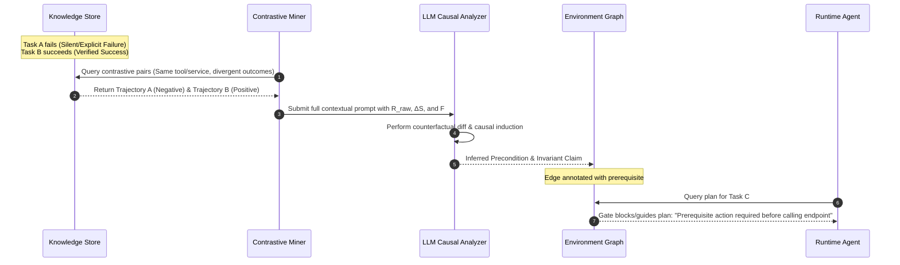

# Cross-Task Contrastive Semantic Learning & Precondition Induction

**Status:** Proposed Architecture & Design Specification  
**Location:** `docs/todos/contrastive-semantic-learning.md`  
**Target Capabilities:** Causal Trajectory Differencing, Semantic Outcome Mining, Graph Precondition Induction, Cross-Task Policy Transfer  

---

## 1. Executive Summary & Problem Statement

In multi-task agentic environments (such as AutomationBench, web navigation, and SaaS automation), agents frequently encounter complex operational dependencies:
- **Authentication & Sessions:** Endpoints require preceding login or token acquisition steps.
- **Workflow & Domain Preconditions:** In Jira, tickets must be assigned before transitioning to "In Progress"; in Google Sheets, spreadsheet metadata must be retrieved to discover tab names before cell values can be read; in CRMs, a contact or subscription record must exist before activating a customer.
- **Parameter & Format Invariants:** Endpoints silently ignore unnested payloads or require specific schema wrappers.

### The Core Failure of Current Systems: Status-Code Myopia
Existing frameworks and baseline learners typically treat step success/failure as a binary signal dominated by transport-level HTTP status codes (e.g., $200\text{ OK}$ vs. $401/403/500$). This approach misses the vast majority of real-world agent failure modes:
1. **Silent Failures with $200\text{ OK}$:** APIs (Slack, GraphQL, Airtable, Zapier) frequently return HTTP 200 while the payload indicates failure: `{"ok": false, "error": "channel_not_found"}`, `{"updated": 0}`, or an empty list `[]` when records were requested.
2. **Rich Semantic Diagnostic Signals:** Response bodies contain parameter hints, warnings, schema fragments, and validation rules that explain *why* an action failed.
3. **User & Verifier Feedback:** Evaluation assertions, test grader remarks, or supervisor messages ("Task failed: customer status was not updated in the database") contain definitive ground truth that transport headers cannot capture.
4. **Task Isolation:** In the current harness, when Task A skips a prerequisite (e.g., authentication or metadata lookup) and fails, and Task B performs the prerequisite and succeeds, the framework treats them as isolated episodes. It never compares the two execution trajectories to deduce: *"Action $A_1$ is a mandatory prerequisite for Action $A_2$."*

---

## 2. The Holistic Evidence Space

Instead of tracking status codes, each step within an execution trajectory captures a rich multi-modal evidence tuple:

$$\text{StepObservation} = \Big\langle \mathcal{I}, \mathcal{A}, \mathcal{R}_{\text{raw}}, \Delta \mathcal{S}, \mathcal{F} \Big\rangle$$

Where:
- $\mathcal{I}$ (**Intent / Subgoal**): The agent's stated rationale, target hypothesis, or output expectation.
- $\mathcal{A}$ (**Action Specification**): The invoked tool, exact serialized arguments, headers, and parameter shapes.
- $\mathcal{R}_{\text{raw}}$ (**Raw Environment Response**): Full response body, headers, warnings, and error messages (not just HTTP code).
- $\Delta \mathcal{S}$ (**Observed State Delta**): The diff of observable facts, touched records, created entities, or empty state returns.
- $\mathcal{F}$ (**Feedback & Assertions**): User messages, runtime validator warnings, task-level completion check results, and grader evaluations.

```mermaid
flowchart TD
    subgraph Multi-Modal Step Evidence
        I["Intent & Rationale (I)"]
        A["Tool Call & Arguments (A)"]
        R["Raw Environment Response & Warnings (R)"]
        S["Observed State Delta & Mutations (ΔS)"]
        F["User Feedback & Assertions (F)"]
    end

    Multi-Modal Step Evidence --> Classifier["Semantic Outcome Classifier"]
    Classifier --> Miner["Contrastive Trajectory Pair Miner"]
    Miner --> LLM["LLM Causal Attribution Engine"]
    LLM --> Graph["Knowledge Graph Precondition Claims"]
    Graph --> Gate["Runtime Gate & Execution Planner"]
```

---

## 3. Multi-Level Semantic Outcome Taxonomy

Every step observation is classified into one of five semantic outcome categories:

| Category | Definition | Empirical Example |
| :--- | :--- | :--- |
| **1. Explicit Failure** | Tool crashed or returned explicit error payload/exception. | `{"error": "Unauthorized", "code": 401}` |
| **2. Silent / Semantic Failure** | Transport succeeded ($200\text{ OK}$), but application-level payload indicates no effect or error. | `{"success": true, "updated": 0, "warning": "Requires subscription"}` or `{"ok": false, "error": "not_in_channel"}` |
| **3. Empty Search / Unproductive Query** | Discovery or query executed successfully but yielded no matching entities or data. | `{"records": []}` due to querying wrong tab name or misspelled workspace ID. |
| **4. Downstream Dead End** | Action succeeded locally, but produced an invalid state, bad ID, or corrupted format that caused subsequent steps to fail. | Created user without required team binding, causing downstream assignment step to fail. |
| **5. Verified Success** | Action produced expected state mutation, non-empty data, and passed task-level assertions. | `{"updated": 1, "status": "Active"}` with confirmed verifier assertion pass. |

---

## 4. The LLM-Driven Contrastive Causal Pipeline



### Step 1: Contrastive Pair Mining
When an execution finishes or logs an unproductive step, the **Contrastive Miner** searches across tasks for counterpart trajectories:
- **Negative Trajectory ($\tau^-$):** Step on endpoint/tool $E$ resulting in Category 1, 2, or 4.
- **Positive Trajectory ($\tau^+$):** Step on endpoint/tool $E$ (or related namespace) resulting in Category 5 (Verified Success).

### Step 2: Causal Attribution Prompting
The LLM is prompted with the complete evidence space from both trajectories to extract the exact causal discrepancy:

````markdown
You are an expert causal diagnostic engine for autonomous software agents.
Analyze why a tool execution failed or was unproductive in Task A compared to why a similar action succeeded in Task B.

### Negative Trajectory (Task A — FAILED / UNPRODUCTIVE)
- Task Goal: "Activate enterprise customer Acme Corp"
- Preceding Actions: [api_search("customers"), crm.get_customer(name="Acme Corp")]
- Failed Action: crm.update_status(customer_id="cust_101", status="Active")
- Raw Response: {"success": true, "updated": 0, "message": "No active billing profile attached"}
- Observed State Delta: Customer status remained "Pending"
- Verifier / Assertion Output: "FAILED: Customer status is not Active"

### Positive Trajectory (Task B — VERIFIED SUCCESS)
- Task Goal: "Onboard and activate customer Beta Corp"
- Preceding Actions: [crm.get_customer(name="Beta Corp"), billing.create_subscription(customer_id="cust_202", plan="Enterprise")]
- Succeeded Action: crm.update_status(customer_id="cust_202", status="Active", subscription_id="sub_555")
- Raw Response: {"success": true, "updated": 1, "status": "Active"}
- Observed State Delta: Customer status transitioned to "Active"
- Verifier / Assertion Output: "PASSED: Customer is Active"

### Diagnostic Requirements:
1. **Semantic Root Cause:** Explain the exact missing precondition, intermediate state, or parameter formatting that caused Task A to fail despite returning HTTP 200.
2. **Causal Invariant:** Formulate an operational rule governing when and how `crm.update_status` can be invoked.
3. **Prerequisite Action:** Identify the preceding tool call required to establish the necessary state.
````

### Step 3: Structured Diagnostic Response
The LLM returns structured JSON matching the harness schema:

```json
{
  "semantic_root_cause": "Calling crm.update_status with status='Active' silently fails (updated: 0) unless an active billing subscription has been created and linked to the customer.",
  "target_action": "crm.update_status",
  "trigger_condition": {
    "status": "Active"
  },
  "failure_signature": {
    "updated": 0
  },
  "required_preceding_action": "billing.create_subscription",
  "required_argument": "subscription_id",
  "operational_rule": "Before activating a customer in the CRM, first invoke billing.create_subscription to establish an active billing profile. Pass the resulting subscription ID into update_status."
}
```

---

## 5. Knowledge Graph Representation

The inferred insight is stored in the persistent SQLite knowledge store as an actionable `precondition` claim:

```json
{
  "claim_id": "rule_crm_active_requires_billing_sub",
  "layer": "behavior",
  "relation": "precondition",
  "participants": [
    "crm.update_status",
    "billing.create_subscription"
  ],
  "statement": "crm.update_status(status='Active') silently fails unless billing.create_subscription is executed first and subscription_id is provided.",
  "scope": {
    "environment": "automationbench",
    "version": "1.0",
    "role": "agent",
    "tenant": null,
    "task_id": null
  },
  "payload": {
    "target_tool": "crm.update_status",
    "conditions": {"status": "Active"},
    "silent_failure_signature": {"updated": 0},
    "prerequisite_tool": "billing.create_subscription",
    "evidence": {
      "negative_episodes": ["ep_task_a_turn_4"],
      "positive_episodes": ["ep_task_b_turn_3"]
    }
  },
  "status": "supported",
  "origin": "contrastive_induction"
}
```

---

## 6. Runtime Gating, Execution Planning, and Recovery

Once stored, this causal rule actively protects and guides the agent on all future tasks:

### 1. Pre-Execution Gating (`check_decision`)
When the model proposes an action in Task C:
- Proposal: `crm.update_status(customer_id="cust_999", status="Active")`
- The runtime gate checks active graph preconditions.
- If `billing.create_subscription` has not been executed in the current trajectory, the gate blocks execution:
  > *"Execution Gate Blocked: Calling crm.update_status with status='Active' has a known precondition: an active subscription must be created via billing.create_subscription first (otherwise update silently produces updated: 0). Create the subscription first."*
- **Result:** Saves wasted environment calls and prevents silent failure loops.

### 2. Immediate Semantic Error Recovery
If the model issues a call that returns a silent failure pattern (`updated: 0` or empty payload `[]`):
- The runtime immediately flags that the response matches a known failure signature.
- Instead of repeating the identical call for 50 turns, the harness injects high-priority diagnostic feedback:
  > *"Operational Feedback: The tool returned updated: 0. This is a known silent failure indicating missing prerequisite state (active subscription). Do not repeat this call; proceed to the prerequisite step."*

### 3. Cross-Task Knowledge Transfer
Because the claim is indexed by **tool/endpoint semantics** rather than the task ID, any task across any department (Sales, HR, Support, Finance) that activates a customer automatically benefits from the learned invariant.

---

## 7. Comparison: Baseline vs. Contrastive Semantic Learning

| Feature | Baseline Harness | Contrastive Semantic Learning |
| :--- | :--- | :--- |
| **Failure Detection** | HTTP status codes $\ge 400$ only | Explicit errors, silent failures ($200\text{ OK}$ with 0 updates), empty lists, downstream breaks, verifier remarks |
| **Learning Scope** | Intra-task only (within the same task session) | Inter-task contrastive mining across the entire historical database |
| **Causal Attribution** | Heuristic URL/method matching | LLM-driven counterfactual differencing over full response bodies & state diffs |
| **Precondition Inference** | None (prerequisites assumed static) | Dynamic graph edge induction linking prerequisites to target endpoints |
| **Runtime Enforcement** | Static parameter schema checks | Precondition gating in `check_decision()`, preventing silent failure loops |

---

## 8. Implementation Roadmap

1. **StepObservation Logger (`src/worldmodel_harness/observations.py`):**
   - Extend `Episode` to capture `state_delta`, `warnings`, and `user_feedback` alongside raw arguments and responses.
2. **Outcome Classifier (`src/worldmodel_harness/outcome_classifier.py`):**
   - Implement heuristic + LLM classifier for Category 1–5 outcomes (identifying silent failures like `updated: 0`).
3. **Contrastive Trajectory Miner (`src/worldmodel_harness/contrastive_miner.py`):**
   - Index episodes by `(tool, semantic_category)` to retrieve counterpart pairs $(\tau^-, \tau^+)$.
4. **Causal Induction Engine (`src/worldmodel_harness/causal_induction.py`):**
   - Implement the LLM contrastive prompt and output parser to generate `precondition` claims.
5. **Runtime Precondition Gating (`src/worldmodel_harness/decisions.py`):**
   - Connect inferred `precondition` claims to `check_decision()` to block unmet dependencies before execution.
