# Graph-Theoretic Process Plan Retrieval & Workflow Induction

**Date:** October 20, 2026  
**Status:** Architecture Specification & Implementation Plan  
**Target File:** `docs/todos/graph-process-plan-retrieval.md`  

---

## 1. Problem Statement & Motivation

During evaluation in the `learn` arm, the persistent world model (`learn.sqlite`) accumulates thousands of execution episodes and hundreds of verified endpoint contracts. However, when the agent is presented with a task, the prompt context currently injects only **Layer 1 (Interface / Contract Knowledge)**:
- Flat lists of individual endpoint schemas (`url`, `method`, parameters, body formats).
- Contrastive pairwise invariants (e.g., `messages.send` requires prior `base64_encode`).

### The Missing Layer: Process & Plan
The environment layer does not provide an operational **process** or **plan** for how the task should be executed. As a result:
1. The agent is forced to invent the multi-step execution plan from scratch on every turn using pure autoregressive in-context reasoning.
2. Even when all individual endpoint contracts are present in memory, the model wanders across turns (e.g. taking 30–50 turns), trying arbitrary endpoint orderings.
3. The existing `available_procedures` field in the prompt envelope is permanently empty (`[]`) because the procedural layer was gated behind `adaptive: bool = False` in `ExperimentSettings`.

### Core Requirements
1. **Decoupled from Benchmark / Task Metadata:**
   Retrieval and path extraction **must NOT** use `task_id`, `task_name` (e.g. `marketing.email_blast_suppression`), or hidden environment state. It must operate purely on the natural language task instruction and current intent.
2. **Generalizable Across Similar Tasks:**
   Workflows learned in one domain (e.g. reading Gmail, parsing an ID, and mutating a Sheet in HR) must be naturally transferable and applicable to similar task structures in Finance or Marketing.
3. **Graph-Theoretic Traversal:**
   The knowledge graph must connect operations via transition edges and value flows. Given a task prompt, the retrieval engine must find the **best path (or workflow DAG)** in the graph that covers the steps necessary to solve the task.

---

## 2. What Exists Today vs. What is Missing

```mermaid
flowchart TD
    subgraph "What Exists Today (Layer 1: Isolated Contracts)"
        A1["Claim: Drive files.list"]
        A2["Claim: Sheets values.get"]
        A3["Claim: Sheets values.update"]
        A4["Claim: Gmail messages.send"]
        A1 -. "No Traversal Edge" .- A2
        A2 -. "No Traversal Edge" .- A3
        A3 -. "No Traversal Edge" .- A4
        style A1 fill:#e1f5fe,stroke:#0288d1
        style A2 fill:#e1f5fe,stroke:#0288d1
        style A3 fill:#e1f5fe,stroke:#0288d1
        style A4 fill:#e1f5fe,stroke:#0288d1
    end

    subgraph "What is Missing (Layer 2: Directed Workflow Graph)"
        B1["Node: files.list"] -->|"Transition (P=0.92)<br/>flows: file.id -> spreadsheetId"| B2["Node: values.get"]
        B2 -->|"Transition (P=0.88)<br/>flows: rows -> values"| B3["Node: values.update"]
        B3 -->|"Transition (P=0.95)<br/>flows: summary -> body"| B4["Node: messages.send"]
        B4 -->|"Transition (P=0.99)"| B5["Node: finish"]
        style B1 fill:#e8f8f5,stroke:#27ae60
        style B2 fill:#e8f8f5,stroke:#27ae60
        style B3 fill:#e8f8f5,stroke:#27ae60
        style B4 fill:#e8f8f5,stroke:#27ae60
        style B5 fill:#d4efdf,stroke:#1e8449,stroke-width:2px
    end
```



### Detailed Gap Analysis

| Component | Current State | Missing Functionality |
|---|---|---|
| **Graph Topology** | Nodes are isolated `Claim` records (`endpoint_contract`, `contrastive_precondition`). Dependencies only track claim-version validity. | No directed **operation-to-operation transition edges** or **parameter value-flow edges** indicating execution sequences. |
| **Episode Exploitation** | 2,000+ execution episodes are logged chronologically in `episodes` SQLite table, but only queried for contrastive difference mining. | Successful multi-step episode sequences are never compiled into reusable workflow paths. |
| **Retrieval Mechanism** | `retrieve()` scores individual claims via BM25 lexical overlap with `query = prompt_text`, plus 1-hop participant neighborhood. | No graph pathfinding (e.g. shortest path, highest-probability path, or topological subgraph sort) between observation nodes and goal mutation nodes. |
| **Prompt Injection** | Injects `claims` (raw API schemas) and `learned_invariants` (negative blocks). `available_procedures` is always `[]`. | Injects no sequential **`process_plan`** or step-by-step operational roadmap. |
| **Modularity & Generalization** | The agent must infer the complete sequence on every turn. | Reusable sub-paths (e.g., `Drive Search -> Sheet Read`, `Search Email -> Extract Tag -> Create Asana Task`) are not indexed as generalizable subgraphs. |

---

## 3. Technical Architecture: Graph-Theoretic Process Plan Induction

### A. Graph Representation of the Environment
We define the Operational World Graph $G = (V, E)$ where:
1. **Vertices ($V$):**
   - **Canonical Operation Nodes:** e.g., `google_drive.files.list`, `sheets.spreadsheets.values.get`, `gmail.users.messages.list`, `asana.tasks.create`, `finish`.
   - **Resource / Entity Types:** e.g., `Spreadsheet`, `EmailMessage`, `AsanaTask`, `Contact`.
2. **Edges ($E$):**
   - **Empirical Transition Edges ($E_{\text{trans}}$):** Directed edges $(u, v)$ where operation $v$ followed operation $u$ in successful or high-partial-credit trajectories.
     - Weight: $W(u, v) = -\log P(v \mid u, \text{success})$, representing empirical transition probability.
   - **Value-Flow Edges ($E_{\text{flow}}$):** Explicit data bindings between output of $u$ and input parameter of $v$ (e.g., $u.\text{response.files}[0].\text{id} \to v.\text{parameters.spreadsheetId}$).
   - **Causal Invariant Edges ($E_{\text{prereq}}$):** Contrastive preconditions (e.g., $u = \text{base64\_encode} \to v = \text{messages.send}$).

### B. Task-ID Independent Query & Seed Resolution
The retrieval query is strictly derived from the natural language task instruction $T$:
1. **Entity & Action Extraction:**
   Parse $T$ into operational intent sets:
   - **Source Observations ($S_{\text{start}}$):** Entities/APIs representing initial state reading (e.g., `[gmail, drive, sheets, airtable, read, find, list]`).
   - **Target Mutations ($S_{\text{target}}$):** Entities/APIs representing state change (e.g., `[send, update, create, tag, remove, suppress]`).
2. **Seed Mapping:**
   Match $S_{\text{start}}$ and $S_{\text{target}}$ against node definitions in $V$ using semantic/lexical overlap:
   - $V_{\text{start}} = \{u \in V \mid \text{overlap}(u, S_{\text{start}}) > 0\}$
   - $V_{\text{target}} = \{v \in V \mid \text{overlap}(v, S_{\text{target}}) > 0\} \cup \{\text{finish}\}$

### C. Best Path / Subgraph Extraction Algorithm
Given $V_{\text{start}}$ and $V_{\text{target}}$, find the optimal workflow path $P^* = (v_1, v_2, \dots, v_k)$:
$$\operatorname{argmax}_{P} \prod_{i=1}^{k-1} P(v_{i+1} \mid v_i, \text{success}) \times \text{Coverage}(P, S_{\text{target}})$$

Algorithm:
1. Construct the subgraph $G_{\text{task}}$ containing all nodes relevant to the task's entity types.
2. If multiple target mutations exist (e.g. update Sheet AND remove from Google Ads), perform a **Steiner Minimal Tree / DAG Search** connecting $V_{\text{start}}$ to all elements of $V_{\text{target}}$.
3. Topologically sort the selected subgraph to produce an ordered sequence of operations.

### D. Declarative Process Plan Injection in `render_context()`
In `src/worldmodel_harness/context.py`, the rendered context is augmented with the extracted path:

```json
{
  "workflow_process": {
    "goal": "Synchronize bounced contacts from Google Sheet to Google Ads suppression list",
    "steps": [
      {
        "step": 1,
        "operation": "sheets.spreadsheets.values.get",
        "description": "Read contact email rows and status from the suppression tracker spreadsheet.",
        "expected_data": "Array of contact rows"
      },
      {
        "step": 2,
        "operation": "google_ads.userLists.removeMembers",
        "description": "Remove unsubscribed and bounced emails from Google Ads customer match audience.",
        "input_flow": "Emails extracted from Step 1 rows"
      },
      {
        "step": 3,
        "operation": "sheets.spreadsheets.values.update",
        "description": "Update tracker status column to 'Suppressed' for processed contacts.",
        "input_flow": "Target cell range and updated status values"
      },
      {
        "step": 4,
        "operation": "finish",
        "description": "Verify mutations and report exact verbatim count to controller."
      }
    ]
  },
  "claims": [ ... required endpoint contracts for the above steps ... ],
  "learned_invariants": [ ... ]
}
```

---

## 4. Implementation Roadmap

### Phase 1: Episode Trajectory Mining (`src/worldmodel_harness/trajectory_graph.py`)
- Implement `compile_trajectory_graph(store: KnowledgeStore, scope: Scope) -> TrajectoryGraph`:
  - Iterates over successful / high-scoring episodes grouped by task runs.
  - Computes operation transition frequencies $N(u \to v)$ and transition probabilities $P(v \mid u)$.
  - Detects cross-operation parameter value flows (e.g., string matching of IDs between response bodies and subsequent request arguments).
  - Stores transition edges as lightweight graph claims (`relation: "operation_transition"`).

### Phase 2: Process Pathfinding (`src/worldmodel_harness/process_planner.py`)
- Implement `extract_workflow_plan(store: KnowledgeStore, scope: Scope, query: str) -> WorkflowPlan`:
  - Tokenizes the natural language prompt $query$ into intent terms without task IDs.
  - Selects source and target operation candidates from the graph.
  - Uses Dijkstra / DAG topological path search to find the highest-confidence execution sequence.
  - Prunes redundant or cyclical operations.

### Phase 3: Context Renderer & System Prompt Integration (`src/worldmodel_harness/context.py`)
- Update `render_context()`:
  - If a valid workflow plan is found with confidence above threshold, inject `"workflow_process"` at the top of the operational context block.
  - Automatically prioritize the endpoint contracts belonging to the steps in the extracted plan within the token budget.
  - Instruct the agent: *"Follow the recommended workflow process steps in order. Each step's endpoint contract is provided below."*

### Phase 4: Dynamic Re-Planning During Execution
- If an action within the plan fails or returns empty data:
  - The runtime updates `active_operation` and marks that step blocked.
  - On the next turn, the pathfinder re-routes from the current failure node to alternative recovery paths in the graph.

---

## 5. Verification & Success Criteria

1. **Prompt Decoupling:**
   - Tests assert that `extract_workflow_plan` produces the same valid workflow when given different paraphrases of a task prompt.
   - Tests assert that no `task_id` or benchmark dataset fields are accessed during pathfinding.
2. **Turn Efficiency:**
   - On multi-step tasks (e.g. `marketing.email_blast_suppression`, `operations.asana_fire_drill`), turn count decreases by $\ge 40\%$ compared to unguided contract lookup.
3. **Cross-Domain Transfer:**
   - Paths learned on one domain (e.g. Google Drive $\to$ Google Sheets) seamlessly transfer to new tasks in different domains requiring the same service transition.
4. **Zero Regressions:**
   - All 360 unit tests pass cleanly.
