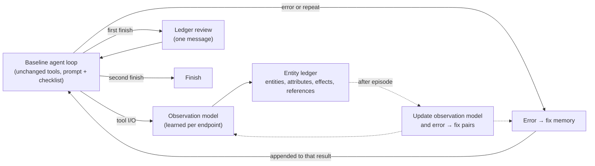

# World model v2: the world model as the agent's view of task state

Status: design proposal, revision 2 (2026-10-30). Superseded for next steps by [v3: a lifted experience graph](world-model-v3.md) (2026-10-31). It replaces the operational layer (E013–E014) and the advisory note (E015). The evidence is from E014–E016; the journal and code are on branch `lean-advisory`. Revision 1 proposed a deterministic task-text requirement gate. The failure analysis in §1.2 showed it would address about 3% of failed checks, so it was replaced.

## 1. Evidence

### 1.1 What the experiments established

| # | Finding | Evidence |
|---|---|---|
| L1 | Route knowledge given up front **replaces** exploration, and the skipped reads held the deciding facts. Fewer calls, lower accuracy. | E015b 7/15 vs 10/15; E015c 4/12 and 2/12 vs 12/12 |
| L2 | Control over action selection (one action per turn, guards, plans, goal-tracker finish) costs accuracy and time. | E014: −17 points, about 4× time |
| L3 | Large memory injected every turn adds slips and tokens. | E014 |
| L4 | A fixed "look further before writing" instruction improves accuracy but costs time. Its in-sample saving did not transfer. | E015d 15/16; E016 29/90 vs 21/90, +16% median time |
| L5 | "Reads before writes" learned from trajectories is generic. | E015d 10/16 |
| L6 | Gemma is nearly deterministic (about 37 of 45 tasks repeat across rounds). More tasks are worth more than more rounds. | E016 |

### 1.2 Why tasks fail

Every failed grader check from E016 round 0 is classified below. Each literal the check expects is located in the trajectory: in a write, in the task text, in a read response, or nowhere. The script is `scripts/classify_failures.py <run-dir>`. Grader output is used only for this offline diagnosis, never for learning.

| Class | Baseline (194 checks) | Checklist (166) | Example |
|---|:---:|:---:|---|
| **A. Exclusion violated**: wrote what a rule excludes | 12% (11 tasks) | 16% | SMS sent to a contractor whose badge is not expiring; post to `#all-staff` that was forbidden |
| **B1. Missed target that was read**: a recipient appeared in reads but got nothing | 20% (8 tasks) | 25% | Commission statements: one summary to payroll instead of one email per rep |
| B2. Missed target named in the task | 3% (4 tasks) | 4% | |
| **B3. Missed target never seen**: it was in an unread source | 9% (4 tasks) | **1%** | the checklist fixed this class |
| **C. Content not in any read**: computed, or from an unread source | 11% (13 tasks) | 12% | Ending cash balance `153,400`; depreciation amounts |
| **D. Read but not written**: the value was read and omitted | 17% (11 tasks) | 20% | |
| **E. All literals written, wrong place or form**: right values in the wrong message, row or structure | 26% (12 tasks) | 22% | |

In addition, about 5 of 35 failed trials are **write loops** (38–170 malformed writes, zero credit).

What this says:

1. **Almost nothing is an endpoint-discovery failure.** The v1 graph mostly represented endpoints and routes.
2. **Only 3% are task-text requirements left unaddressed.** A gate matching task-text literals (revision 1) would be nearly useless.
3. **The checklist works on exactly one class, B3** (unread sources: 18 → 2). The rest are unchanged.
4. **Classes A, B1, D and E (about 75%) are entity-level errors.** The task says "for each row or record with property P, do X". The agent read the entities but applied the rule to the wrong set, skipped some, or put the values in the wrong place. The failure is in tracking **which entities exist, what their deciding attributes are, and what has been done to each**.

## 2. Reformulation

The v1 world model was a map of the environment's **interface** ("which call leads where"), shown to the model as advice. The model did not need that.

v2 makes the world model the **state of the environment instance as observed in this episode**: the entities read, their attributes, and the effects of the writes on them. Cross-task learning provides the **observation model** that builds that state. Concretely, for each service it learns how to turn responses into entities and attributes, and how to turn write requests into effects on entities. The learned knowledge is used **by the harness** to build state, not given to the model as routes.

`S_t` = {entities e: attributes(e), effects(e)}. A read adds entities and attributes. A write adds effects. This is the state-transition view (`docs/state_transition_world_model.md`) applied to the instance rather than to the API.

| Component | Lifetime | Role | Shown to the model |
|---|---|---|---|
| **Entity ledger** (episode state) | One episode | Entities, attributes, effects per entity | Once, at the first `finish`, as a compact table |
| **Observation model** (learned) | Across tasks | Per endpoint: which response paths are entities, their key and attributes; how a write's request maps to entities (recipient, row, record id), including decoding such as Gmail `raw` base64 | Never; it builds the ledger |
| **Error → fix memory** (learned) | Across tasks | Request format and known fixes per endpoint | Only appended to an error or repeated-call result |
| Checklist (fixed) | — | Targets B3 (unread sources) | System prompt, as in E016 |

Design principles (from L1–L6):

1. **Additive, never substitutive.** Nothing tells the agent a read is unnecessary or which endpoint to use.
2. **Just in time.** Nothing is injected up front beyond the task and the checklist.
3. **One intervention at a commit point.** At most one held `finish`; no action-selection control.
4. **Small and once.** The ledger view is bounded (for example 40 rows) and shown once.
5. **Built deterministically.** The ledger is built by code from tool I/O, so its time cost is one extra model turn, only at finish.

## 3. The entity ledger and the finish review

**Construction** (deterministic, from tool I/O):
- **Entities**: records, rows, contacts, tickets and messages found in read responses. Each has a key (id, email or row number) and attributes (status-like fields, amounts, owners, dates).
- **Effects**: for each write, the entities it touches (recipient email, row id, record id, channel) and a short summary of what was written.
- **References**: resources named in responses but never read (feeds B3, complementing the checklist).

**Finish review.** On the first `finish`, the harness returns one message, for example:

```
Before finishing, check each item against the task's rules.
Entity type: AR rows (6 read)
  Row 2  NovaTech  Status=Include        → in email to cfo@ (40,000)
  Row 5  Delta     Status=Do Not Include → in email to cfo@   ← rule says skip?
People with an email address (5 read, 1 written to)
  alice@ … eve@  → nothing sent
Unread references: "Q3 policy" (mentioned in message m_12)
```

No verdicts. The table puts each entity's deciding attributes beside what was done to it, which targets:
- **A (exclusion)**: an excluded attribute next to an effect;
- **B1 (missed target)**: entities with nothing done to them;
- **D and E (omitted or misplaced content)**: the written summary per entity.

The second `finish` always goes through.

**Risk.** Listing untouched entities can push the model to write to entities the rules exclude, increasing class A. Mitigations: neutral wording, attributes shown beside every entity, and class A tracked as a primary guard metric.

**Not addressed:** class C (computed values). Arithmetic errors need a computation aid, which is a separate harness capability and not a world-model claim. If tested, it is a separate arm.

## 4. The learned observation model

This is where cross-task learning lives, and it is the reformulated "graph knowledge":

- **Nodes**: endpoints, response paths (`$.values[*]`, `$.messages[*]`), entity types, attribute fields, key fields.
- **Edges**:
  - `RETURNS(endpoint → entity type via path)`;
  - `KEYED_BY(entity type → field)`;
  - `HAS_ATTRIBUTE(entity type → field)`;
  - `TOUCHES(write endpoint → entity type via request field)`, for example Gmail send `raw.To` → person, or sheets `values.update` range → row;
  - `SAME_AS(field ↔ field)` across services, such as an email address in a sheet and the Gmail recipient. This reuses the v1 value-flow learner.
- **Learning**: from trajectories only. Repeated list-shaped response paths give entity types. Fields whose values are reused in later requests give keys. Low-cardinality string fields give status-like attributes. Request fields whose values match a known entity key give `TOUCHES`. Every edge must be confirmed in at least 2 tasks (`MIN_TASKS`, as in the advisory).
- **Fallback**: unknown endpoints use generic parsing (lists of objects, emails, ids). The ledger is weaker but still built.

Q1 becomes measurable: does the learned observation model make the ledger more complete than generic parsing, and does that change accuracy? It can be measured offline first: ledger recall of grader-relevant entities, using E016 trajectories.

## 5. Error → fix memory (reactive)

Learned from trajectories as pairs: an error on endpoint X, then the next success on X, with the argument difference. It is triggered only by an `error` outcome or the same call 3 times in the last 6. The contract's request format and up to two known fixes are appended to **that** tool result. It targets write loops: few tasks, but the most calls and time.

## 6. Architecture



## 7. Plan and evaluation

**Step 0, offline (before any live run):**
- Build the ledger from the existing E016 trajectories, first with generic parsing and then with the learned observation model (leave-one-task-out).
- Measure, per failed trial, whether the ledger table **visibly contains the error** (the excluded entity with an effect, the untouched target, the misplaced value).
- Measure ledger size on passing trials (noise).
- If the error is visible in fewer than about 40% of A, B1, D and E failures, stop and rethink before spending live runs.

**Step 1, live, development set** (the 45 E016 tasks, one round, same day, interleaved):
- arms: baseline; checklist; checklist + ledger review; checklist + ledger review + error → fix;
- the bar: beat the checklist on strict accuracy **without** higher median time.

**Step 2, held out:** about 100 fresh tasks from the 604, with the configuration fixed before the run.

**Metrics:**
- strict accuracy and median time, paired by task (sign test, bootstrap CI);
- failure-class shifts (classes A to E, using the §1.2 classifier);
- review firing rate, and review effect (the fraction of reviews followed by a new write or a changed write);
- class A increase as a harm guard;
- calls spent in loops.

## 8. What carries over from code

From `lean-advisory`: the store, the contract learner and the value-flow learner (which become `SAME_AS`), and `detect_loop`. Also `run_eval.py` with interleaving, and the checklist text.

Not carried over: route notes, plan selection, the per-turn memory, the action wrapper, guards, the goal tracker, and the learned "checks".

## 8a. Step 0 result: offline replay (2026-10-30)

`scripts/ledger_offline.py runs/e016-checklist-heldout <arm>` rebuilds the ledger (`src/worldmodel_harness/ledger.py`, generic parsing plus hand-written Sheets row and range rules and Gmail `raw` decoding) from each saved E016 round-0 trajectory and renders the finish review. A failed check counts as **visible** under these conditions:
- **A**: the excluded literal appears on a row that shows a write;
- **B**: the missed target appears on a row whose writes did not go to it;
- **C, D, E**: the expected literal appears on some row.

This is an upper bound on what the review can fix: being visible does not mean the model will act on it.

| Class | Baseline visible | Checklist visible |
|---|:---:|:---:|
| A exclusion violated | 18/23 (78%) | 22/26 (85%) |
| B missed target that was read | 16/35 (46%) | 11/38 (29%) |
| B missed target named in the task | 1/6 | 0/6 |
| D read but not written | 26/31 (84%) | 21/33 (64%) |
| E wrong place or form | 38/52 (73%) | 32/40 (80%) |
| **Core (A, B-read, D, E)** | **98/141 (70%)** | **86/137 (63%)** |
| C computed (out of scope) | 12/26 | 6/21 |

- **Size:** the review is small. On passing trials the median is 6–8 lines (about 0.6–1k characters); the largest is 48 lines.
- **When it is empty:** 9 of 35 failing baseline trials have an empty review. Seven of these made no successful write at all. Of those seven:
  - 3 were write loops, for example 38 and 170 failed Gmail and Slack writes;
  - 4 never attempted a write.
  
  Nothing to review there; those trials are for the error → fix memory, not the review.
- **Verdict:** the review passes the 40% bar (70% of the core baseline failures are visible). Missed targets are the weakest class. Writes that address an item without naming it, such as a summary sent to payroll that lists every rep, mark the item as acted on. A finer effect model (who received what) is the first thing the learned observation model should improve.

Next: wire the review into the agent loop at the first `finish`, then run the live development comparison (§7, step 1).

## 8b. Step 1 result: live development comparison, E017 (2026-10-30)

Baseline 15/45, checklist 14/45, checklist + review 14/45 strict. Review vs. checklist: +2 / −2 per task. Median time was 66 s, 78 s and 82 s respectively. See the E017 entry in `docs/experiment-journal.md`.

- The review was shown in 34 trials. The agent made an API call after it in 4 and finished immediately in 30.
- The only grade the review changed got worse. In `operations.twilio_production_incident`, a "nothing written" row for an excluded incident led to pages, a ticket and Slack posts for it (class A).
- **Stop rule met.** The review does not beat the checklist, so no further components (observation model, error → fix memory) are added on top of it.

What this says about the formulation:
- Offline visibility measured whether the deciding fact is on the page. It did not measure whether the model compares the page against the rules, and Gemma does not.
- A list of states acts as a to-do list. Highlighting untouched items pushes toward action and does nothing for omissions the model already considers done.
- Any next step has to make the comparison itself, not show more state. For example, code checks an explicit predicate extracted from the task against the ledger and raises only contradictions. Without that, the ledger is diagnostic tooling (offline failure analysis), not an agent intervention.

## 8c. Error -> fix memory, E018 (2026-10-31)

`src/worldmodel_harness/fixes.py`, built by `scripts/build_fix_memory.py`. Result: accuracy is unchanged (12/45 in both arms). Where a note fired (23 tasks), environment calls fell 26% and time 20%. Median time fell 7% and p90 time 30%. Details are in the E018 journal entry.

It worked where the review did not, for two reasons:
- Code makes the comparison: the failed request against one that worked, on the same endpoint and error.
- The note names a concrete defect in the agent's last call ("no `body` argument"). It never asks the agent to judge its own work against the task.

Wording mattered more than content: the same information as an abstract shape comparison was ignored.

## 8d. Recovery graph, E019 (2026-10-31)

The fix memory was extended into a graph of stuck points. A node is a failed call (endpoint, error, request shape). Its edges are what moved earlier runs forward:
- a shape fix (E018);
- a route to another endpoint of the same service;
- a dead end, where the service never recovered.

Run on the same day as baseline and the fix memory, it did not improve on the fix memory: strict 12 vs. 13 of 45, partial credit 6 better and 11 worse, 4% more calls. The fix memory's E018 savings replicated (faster on 34 of 45 tasks, 17% fewer calls). Details are in the E019 journal entry.

- **Routes:** they mostly repeat a Sheets URL correction that Gemma already makes on its own. Dropped.
- **Dead ends:** they are accurate and can stop long stalls. But telling Gemma to "get the information from another source" started a 93-search loop in one task. Any retry should state only the fact and say to continue with the rest of the task.

This confirms the E018 lesson: a note helps when it names a defect in the last call and gives a call to copy. An open instruction ("find another source") gives Gemma a new search goal instead.

E020 retested dead ends with a note that states only the fact, and they failed again: strict 12 vs. 14 of 45, 8% more calls where notes fired. The recruitment search loop came back, so the note's presence at that moment matters, not its wording. The one large time saving came from avoiding a reproducible runaway generation, which a lower `max_tokens` would cap in every arm. Of the recovery graph, only shape-fix edges remain.

## 9. Research questions, restated

- **Q1 (retained knowledge)**: does a learned observation model (cross-task) make the episode state more complete and accuracy higher than generic parsing?
- **Q2 (selective use)**: is one state review at the commit point better on accuracy and time than up-front notes (E015) and an unconditional instruction (checklist)?
- **Q3 (useful learning)**: which failure classes does each component move, and at what cost?
- Q4 and Q5 are deferred until Q1–Q2 are positive.
